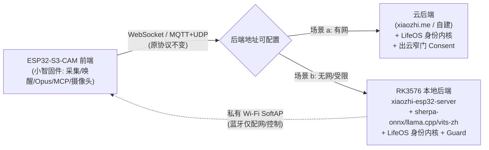

# 技术交底：小智AI × ESP32-S3-CAM × LifeOS/elderly-companion 可行性分析（2026-10-26）

> **阶段**：tech explore / 技术交底（**不含编码**）
> **研究对象**：
> - 小智AI 固件源码 —— [`demo/esp32-s3-materials/xiaozhi-source/xiaozhi-esp32-2.5.2`](../esp32-s3-materials/xiaozhi-source/xiaozhi-esp32-2.5.2)（ESP32-S3-CAM 为主，MIT）
> - ESP32-S3-CAM 硬件资料 —— [`demo/esp32-s3-materials/01-板子图片和原理图`](../esp32-s3-materials/01-板子图片和原理图)、[`02-芯片手册`](../esp32-s3-materials/02-芯片手册)
> - 摄像头例程 —— [`demo/esp32-s3-materials/Vscode+espidf摄像头例程`](../esp32-s3-materials/Vscode+espidf摄像头例程)（例程1：拍照存SD卡；例程2：视频传输到LCD）
> - 参照项目 —— [`Edragon/ESP32-S3-I2Saudio`](https://github.com/Edragon/ESP32-S3-I2Saudio)（百度云 ASR + 百度文心模型）
> - 合并计划 —— [`review/LifeOS_elderly-companion合并可行性研究_20261004.md`](../../review/LifeOS_elderly-companion合并可行性研究_20261004.md)
> **实事求是纪律**：所有论断挂真相源（文件路径 + 行号）；"JSON Schema / 内部实现推断"按工程常识条目对待；对百度云项目的判断基于其公开 README 描述（**未逐行核对其源码**），已在文中标注；可争论，欢迎挑战。

---

## 0. 结论速览（TL;DR）

| 问题 | 一句话结论 |
|---|---|
| **Q1** 小智AI 功能与栈 | 端侧"语音采集+唤醒+播放"客户端 + MCP 设备控制；重活（ASR/LLM/TTS/记忆/视觉理解）**全在云端**；ESP32-S3 只做前端 |
| **Q2** 语音/交互本地还是云端 | **主要云端**。ESP32-S3 本地只做 VAD+KWS（ESP-SR 唤醒）+ Opus 编解码；ASR/LLM/TTS 全走 WebSocket/MQTT 到服务器 |
| **Q3** vs 百度云 I2Saudio | 小智是"**协议/生态**方案"（OPUS 流 + MCP，云端全栈）；百度云方案是"**API 直连**"（PCM→百度 ASR→文心→百度 TTS）。小智更工程化、可换后端；百度方案更省事、更绑厂商 |
| **Q4** 摄像头例程能否集成 | **可以，且小智已有现成范例** —— [`zhengchen/cam`](../esp32-s3-materials/xiaozhi-source/xiaozhi-esp32-2.5.2/main/boards/zhengchen/cam) 板卡已把「语音 + 摄像头 + `self.camera.take_photo` MCP 工具 + 图片上传云端理解」集成完毕 |
| **Q5a** WiFi/4G 云方案 | **合理**，且是"开箱即用"路径（小智默认形态）——但需接入 LifeOS 身份内核与 elderly-companion 安全栈 |
| **Q5b** 前端(ESP32-S3-CAM)+RK3576 后端 | **合理，且与小智协议天然兼容** —— 只需实现"小智服务端协议"跑在 RK3576 上，把云换成本地。差距在**后端协议实现 + 本地模型栈 + 蓝牙/私有WiFi 传输** |
| **Q6** 输出 | 本文档（未编码） |

**核心洞察**：小智AI 的价值**不在固件本身，而在它定义了一套"前端-后端解耦"的通信协议**（WebSocket / MQTT+UDP + MCP）。这意味着"换后端"（云 → RK3576）是**架构内建能力**，而非改造。

---

## Q1. 小智AI 的主要功能与技术栈详情

### 1.1 功能清单（源码核实）

| # | 功能 | 真相源 |
|---|---|---|
| 1 | **离线语音唤醒**（自定义唤醒词，ESP-SR） | [`main/audio/`](../esp32-s3-materials/xiaozhi-source/xiaozhi-esp32-2.5.2/main/audio)、[`README.md:25`](../esp32-s3-materials/xiaozhi-source/xiaozhi-esp32-2.5.2/README.md) |
| 2 | **双传输**：WebSocket 与 MQTT+UDP 混合 | [`docs/websocket.md`](../esp32-s3-materials/xiaozhi-source/xiaozhi-esp32-2.5.2/docs/websocket.md)、[`docs/mqtt-udp.md`](../esp32-s3-materials/xiaozhi-source/xiaozhi-esp32-2.5.2/docs/mqtt-udp.md) |
| 3 | **Opus 音频流** + 流式 ASR/LLM/TTS 或 Realtime 端到端语音模型 | [`docs/websocket.md:318-327`](../esp32-s3-materials/xiaozhi-source/xiaozhi-esp32-2.5.2/docs/websocket.md) |
| 4 | **AEC 全双工打断**（device-side / server-side） | [`docs/websocket.md:48`](../esp32-s3-materials/xiaozhi-source/xiaozhi-esp32-2.5.2/docs/websocket.md)、[`mcp_controller.cc:28`](../esp32-s3-materials/xiaozhi-source/xiaozhi-esp32-2.5.2/main/boards/zhengchen/cam/mcp_controller.cc) |
| 5 | **声纹识别**（说话人身份，3D-Speaker） | [`README.md:28`](../esp32-s3-materials/xiaozhi-source/xiaozhi-esp32-2.5.2/README.md) |
| 6 | **显示**：OLED / LCD，表情/情绪呈现 | [`main/display/`](../esp32-s3-materials/xiaozhi-source/xiaozhi-esp32-2.5.2/main/display) |
| 7 | **摄像头视觉输入**（部分板卡） | [`main/boards/common/esp32_camera.cc`](../esp32-s3-materials/xiaozhi-source/xiaozhi-esp32-2.5.2/main/boards/common/esp32_camera.cc) |
| 8 | **电池显示与电源管理** | [`zhengchen_cam_board.cc:307`](../esp32-s3-materials/xiaozhi-source/xiaozhi-esp32-2.5.2/main/boards/zhengchen/cam/zhengchen_cam_board.cc) |
| 9 | **38/39 种界面语言** | [`README.md:31`](../esp32-s3-materials/xiaozhi-source/xiaozhi-esp32-2.5.2/README.md) |
| 10 | **Wi-Fi 配网**（热点 / BluFi） | [`docs/blufi.md`](../esp32-s3-materials/xiaozhi-source/xiaozhi-esp32-2.5.2/docs/blufi.md) |
| 11 | **设备端 MCP**（音箱/LED/舵机/GPIO 控制） | [`main/mcp_server.cc`](../esp32-s3-materials/xiaozhi-source/xiaozhi-esp32-2.5.2/main/mcp_server.cc)、[`docs/mcp-usage.md`](../esp32-s3-materials/xiaozhi-source/xiaozhi-esp32-2.5.2/docs/mcp-usage.md) |
| 12 | **云端 MCP**（智能家居/PC 操作/知识检索/邮件） | [`README.md:35`](../esp32-s3-materials/xiaozhi-source/xiaozhi-esp32-2.5.2/README.md) |
| 13 | **OTA 固件升级** | [`main/ota.cc`](../esp32-s3-materials/xiaozhi-source/xiaozhi-esp32-2.5.2/main/ota.cc) |
| 14 | **4G 网络**（ML307/EC801E/NT26 Cat.1） | [`README.md:24`](../esp32-s3-materials/xiaozhi-source/xiaozhi-esp32-2.5.2/README.md) |
| 15 | **摄像头拍照 + 云端图片理解**（vision） | [`mcp_server.cc:92-116`](../esp32-s3-materials/xiaozhi-source/xiaozhi-esp32-2.5.2/main/mcp_server.cc) |
| 16 | **多板卡支持**（138 板卡目录 / 171 发布变体，含 ESP32-S31） | [`README.md:50`](../esp32-s3-materials/xiaozhi-source/xiaozhi-esp32-2.5.2/README.md) |

### 1.2 技术栈详情

**芯片/系统层**
- SoC：ESP32、ESP32-C3/C5/C6、**ESP32-S3**、ESP32-P4、ESP32-S31（[`README.md:32`](../esp32-s3-materials/xiaozhi-source/xiaozhi-esp32-2.5.2/README.md)）
- SDK：ESP-IDF **v6.0.1+**（推荐 v6.1，不支持 5.x）（[`README.md:17`](../esp32-s3-materials/xiaozhi-source/xiaozhi-esp32-2.5.2/README.md)）
- 语言：C++（Google C++ 风格），FreeRTOS 任务模型

**音频链路**
- 采集：I2S 麦克风（部分板卡 simplex 分时 / duplex），采样率 16 kHz（上行）/ 24 kHz（下行）
- 编码：**Opus**，帧长 60 ms，单声道
- 前端处理：ESP-SR（唤醒 + AFE/AEC）；
- 播放：I2S 功放

**协议层**
- 传输：WebSocket（文本 JSON + 二进制 Opus）或 MQTT（控制） + UDP（AES-CTR 加密音频）
- 应用协议：`hello / listen / stt / llm / tts / mcp / system / alert / goodbye`（[`docs/websocket.md:141-314`](../esp32-s3-materials/xiaozhi-source/xiaozhi-esp32-2.5.2/docs/websocket.md)）
- MCP：JSON-RPC 2.0（`initialize / tools/list / tools/call / notifications/*`）（[`docs/mcp-protocol.md`](../esp32-s3-materials/xiaozhi-source/xiaozhi-esp32-2.5.2/docs/mcp-protocol.md)）

**通信细节（关键实现事实）**
- 设备连接头：`Authorization` / `Protocol-Version` / `Device-Id`(MAC) / `Client-Id`(UUID)（[`docs/websocket.md:91-100`](../esp32-s3-materials/xiaozhi-source/xiaozhi-esp32-2.5.2/docs/websocket.md)）
- UDP 音频包：`type|flags|payload_len|ssrc|timestamp|sequence`，AES-CTR，密钥经 MQTT 下发（[`docs/mqtt-udp.md:212-236`](../esp32-s3-materials/xiaozhi-source/xiaozhi-esp32-2.5.2/docs/mqtt-udp.md)）
- 状态机：Idle→Connecting→Listening→Speaking→Idle（[`docs/websocket.md:335-386`](../esp32-s3-materials/xiaozhi-source/xiaozhi-esp32-2.5.2/docs/websocket.md)）

**服务端参考实现**（不在本仓）：
- [`xinnan-tech/xiaozhi-esp32-server`](https://github.com/xinnan-tech/xiaozhi-esp32-server)（Python）等四种语言实现（[`README.md:139-142`](../esp32-s3-materials/xiaozhi-source/xiaozhi-esp32-2.5.2/README.md)）

> **结论（Q1）**：小智AI 是一个**"MCU 语音前端 + 云端大脑"的 MCP 聊天机器人固件框架**。它的技术资产有三层：① 端侧音频/唤醒/显示/摄像头驱动层；② 两套传输协议 + MCP；③ 庞大的板卡适配矩阵。

---

## Q2. 语音与交互：云端实现 还是 ESP32-S3 内实现？

### 2.1 明确回答：**主要依赖云端**，端侧只做"前端"

| 环节 | 在哪实现 | 证据 |
|---|---|---|
| 音频采集 / 播放 | **ESP32-S3 本地** | I2S 驱动 + Opus 编解码（[`main/audio/`](../esp32-s3-materials/xiaozhi-source/xiaozhi-esp32-2.5.2/main/audio)） |
| 唤醒词（KWS） | **ESP32-S3 本地**（离线） | ESP-SR，[`main/audio/wake_words/`](../esp32-s3-materials/xiaozhi-source/xiaozhi-esp32-2.5.2/main/audio/wake_words/) |
| VAD / AEC | 本地或云端（可配） | `CONFIG_USE_DEVICE_AEC` / `CONFIG_USE_SERVER_AEC`（[`docs/websocket.md:48`](../esp32-s3-materials/xiaozhi-source/xiaozhi-esp32-2.5.2/docs/websocket.md)、[`cam/config.json:9`](../esp32-s3-materials/xiaozhi-source/xiaozhi-esp32-2.5.2/main/boards/zhengchen/cam/config.json)） |
| **ASR（语音转文字）** | **云端** | 服务端下发 `{"type":"stt"}`（[`docs/websocket.md:237-239`](../esp32-s3-materials/xiaozhi-source/xiaozhi-esp32-2.5.2/docs/websocket.md)） |
| **LLM（对话/意图/情绪）** | **云端** | 服务端下发 `{"type":"llm","emotion":...}`（[`docs/websocket.md:241-243`](../esp32-s3-materials/xiaozhi-source/xiaozhi-esp32-2.5.2/docs/websocket.md)） |
| **TTS（语音合成）** | **云端**（端侧仅播放 Opus） | 服务端下发 `{"type":"tts","state":"start"}` + 二进制音频（[`docs/websocket.md:245-248`](../esp32-s3-materials/xiaozhi-source/xiaozhi-esp32-2.5.2/docs/websocket.md)） |
| **视觉理解** | **云端** | 拍帧→JPEG 编码本地→HTTP multipart 上传→`Explain()` 返回文本（[`esp32_camera.cc:177-320`](../esp32-s3-materials/xiaozhi-source/xiaozhi-esp32-2.5.2/main/boards/common/esp32_camera.cc)） |
| 记忆/身份 | **云端** | 端侧无持久对话记忆概念（无 LifeOS 式事件库） |
| 设备控制（音量/灯） | **ESP32-S3 本地**（经 MCP 被云端调用） | `self.audio_speaker.set_volume` 等（[`mcp_server.cc:62-116`](../esp32-s3-materials/xiaozhi-source/xiaozhi-esp32-2.5.2/main/mcp_server.cc)） |

### 2.2 关键实证：`vision` 能力是"客户端把上传地址交给设备"

```json
// 后端 initialize 时把自己/云端的图片理解 URL 下发给设备
{ "capabilities": { "vision": { "url": "...", "token": "..." } } }
```
设备收到后 `camera->SetExplainUrl(url, token)`，拍照时 POST 到该 URL 并回传文本
（[`mcp-protocol.md:66-82`](../esp32-s3-materials/xiaozhi-source/xiaozhi-esp32-2.5.2/docs/mcp-protocol.md)、[`mcp_server.cc:363-380`](../esp32-s3-materials/xiaozhi-source/xiaozhi-esp32-2.5.2/main/mcp_server.cc)）。

> **这意味着：图片理解的"后端地址"是可插拔的**——云端可换成本地 RK3576 上的 HTTP endpoint（这是 Q5b 的关键切入点）。

### 2.3 端侧算力定位

ESP32-S3 承担的是**低算力实时任务**：I2S 采集、Opus 编解码（有硬件/dsp 辅助）、ESP-SR 唤醒、显示刷新、JPEG 编码（对比云端）。**没有任何本地 ASR/LLM 推理**。这与 [`review/..._20261004.md`](../../review/LifeOS_elderly-companion合并可行性研究_20261004.md) §5.8 的判断完全一致：S3 是"LLM 客户端"，不是"LLM 推理主机"。

---

## Q3. 小智AI vs 百度云方案（Edragon/ESP32-S3-I2Saudio）

> **证据边界（诚实声明）**：小智判断全部来自本仓源码（已核实）；百度云方案 [`Edragon/ESP32-S3-I2Saudio`](https://github.com/Edragon/ESP32-S3-I2Saudio) 的判断基于其公开 README 的描述（**未逐行核对源码**，按工程常识条目对待）。其描述为：ESP32-S3 采集 I2S 音频 → 调用**百度云语音识别 API** 转文字 → 调用**百度文心（ERNIE）模型 API** 对话 → 调用百度 TTS → 播放。

### 3.1 架构对比

| 维度 | 小智AI | 百度云方案（I2Saudio，据 README） |
|---|---|---|
| **架构范式** | 前端-后端**协议解耦**（OPUS 流 + JSON 控制 + MCP） | 前端**直接调云 API**（HTTP 请求-响应式） |
| **音频传输** | OPUS 流式（WebSocket binary / UDP），60ms 帧 | 通常 PCM/WAV 分片上传；ASR 多为"录一段传一段" |
| **实时性** | 流式 ASR + 流式 TTS，支持边听边说/打断（AEC） | 多为半双工：录完→识别→生成→播放 |
| **ASR** | 后端自选（云端或本地 sherpa-onnx 等） | **百度 ASR API**（厂商绑定） |
| **LLM** | 后端自选（Qwen/DeepSeek/自建 vLLM/llama.cpp） | **百度文心 ERNIE**（厂商绑定） |
| **TTS** | 后端自选（任意流式 TTS） | **百度 TTS**（厂商绑定） |
| **扩展/设备控制** | **MCP 协议**（标准 JSON-RPC，设备能力被模型调用） | 一般无（或自定义硬编码指令） |
| **后端可替换性** | ★★★★★ 换 URL 即换后端（多语言服务端已有 4 个实现） | ★★ 换厂商需重写 API 调用层 |
| **生态/板卡** | 138 板卡目录 / 171 变体 | 单一开发板适配 |
| **许可** | MIT（固件）；后端参考实现各自开源 | 固件开源；**云 API 按调用计费** |
| **开发门槛** | 高（需自建/理解协议栈与后端） | 低（填 API Key 即可跑通） |

### 3.2 优缺点

**小智AI 优点**
1. **后端完全可替换**——这是对我们最重要的属性：云、私有云、局域网 RK3576 都能当后端（Q5b 的基础）。
2. **流式 + 打断**——老人交互体验的关键（不会"说完才能听"）。
3. **MCP 标准**——设备能力（摄像头/动作/灯）可被模型按需调用，不用硬编码指令。
4. **工程成熟**——171 变体、AEC、声纹、OTA、配网齐全。

**小智AI 缺点**
1. **协议复杂**——实现一个兼容后端有工作量（两条传输 + 二进制协议 V1/V2/V3 + MCP）。
2. **默认依赖公网**——官方固件默认连 `xiaozhi.me`（[`README.md:110`](../esp32-s3-materials/xiaozhi-source/xiaozhi-esp32-2.5.2/README.md)），隐私敏感场景必须自建后端。
3. **端侧无智能**——断网即"哑巴"（只能唤醒+本地提示音），无本地对话兜底。

**百度云方案 优点**
1. **上手快**——填 Key 即可，适合验证/原型。
2. **中文 ASR/TTS 质量现成**——百度在中文语音上积累深。
3. **无需自建后端基础设施**。

**百度云方案 缺点**
1. **厂商强绑定**——ASR/LLM/TTS 三环全锁在百度，换不了。
2. **数据出境到第三方云**——与 [`review/...`](../../review/LifeOS_elderly-companion合并可行性研究_20261004.md) §4.2 的"本体封闭为默认"隐私纪律直接冲突。
3. **实时性通常弱**——HTTP 请求-响应范式难做低延迟全双工打断。
4. **按调用计费，长期成本随使用量线性增长**。
5. **无设备控制协议（MCP）**——扩展性差。

### 3.3 选型判断

> **对我们（老人陪伴 + 隐私封闭 + 后端可换）而言，小智AI 的"协议解耦"范式显著优于百度云的"API 直连"范式。** 百度云方案唯一优势是"快速验证"——可作为**对照基线**（baseline），不是产品路径。理由：隐私纪律要求"隐私封闭为默认"（review §4.2），而百度云的强绑定与出境到第三方云与之根本冲突；且小智的协议解耦恰好让我们能"把云换成本地 RK3576"。

---

## Q4. 摄像头例程能否与小智AI 集成？

### 4.1 明确回答：**能，且小智已有一个集成完毕的参考实现**

**关键发现**：小智主项目内已存在 [`main/boards/zhengchen/cam/`](../esp32-s3-materials/xiaozhi-source/xiaozhi-esp32-2.5.2/main/boards/zhengchen/cam) 板卡（征辰科技 AI camera），它是"小智AI 的魔改项目"（[`cam/README.md:4`](../esp32-s3-materials/xiaozhi-source/xiaozhi-esp32-2.5.2/main/boards/zhengchen/cam/README.md)），已经实现：

1. **语音**：I2S 麦克风（ES7210 四通道）+ 功放（ES8311），24 kHz（[`cam/config.h:6-21`](../esp32-s3-materials/xiaozhi-source/xiaozhi-esp32-2.5.2/main/boards/zhengchen/cam/config.h)）
2. **摄像头**：DVP 8-bit + OV 系列，RGB565（[`cam/config.h:47-66`](../esp32-s3-materials/xiaozhi-source/xiaozhi-esp32-2.5.2/main/boards/zhengchen/cam/config.h)、[`zhengchen_cam_board.cc:240-273`](../esp32-s3-materials/xiaozhi-source/xiaozhi-esp32-2.5.2/main/boards/zhengchen/cam/zhengchen_cam_board.cc)）
3. **LCD**：ST7789 SPI 320×240（[`zhengchen_cam_board.cc:191-238`](../esp32-s3-materials/xiaozhi-source/xiaozhi-esp32-2.5.2/main/boards/zhengchen/cam/zhengchen_cam_board.cc)）
4. **MCP 工具 `self.camera.take_photo`**：模型可主动拍照 + 提问（[`mcp_server.cc:92-116`](../esp32-s3-materials/xiaozhi-source/xiaozhi-esp32-2.5.2/main/mcp_server.cc)）
5. **摄像头预览到屏**：`Capture()` 把帧写入 `display->SetPreviewImage(...)`（[`esp32_camera.cc:128-141`](../esp32-s3-materials/xiaozhi-source/xiaozhi-esp32-2.5.2/main/boards/common/esp32_camera.cc)）
6. **拍照上传云端理解**：JPEG 编码 → HTTP multipart → `Explain()`（[`esp32_camera.cc:177-320`](../esp32-s3-materials/xiaozhi-source/xiaozhi-esp32-2.5.2/main/boards/common/esp32_camera.cc)）
7. 另有 [`bread-compact-wifi-s3cam`](../esp32-s3-materials/xiaozhi-source/xiaozhi-esp32-2.5.2/main/boards/bread-compact-wifi-s3cam)（面包板 S3CAM，simplex I2S + 摄像头）作为最简模板

### 4.2 两个例程与小智的对应关系

| 例程 | 例程做什么 | 小智等价物 | 集成难度 |
|---|---|---|---|
| **例程1**（拍照片存 SD 卡） | `esp_camera_init` → `esp_camera_fb_get` → `frame2jpg` → `fopen` 写 SD（[`camera.c:119-178`](../esp32-s3-materials/Vscode+espidf摄像头例程/1.摄照片并存取到SD卡/main/camera.c)） | 小智 `Esp32Camera::Capture()` 已做采帧+JPEG；**缺 SD 卡写入** | **低**——加 SD 挂载（例程1 的 `sd_card.c`/main.c 可直接参考）+ 在 `Capture()` 后落盘 |
| **例程2**（视频传 LCD） | LVGL + esp_lcd 把摄像头帧刷到 ILI9341/GC9A01（[`spi_lcd_touch_example_main.c`](../esp32-s3-materials/Vscode+espidf摄像头例程/2.拍摄视频实时传输到LCD/spi_lcd_touch/main/spi_lcd_touch_example_main.c)） | 小智 `display->SetPreviewImage(...)` + LVGL 显示栈已具备 | **低**——已有"帧→预览"通路，例程2 只是不同 LCD 驱动适配 |

### 4.3 把小智 + 摄像头例程集成的技术难度清单

| # | 难度项 | 说明 | 等级 |
|---|---|---|---|
| D1 | **资源竞争（PSRAM/CPU）** | 摄像头帧缓冲 + LVGL + 音频队列 + Opus 编码共用 PSRAM 与 CPU；S3 单核算力有限，需任务优先级调度（小智已用 `TaskPriorityReset` 降相机任务优先级，[`mcp_server.cc:104`](../esp32-s3-materials/xiaozhi-source/xiaozhi-esp32-2.5.2/main/mcp_server.cc)） | ★★ |
| D2 | **视频 vs 拍照的模式差异** | 例程2 是持续视频流；小智是"按需拍照"。持续视频流会持续占用 DVP 与 CPU，与语音全双工冲突 | ★★★ |
| D3 | **SD 卡 + 文件系统** | SDMMC/FATFS 挂载 + 文件命名/轮转；与 sdkconfig 分区/日志共存 | ★ |
| D4 | **多路音频（例程板卡差异）** | 例程用 simplex I2S（无 codec），小智 cam 板用 ES7210/ES8311（I2C codec）；引脚复用差异大，需重映射 | ★★ |
| D5 | **AEC 与摄像头共存** | 视频流/JPEG 编码会挤占 AEC 实时性，打断体验下降 | ★★ |
| D6 | **视频上传带宽** | 若要把视频流送到后端（而非仅本地 LCD），Wi-Fi 带宽与功耗是大问题（[`docs/mqtt-udp.md`](../esp32-s3-materials/xiaozhi-source/xiaozhi-esp32-2.5.2/docs/mqtt-udp.md) 的 UDP 通道带宽有限） | ★★★ |
| D7 | **摄像头引脚与 ESP32-S3-CAM 对应** | 本项目目标板 ESP32-S3-CAM（`01-板子图片和原理图/ESP32-S3-CAM`）的 DVP 引脚需与小智现成板卡（zhengchen-cam / bread-compact-wifi-s3cam）的 `CAMERA_PIN_*` 对齐——两者引脚定义不同，**新增一块 board 适配即可**（小智 board 体系就是为这事设计的） | ★ |

### 4.4 结论（Q4）

> **可以集成，而且不是"集成两个例程"，而是"参照小智已有的 `zhengchen/cam` 板卡，为 ESP32-S3-CAM 新增一块 board 适配"。** 例程1（拍照存 SD）提供的是**本地落盘**能力（小智当前缺），例程2（视频传 LCD）提供的是**LCD 驱动参考**（小智已有等价 `SetPreviewImage`）。技术难度集中在 **D1（PSRAM/CPU 资源竞争）** 与 **D2/D6（视频流 vs 按需拍照、视频上传带宽）**——这与上位文档 §5.8 的判断一致：**ESP32-S3 是"摄像头采集 + JPEG 压缩"的合适前端，但"持续视频流理解"应下放到主控（RK3576）**。

---

## Q5. 场景 a（WiFi/4G 云端分布式）与场景 b（ESP32-S3-CAM 前端 + RK3576 本地后端）

> 终极思路：以 **ESP32-S3-CAM 为前端**，a) 有网时"后端可有可无、以云上模型为主"；b) 无网/受限时"前端 + RK3576 主控本地模型服务，前端与后端用蓝牙或私有 Wi-Fi 沟通"。

### 5.1 场景 a：WiFi/4G 存在 —— 云端分布式（后端可有可无）

**是否合理：合理，且是小智 AI 的"原生形态"。**

| 要点 | 判断 | 依据 |
|---|---|---|
| 开箱即用 | ✅ 小智默认连 `xiaozhi.me`，注册即用 Qwen Realtime | [`README.md:110`](../esp32-s3-materials/xiaozhi-source/xiaozhi-esp32-2.5.2/README.md) |
| 后端可有可无 | ✅ 有官方/自建服务器即可；前端固件不变 | 协议解耦（Q2） |
| 4G 支持 | ✅ ML307/EC801E/NT26 Cat.1，可做无 Wi-Fi 场景 | [`README.md:24`](../esp32-s3-materials/xiaozhi-source/xiaozhi-esp32-2.5.2/README.md) |
| 摄像头视觉 | ✅ `self.camera.take_photo` + 云端 `vision.url` | [`mcp_server.cc:92-116`](../esp32-s3-materials/xiaozhi-source/xiaozhi-esp32-2.5.2/main/mcp_server.cc) |

**场景 a 与本项目的差距（要补的）**：
1. **隐私出境纪律**：小智默认把语音/图像送公网云——与上位文档 §4.2"本体封闭为默认、出境为例外且逐项同意"直接冲突。**必须自建后端 + 出云窄门**（Consent 开关 + 出云过滤器红线位）。
2. **身份连续性**：小智端侧/云端均无 LifeOS 式事件库与人格契约——需把 **LifeOS 身份内核**挂到自建后端（对齐上位文档 S1）。
3. **安全栈**：无 Guard Engine / SOS / 跌倒——需把 **elderly-companion Guard Engine** 挂到后端或端侧。
4. **老人语音前端**：小智是通用中文，无老人语音（喘息/方言/慢速）优化——需在 ASR 侧接 sherpa-onnx 老人模型。

### 5.2 场景 b：无网/受限 —— ESP32-S3-CAM 前端 + RK3576 本地后端

**是否合理：合理，且与小智协议天然兼容——本质是"把云换成本地"。**

**核心机制（关键洞察）**：小智的**服务端地址是可配置的**，且官方明确列出多种自建服务器实现（[`README.md:137-143`](../esp32-s3-materials/xiaozhi-source/xiaozhi-esp32-2.5.2/README.md)）。因此：
- **把 xiaozhi-esp32-server（Python）跑在 RK3576 上** → 前端固件**几乎不改**，只需把 WebSocket/MQTT 服务器地址指向 RK3576；
- **把云端 ASR/LLM/TTS 换成 RK3576 本地模型**（sherpa-onnx / llama.cpp / vits-zh，对齐上位文档 §5.2 主控软件栈）；
- **把云端 `vision.url` 换成本地 HTTP endpoint**（`Explain()` 只认 URL，不认"云"）——图片理解下沉到 RK3576。

**前端-后端通信（蓝牙 vs 私有 Wi-Fi）评估**：

| 通道 | 带宽/时延 | 适用 | 风险 |
|---|---|---|---|
| **私有 Wi-Fi（SoftAP/局域网）** | 高（数 Mbps），低时延 | **首选**——直接复用小智的 WebSocket/MQTT over IP 协议栈，**零协议改造** | ESP32-S3 与 RK3576 需同一局域网（RK3576 开 AP，S3 STA 连接） |
| **蓝牙（BLE / BR-EDR）** | 低-中（BLE ~几十 KB/s，EDR ~1-2 Mbps） | 配网、控制、低数据量事件 | **音频流吃紧**：Opus 流（16k/60ms）BLE 勉强，S3 的 BLE 与 Wi-Fi 共用射频、并发受限 |
| **USB CDC（有线）** | 高（12 Mbps） | 若前端与主控同机箱（上位文档 §5.10 采纳） | 需物理连线——与"无线宠物"形态冲突 |

> **裁决**：**优先私有 Wi-Fi（复用现成 IP 协议栈，零改造）**；蓝牙仅用于**配网与低数据量控制/事件**，不作为音频主链路（BLE 音频需 LE Audio/LC3，S3 支持有限，且与 Wi-Fi 射频冲突）。上位文档 §5.10 已论证**有线场景用 USB CDC**；**无线场景建议 RK3576 开 SoftAP + 前端 STA，跑小智原协议**——这是"改动最小、复用最大"的路径。

### 5.3 场景 a/b 的统一后端抽象



> **一句话**：**场景 a 与 b 共享同一个前端固件**——区别只在"后端 URL 指向哪里"。这正是小智 AI"协议解耦"架构带来的最大红利，也说明**你的终极思路在架构层面是自洽且成本可控的**。

### 5.4 差距清单：用"小智 AI"实现"ESP32-S3-CAM 前端"还差什么

| # | 差距项 | 现状（小智） | 缺口 | 工作量级 |
|---|---|---|---|---|
| G1 | **板卡适配** | 有 zhengchen-cam / bread-s3cam 等 | 本项目 **ESP32-S3-CAM** 的 DVP/I2S/LCD 引脚映射成新 board | ★（小） |
| G2 | **本地落盘（例程1）** | 小智无 SD 写 | 集成 SDMMC/FATFS，拍照/事件落盘（用于离线缓存/证据留存） | ★ |
| G3 | **本地后端实现（场景 b）** | 依赖官方云/自建 | 在 RK3576 跑兼容后端 + 本地 ASR/LLM/TTS（**最大工作量**） | ★★★★ |
| G4 | **身份连续性（LifeOS）** | 无 | 把 LifeOS 15 实体 + L0/L1/L2 事件协议 + `deterministic_commit` 挂进后端 | ★★★ |
| G5 | **安全栈（Guard）** | 无 | 跌倒/SOS/围栏 + 紧急升级旁路（对齐 elderly-companion） | ★★★ |
| G6 | **老人语音前端** | 通用中文 | E-VAD + 老人优化 ASR（sherpa-onnx）+ 情感 TTS | ★★ |
| G7 | **隐私/合规** | 默认出境公网 | 出云窄门 + Consent 单独同意 + 两级删除 + provenance | ★★ |
| G8 | **无线板间链路** | 依赖 IP 网络 | 场景 b 的私有 Wi-Fi SoftAP 组网（蓝牙仅配网） | ★★ |
| G9 | **摄像头→本地视觉理解** | 依赖云端 `vision.url` | 本地 HTTP vision endpoint（RK3576 姿态/跌倒） | ★★ |
| G10 | **验证纪律** | 无 Gate/预注册 | 把 LifeOS 的 Gate/CI 断言套在整机指标上 | ★ |

---

## Q6. 结论与建议的下一步（不 coding）

### 6.1 三句话结论

1. **小智 AI 是一个"协议解耦的语音外设框架"**——端侧只做采集/唤醒/播放/显示/摄像头，全部智能在云端；它的最大价值不是固件，而是**一套可自建、可换后端的通信协议（WebSocket/MQTT+UDP + MCP）**。
2. **摄像头例程与语音的集成，小智已有现成范例（`zhengchen/cam`）**——不必"塞例程"，而是"参照板卡 + 新增 ESP32-S3-CAM 适配"；真正难度在**资源竞争**与**持续视频流的带宽/功耗**。
3. **你的终极思路（场景 a 云端分布式 / 场景 b 前端+RK3576 本地后端）在架构上自洽且成本可控**——因为**场景 a/b 共享同一前端固件，只换后端 URL**；这也是小智协议解耦范式的直接红利。**百度云方案（ESP32-S3-I2Saudio）因厂商强绑定 + 不可离线 + 高时延，适合作对照基线，不作产品路径。**

### 6.2 建议的下一步（均**不含 coding**，为后续里程碑准备）

| 顺序 | 动作 | 产出 | 依赖 |
|---|---|---|---|
| P1 | **硬件引脚对齐**：把本项目 ESP32-S3-CAM 原理图（`01-板子图片和原理图/ESP32-S3-CAM/ESP32-S3CAM原理图.pdf`）与小智 `zhengchen-cam`/`bread-compact-wifi-s3cam` 的 `config.h` 逐引脚比对 | 一份"引脚映射差异表" | 无 |
| P2 | **跑通官方形态**：用官方固件在 ESP32-S3-CAM 上验证"唤醒→对话→拍照"（真机，需烧录） | 真机可行性结论（补齐本文"未上板"的空白） | 硬件 |
| P3 | **自建后端评估**：克隆 `xinnan-tech/xiaozhi-esp32-server`（Python），在 PC/Thor 上跑通，替换默认云 | 后端可替换的实证 | 网络 |
| P4 | **本地模型栈预研**：在 RK3576/Thor 上验证 sherpa-onnx + llama.cpp + vits-zh 的小智后端适配 | 场景 b 的模型可行性 | 主控板 |
| P5 | **差距清单转设计**：把 §5.4 的 G1–G10 转成上位文档 S1–S8 的增补条目 | 更新《合并可行性研究》 | 无 |

### 6.3 诚实声明（本文边界）

- 本文**未编译、未烧录、未上板**任何固件；所有可行性为**代码/文档级判断**。
- 百度云方案（`Edragon/ESP32-S3-I2Saudio`）的判断基于公开 README 描述，**未逐行核对源码**。
- ESP32-S3-CAM 的具体引脚以原理图 PDF 为准，本文按小智现成 S3-CAM 板卡推断（P1 需人工比对）。
- 硬件时延/功耗/带宽的**真实数字**须真机实测（P2/P4）。

---

## 附：真相源清单

| 论断 | 真相源（本仓） |
|---|---|
| 小智功能/技术栈 | [`README.md`](../esp32-s3-materials/xiaozhi-source/xiaozhi-esp32-2.5.2/README.md)、[`README_zh.md`](../esp32-s3-materials/xiaozhi-source/xiaozhi-esp32-2.5.2/README_zh.md) |
| WebSocket 协议 | [`docs/websocket.md`](../esp32-s3-materials/xiaozhi-source/xiaozhi-esp32-2.5.2/docs/websocket.md) |
| MQTT+UDP 协议 | [`docs/mqtt-udp.md`](../esp32-s3-materials/xiaozhi-source/xiaozhi-esp32-2.5.2/docs/mqtt-udp.md) |
| MCP 协议 | [`docs/mcp-protocol.md`](../esp32-s3-materials/xiaozhi-source/xiaozhi-esp32-2.5.2/docs/mcp-protocol.md) |
| 摄像头 MCP 工具 | [`main/mcp_server.cc:92-116`](../esp32-s3-materials/xiaozhi-source/xiaozhi-esp32-2.5.2/main/mcp_server.cc) |
| 摄像头抽象/上传 | [`main/boards/common/esp32_camera.cc`](../esp32-s3-materials/xiaozhi-source/xiaozhi-esp32-2.5.2/main/boards/common/esp32_camera.cc) |
| 现成摄像头板卡 | [`main/boards/zhengchen/cam/`](../esp32-s3-materials/xiaozhi-source/xiaozhi-esp32-2.5.2/main/boards/zhengchen/cam)、[`main/boards/bread-compact-wifi-s3cam/`](../esp32-s3-materials/xiaozhi-source/xiaozhi-esp32-2.5.2/main/boards/bread-compact-wifi-s3cam) |
| 例程1（拍照存 SD） | [`Vscode+espidf摄像头例程/1.摄照片并存取到SD卡/main/`](../esp32-s3-materials/Vscode+espidf摄像头例程/1.摄照片并存取到SD卡/main) |
| 例程2（视频传 LCD） | [`Vscode+espidf摄像头例程/2.拍摄视频实时传输到LCD/spi_lcd_touch/main/`](../esp32-s3-materials/Vscode+espidf摄像头例程/2.拍摄视频实时传输到LCD/spi_lcd_touch/main) |
| ESP32-S3-CAM 硬件 | [`01-板子图片和原理图/ESP32-S3-CAM/`](../esp32-s3-materials/01-板子图片和原理图)、[`02-芯片手册/`](../esp32-s3-materials/02-芯片手册) |
| 上位合并文档 | [`review/LifeOS_elderly-companion合并可行性研究_20261004.md`](../../review/LifeOS_elderly-companion合并可行性研究_20261004.md) |
| 百度云对照项目 | [`Edragon/ESP32-S3-I2Saudio`](https://github.com/Edragon/ESP32-S3-I2Saudio)（外部，据 README，未逐行核验） |

---

## 附录 A：ESP32-S3-CAM 外接 4G 模块（ML307/EC801E/NT26 Cat.1）接线指南（2026-10-26 增补）

> **本轮问题**：4G 网络模块（ML307/EC801E/NT26 Cat.1）如何在**面包板上走线**？给出 `ESP32S3CAM-Pin.jpg` 与 `ESP32-S3-CAM实物图.jpg` 的引脚依据；**注意本板是 ESP32-S3-CAM 成品板（WROOM-1-N8 模组 + 摄像头 + SD），不是 ESP32-S3 核心板**。

### A.0 诚实声明（重要）

1. **本模型无法视觉解析 JPG 图片**——`ESP32S3CAM-Pin.jpg` 与 `ESP32-S3-CAM实物图.jpg` 已检测到但**未能逐像素读取**（模型能力限制）。因此本附录的引脚依据来自**同一目录的原理图 PDF 网表**（[`ESP32-S3-CAM/ESP32-S3CAM原理图.pdf`](../esp32-s3-materials/01-板子图片和原理图/ESP32-S3-CAM/ESP32-S3CAM原理图.pdf)，已文本化提取）与 **xiaozhi 的 ML307 参考板卡源码**。
2. **必须人工用图核对**：接线前请对照 `ESP32S3CAM-Pin.jpg` 的**排针丝印**确认 P1/P2 每个引脚的实际编号——PDF 网表能给出"哪个 GPIO 连到哪里"，但**排针物理顺序/丝印**仍需看图核对（这是 A.4 的 P1 待办项）。
3. **本板与核心板的区别（关键）**：ESP32-S3-CAM 是**成品载板**——BOM 明确为 `ESP32-S3-WROOM-1-N8` 模组（[原理图 PDF 元件表](../esp32-s3-materials/01-板子图片和原理图/ESP32-S3-CAM/ESP32-S3CAM原理图.pdf)），且**板载已占用**：DVP 摄像头（OV 系列）、TF 卡槽、USB-C ×2、CH340C 串口、WS2812B 灯、AMS1117-3.3 电源。**4G 模块要挂在剩余的排针 GPIO 上**，不能照搬"核心板 38 脚全可用"的假设。

### A.1 4G 模块需要哪些线（来自 xiaozhi 源码）

真相源：xiaozhi 的 Cat.1 参考板卡
[`main/boards/bread-compact-ml307/config.h:52-53`](../esp32-s3-materials/xiaozhi-source/xiaozhi-esp32-2.5.2/main/boards/bread-compact-ml307/config.h:52)（最简 2 线）与
[`main/boards/zhengchen/cam-ml307/config.h:68-69`](../esp32-s3-materials/xiaozhi-source/xiaozhi-esp32-2.5.2/main/boards/zhengchen/cam-ml307/config.h:68)（**摄像头 + 4G 同板**，与本项目最接近）。

```c
// bread-compact-ml307（最简）
#define ML307_RX_PIN GPIO_NUM_11
#define ML307_TX_PIN GPIO_NUM_12
// zhengchen cam-ml307（摄像头+4G 共存）
#define ML307_RX_PIN GPIO_NUM_44
#define ML307_TX_PIN GPIO_NUM_43
```

**结论：Cat.1 模块（ML307/EC801E）与 ESP32-S3 之间是 2 线 UART（模块 RX/TX ↔ S3 TX/RX，交叉）**，外加电源与地。NT26 为 4 线（多了 DTR/RI，见 [`main/boards/common/nt26_board.cc:11-13`](../esp32-s3-materials/xiaozhi-source/xiaozhi-esp32-2.5.2/main/boards/common/nt26_board.cc:11)）。

| 连线 | 数量 | 说明 |
|---|---|---|
| **UART TX/RX（交叉）** | 2 | S3 的 TX → 模块 RX；S3 的 RX ← 模块 TX（3.3V 逻辑） |
| **VCC** | 1 | 模块供电（ML307 通常 3.3–4.2V；EC801E 类似）——**注意峰值电流**（见 A.3） |
| **GND** | 1 | 共地（必须与 S3 共地） |
| **PWRKEY/RESET（可选）** | 0–2 | 开关机/复位控制（NT26 的 DTR/RI 属此类） |
| **SIM 卡** | — | 模块自带卡座或外接（Cat.1 需插 SIM） |

### A.2 ESP32-S3-CAM 的 GPIO 占用图（来自原理图 PDF 网表）

下表为从原理图网表提取的**已占用 GPIO**（这些**不能**再给 4G 用）；据此可反推剩余可用脚。

| GPIO | 占用功能 | 网表依据（PDF 文本） |
|---|---|---|
| GPIO3 | WS2812B 灯珠 | `GPIO3 / W2812B灯珠` |
| GPIO4 | 摄像头 SIOD（SCCB 数据） | `NLCAM0SIOD / NLGPIO4 / NLOV0SDA` |
| GPIO5 | 摄像头 SIOC（SCCB 时钟） | `NLCAM0SIOC / NLGPIO5 / NLOV0SCL` |
| GPIO6 | 摄像头 VSYNC | `NLCAM0VYSNC / NLGPIO6` |
| GPIO7 | 摄像头 HREF | `NLCAM0HREF / NLGPIO7` |
| GPIO8 | 摄像头数据 D2 | `NLCAM0Y4 / NLGPIO8 / NLOV0D2` |
| GPIO9 | 摄像头数据 D1 | `NLCAM0Y3 / NLGPIO9 / NLOV0D1` |
| GPIO10 | 摄像头数据 D3 | `NLCAM0Y5 / NLGPIO10 / NLOV0D3` |
| GPIO11 | 摄像头数据 D0 | `NLCAM0Y2 / NLGPIO11 / NLOV0D0` |
| GPIO12 | 摄像头数据 D4 | `NLCAM0Y6 / NLGPIO12 / NLOV0D4` |
| GPIO13 | 摄像头 PCLK | `NLCAM0PCLK / NLGPIO13` |
| GPIO15 | 摄像头 XCLK | `NLCAM0XCLK / NLGPIO15` |
| GPIO16 | 摄像头数据 D7 | `NLCAM0Y9 / NLGPIO16 / NLOV0D7` |
| GPIO17 | 摄像头数据 D6 | `NLCAM0Y8 / NLGPIO17 / NLOV0D6` |
| GPIO18 | 摄像头数据 D5 | `NLCAM0Y7 / NLGPIO18 / NLOV0D5` |
| GPIO19 | USB D+（USB-OTG） | `NLGPIO19 / NLUSB0D0`、`USB_DP` |
| GPIO20 | USB D−（USB-OTG） | `NLGPIO20`、`USB_DM` |
| GPIO38 | TF 卡 CMD | `NLSD0CMD / NLGPIO38` |
| GPIO39 | TF 卡 CLK | `NLSD0CLK / NLGPIO39` |
| GPIO40 | TF 卡 DATA | `NLSD0DATA / NLGPIO40` |
| GPIO43/44 | CH340 串口 TXD0/RXD0 | `NLTXD0 / NLRXD0`（烧录/日志口） |
| GPIO0 / EN | BOOT 键 / 使能 | `NLABOOT / BOOT0`、`NLEN` |

**从网表推断的"剩余候选 GPIO"（出现在 P1/P2 排针上，未分配给摄像头/SD/USB/LED）**：
`GPIO1、GPIO2、GPIO14、GPIO21、GPIO35、GPIO36、GPIO37、GPIO41、GPIO45、GPIO46、GPIO47、GPIO48`。
（网表可见 `NLGPIO1 / NLGPIO2`、`NLGPIO14`、`NLGPIO21`、`NLGPIO35..48` 分别连到排针 P1/P2。）⚠️ **这些脚的具体可用性与排针丝印必须对照 `ESP32S3CAM-Pin.jpg` 人工确认**（见 A.0）。

### A.3 面包板接线方案（推荐）

**思路**：4G 模块只占 **2 个 UART 脚**，优先选**靠边、与 USB/摄像头不冲突**的候选脚。由于 ESP32-S3 **任意 GPIO 都可通过 GPIO Matrix 映射为 UART**，选择灵活。

**推荐接线表（Cat.1 模块，如 ML307/EC801E）**：

| 模块引脚 | 接到 ESP32-S3-CAM | 说明 |
|---|---|---|
| 模块 RXD | S3 **GPIO47**（示例，见下） | S3 的 UART TX → 模块 RX |
| 模块 TXD | S3 **GPIO48**（示例） | S3 的 UART RX ← 模块 TX |
| 模块 VCC | **独立 3.3–4.2V 电源**（见下"供电警告"） | **不要直接从 GPIO 取电** |
| 模块 GND | 与 S3 **共地** | 必须共地 |
| （可选）PWRKEY | 悬空或接 GPIO46 | 开关机 |
| SIM | 插入模块卡座 | Cat.1 需 SIM |

**供电警告（Cat.1 的真实坑）**：
- Cat.1 模块**发射峰值电流可达 ~2A、瞬时跌落明显**——**不能**由 ESP32-S3-CAM 板上的 AMS1117-3.3（SOT223，通常 ~1A）长期供出而不加缓冲；
- 面包板方案：**用独立 3.7V 锂电或 5V/3A 电源**给 4G 模块供电，模块与 S3 **共地**；
- 模块 VCC 就近放 **470µF–1000µF 大容量电解电容**（吸收发射瞬态），否则易复位/掉网；
- 数据手册实际电压范围（3.3V vs 4.2V）以**模块手册**为准（工程常识条目）。

**在面包板上的走线顺序（建议）**：
```
① 先接电源与地：4G 模块 VCC → 独立电源；模块 GND → 面包板 GND 母线 → S3 GND（共地）
② 再接 UART：模块 RX ↔ S3 TX(GPIO47)；模块 TX ↔ S3 RX(GPIO48)（交叉，勿接反）
③ 就近加 470µF+ 电解电容到模块 VCC-GND
④ 插入 SIM 卡
⑤ 软件：把小智固件的 ML307_RX_PIN / ML307_TX_PIN 改成所选 GPIO，板卡类型选双网络/ML307 板
```

### A.4 软件侧改动（对齐 xiaozhi 板卡体系）

| 步骤 | 动作 | 真相源 |
|---|---|---|
| S1 | 新建/修改 board 的 `config.h`，定义 `#define ML307_RX_PIN <GPIO>` / `#define ML307_TX_PIN <GPIO>` | [`bread-compact-ml307/config.h:52-53`](../esp32-s3-materials/xiaozhi-source/xiaozhi-esp32-2.5.2/main/boards/bread-compact-ml307/config.h:52) |
| S2 | 板卡基类用 `DualNetworkBoard`（Wi-Fi ⇄ 4G 切换） | [`compact_ml307_board.cc:1,20`](../esp32-s3-materials/xiaozhi-source/xiaozhi-esp32-2.5.2/main/boards/bread-compact-ml307/compact_ml307_board.cc:1) |
| S3 | 若沿用"摄像头 + 4G"共存形态，参照 `zhengchen/cam-ml307`（同为 S3 + 摄像头 + 4G） | [`cam-ml307/config.h:68-69`](../esp32-s3-materials/xiaozhi-source/xiaozhi-esp32-2.5.2/main/boards/zhengchen/cam-ml307/config.h:68) |
| S4 | 4G 模式连不上自建服务器时的常见坑见 FAQ | [`docs/firmware-setting.md:48`](../esp32-s3-materials/xiaozhi-esp32-server/docs/firmware-setting.md:48)（"Wi-Fi 能连、4G 接不上"） |

### A.5 与场景 b（前端 + RK3576）的关系

- **4G 是"场景 a（无 Wi-Fi 时连云/连远端服务器）"的通道**；**场景 b（本地 RK3576）用私有 Wi-Fi/蓝牙，不必用 4G**（4G 引入 SIM、运营商、功耗，且与"隐私封闭默认"相悖）。
- 若整机定位为"外出也能用"，4G 作**场景 a 的补充**；**场景 b 的本地链路仍以私有 Wi-Fi 为主**（对齐交底文档 §5.2 裁决）。
- **引脚冲突提醒**：若本板同时要"摄像头 + 音频 + 4G"，可用 GPIO 会很紧张——**建议先做 A.0 的 P1 引脚人工核对**，必要时用 **ESP32-S31**（前端升级选项，DVP+更多外设，见上位文档 §5.8）或**把 4G 移到 RK3576 侧**（主控带 4G 模组，前端只走 Wi-Fi）。

### A.6 待办（接线前必做）

| # | 待办 | 原因 |
|---|---|---|
| P1 | **人工对照 `ESP32S3CAM-Pin.jpg` 核对 P1/P2 排针丝印与 GPIO 编号** | 本模型无法读图，网表给的是"GPIO→功能"，排针物理顺序需看图 |
| P2 | 确认 4G 模块型号与供电电压范围（3.3V/4.2V） | 决定是否加 LDO/电平匹配 |
| P3 | 确认 4G 模块 UART 波特率与 AT 固件版本 | ML307 默认波特率因批次而异 |
| P4 | 电流预算：4G 峰值 ~2A + 摄像头 + 音频的整机电源树 | 面包板易因瞬态掉电 |

