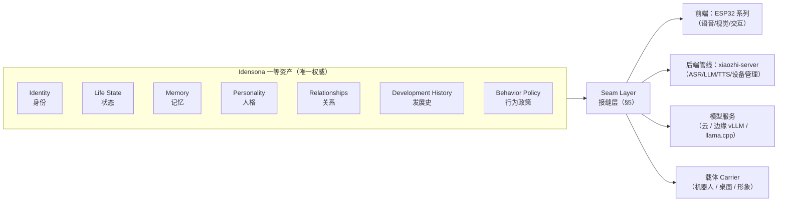
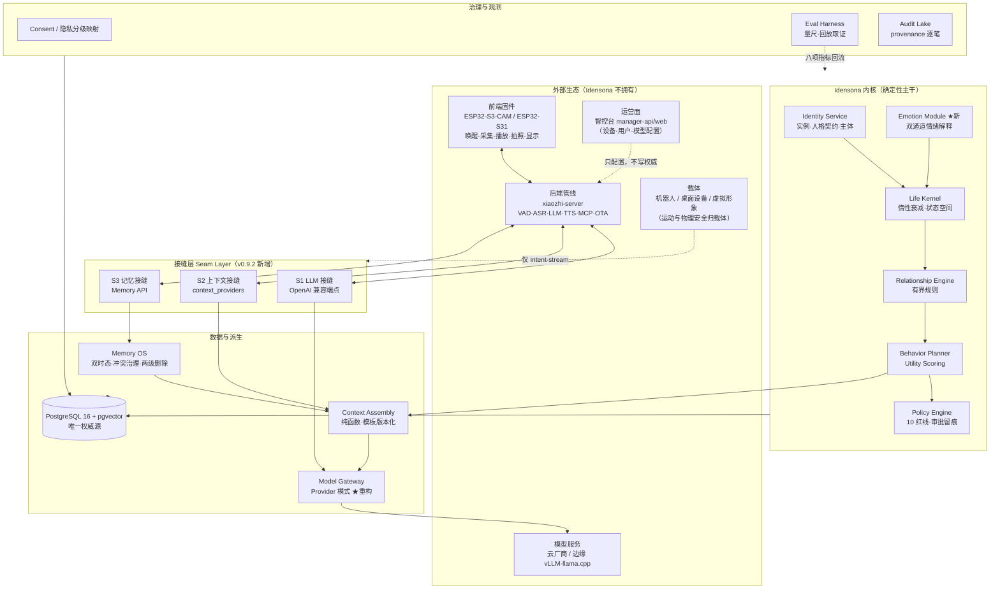
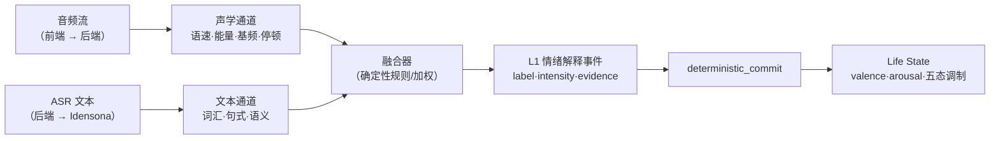
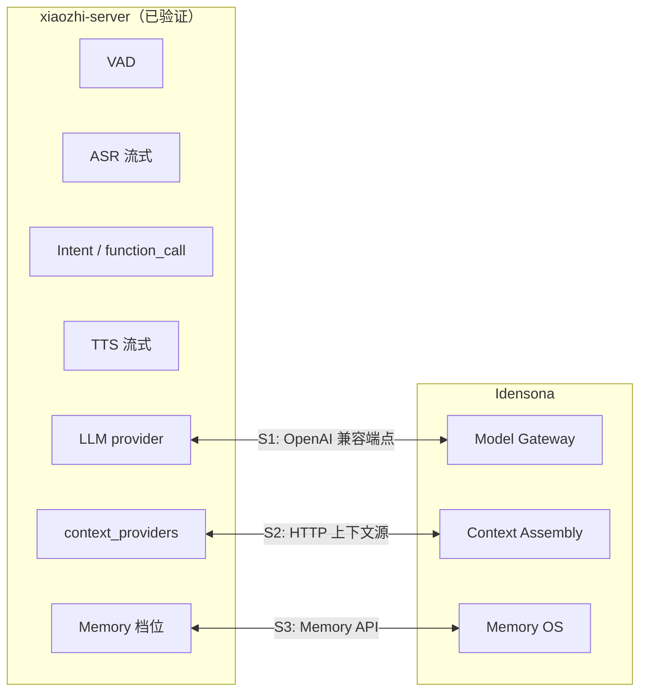
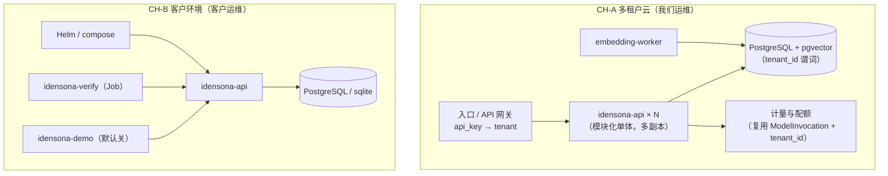
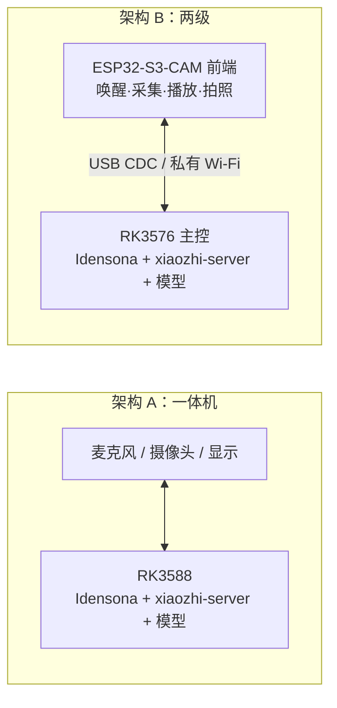

# Idensona 架构设计 v0.9.2

**版本** v0.9.2 ｜ 2026-11-25（2026-11-26 定名 Idensona）｜ 相对 v0.9.1 的**结构性**修订（不是增量补丁）

> **命名说明**：**Idensona = Identity + Persona**（域名 `idensona.com` 已注册）。本文档原代号为 **LifeOS**——该代号已降级为**项目历史代号**，仅保留在历史版本文件名（`LifeOS_*_v0.9.1.md`）与代码路径（`src/lifeos/`）中，以维持版本可追溯性与 183 项测试可用性。正文统一使用 **Idensona**。
> ⚠️ **Persona 语义纪律**：Idensona 的 Persona 指**冻结的人格契约**（`PersonalityContract`，生成后不可随意改动、可回放重算），**不是** AI 行业常见的"角色扮演人设"——详见 [`Idensona_命名方案建议_20261125.md`](Idensona_命名方案建议_20261125.md) §8。

**v0.9.2 文档集（五份，互相约束）**：

| 文档 | 职责 | 关系 |
|---|---|---|
| **[`Idensona_产品规格说明书_v0.9.2.md`](Idensona_产品规格说明书_v0.9.2.md)** | **做什么/不做什么/如何验收**（本文档的**上游约束**） | 阈值与红线以它为准 |
| **本文档（架构设计 v0.9.2）** | 怎么实现：分层、模块、接缝、接口契约 | 受规格书约束 |
| [`Idensona_生态交付与商业合作_v0.9.2.md`](Idensona_生态交付与商业合作_v0.9.2.md) | 交付什么/卖给谁/四条商业路径 | 受规格书 §14 约束 |
| [`Idensona_竞品与市场分析_v0.9.2.md`](Idensona_竞品与市场分析_v0.9.2.md) | 市场类型/功能位竞品/消费者画像 | 受规格书 §1 边界约束 |
| [`Idensona_阶段拆解与任务进度_v0.9.2.md`](Idensona_阶段拆解与任务进度_v0.9.2.md) | 六阶段/任务分解/进度与风险 | 受规格书 §10 约束 |

- 命名决策记录：[`Idensona_命名方案建议_20261125.md`](Idensona_命名方案建议_20261125.md)
- 历史版本（保持原名）：[`LifeOS_架构设计_v0.9.1.md`](LifeOS_架构设计_v0.9.1.md)、[`LifeOS_产品规格说明书_v0.9.1.md`](LifeOS_产品规格说明书_v0.9.1.md)

> **本文档回答**：Idensona 作为**软件生态**的架构是什么、边界在哪、模块如何协作、如何与已验证的前端/语音链路（小智 xiaozhi-esp32 + xiaozhi-server）对接。
> **本文档不回答**：验收阈值（规格书为准）、商业定价（生态交付文档为准）、论文议题（已按指示忽略）。

**v0.9.2 的四条结构性变化（相对 v0.9.1）**：

| # | 变化 | 性质 |
|---|---|---|
| C1 | **Idensona 定位从"AI Pet 心智运行时"上移为"Idensona 生态的身份/状态内核"**——硬件彻底解耦，Idensona 只以软件形式存在 | 定位上移 |
| C2 | **新增 Emotion 模块为一等公民**（情绪识别从"Kernel 的输入字段"升级为独立模块，含双通道输入与专项用例） | 新增模块 |
| C3 | **新增接缝层（Seam Layer）**——把"已验证的语音/视觉/设备链路"（小智）与"Idensona 内核"之间的三个接缝显式化、契约化 | 新增层 |
| C4 | **借鉴 xiaozhi-server 的 Provider 模式**重构 Model Gateway 与各模块适配器（可插拔、配置驱动、热切换） | 重构 |

---

## 1. 架构目标与边界

### 1.1 目标（不变）

1. **换模型、换库、换载体后，Life Instance 仍是"同一个它"**；
2. 任何长期状态**可审计、可回放、可重算**（重放一致率 100%）；
3. LLM 被限制在**叶子位置**：生成候选、抽取、渲染，**永不直写权威状态**。

### 1.2 硬约束（不变 + v0.9.2 明确）

- **单一权威数据源**：PostgreSQL 16 + pgvector；其他存储只做可重建派生缓存；
- **所有写路径经 L0→L1→L2 管线**，无后门写入；
- **全开源依赖**（Apache-2.0 / MIT / BSD / PostgreSQL License）；
- **部署形态**：**开发与客户私有化**用单机 Docker Compose（多 Instance 共库、每实例串行队列）；**多租户云（CH-A）与 Helm 编排（CH-B）已列入交付范围**（2026-11-26 裁决 1A/2C，见 §6.4/§6.5）；**仍不做微服务拆分**；
- **v0.9.2 新增**：**Idensona 不拥有任何硬件**——硬件只是"可选载体（carrier）"，Idensona 对其暴露**唯一窄接口**（§3.4、§5.1）。

### 1.3 边界清单（"清晰的边界"——本项目最容易被模糊的地方）

> 边界纪律：**凡是"不是身份/状态/记忆/人格/关系/治理"的东西，Idensona 一律不做**。

| # | Idensona **做** | Idensona **不做**（归属方） |
|---|---|---|
| B1 | 身份管理（LifeInstance / 人格契约 / 主体关系） | 语音采集、唤醒词、AEC、编解码 → **前端固件（小智）** |
| B2 | 状态演化（Kernel 惰性衰减、情绪状态写入） | ASR / TTS / LLM 推理引擎本身 → **后端管线（xiaozhi-server）+ 模型服务** |
| B3 | 记忆写入/召回/双时态治理/两级删除 | 设备管理、绑定、OTA、多用户控制台 → **xiaozhi-server + 智控台** |
| B4 | 人格与关系动力学（版本化、可回放） | 运动控制、舵机、底盘、SLAM → **载体/机器人栈**（RED-10 冻结） |
| B5 | 行为意图规划 + 10 红线审批 + 逐笔留痕 | 硬件 BOM、结构、电源、量产 → **硬件合作方** |
| B6 | 情绪**解释**与状态映射（Emotion 模块） | 情绪**表达**（表情动画/音色渲染）→ **前端显示层 / TTS 音色** |
| B7 | 评估量尺、回放取证、审计导出 | 论文实验、投稿、学术叙事 → **已排除** |
| B8 | 治理：Consent / 隐私分级映射 / 出境窄门判定 | 法规解释与法律意见 → **法务** |

**边界的物理表现**（三条硬性断言，CI 可验）：

- `src/lifeos/` 内**不得出现**任何 I2S / DVP / GPIO / UART / 舵机 / ROS2 依赖（B1/B4 的反证）；
- `src/lifeos/` 内**不得出现**任何 ASR/TTS 模型推理代码（B2 的反证）；
- 结构化行为意图**不得携带任何运动学参数**（`KINEMATIC_KEYS` 已固化，`RED-10` 已实现——真相源 [`src/lifeos/policy/engine.py:65-171`](../src/lifeos/policy/engine.py:65)）。

### 1.4 文档集分工（避免单文档膨胀）

| 文档 | 回答什么 | 读者 |
|---|---|---|
| **本文档（架构设计 v0.9.2）** | 模块、边界、关系、接缝、接口契约 | 工程师、技术合作方 |
| 生态交付与商业合作 v0.9.2 | 交付场景、四条商业路径、红海/蓝海定位 | 商业决策者、投资人 |
| 竞品与市场分析 v0.9.2 | 功能级竞品、消费者画像、市场类型区分 | 产品、市场 |
| 阶段拆解与任务进度 v0.9.2 | 阶段划分、任务分解、进度/成果/风险 | 项目管理 |

---

## 2. Idensona 是什么（生态定位，一句话与三段式）

**一句话**：**Idensona 是一个以软件形式交付的"身份与连续性内核"——它让同一个"它"跨越模型、设备与时间仍然是它。**

三段式定位（v0.9.2 的核心表述）：

1. **它是内核，不是产品**：不卖硬件、不卖整机、不自建语音管线；它以 **SDK / 服务 / 引擎** 三种形态存在（§6）。
2. **它是生态的"锚"**：生态中的前端（ESP32 系列）、后端管线（xiaozhi-server）、模型服务（云或边缘）、载体（机器人/桌面/虚拟形象）都可以替换，**唯有 Idensona 提供的东西不可替换**——因为它是"连续性"的持有者。
3. **它的价值可被验证**：`Idensona + elderly-companion` 的组合就是"用既有整机链路验证内核"的**验证场**，而不是要做的产品本身（见生态交付文档 §2）。

**Idensona 持有的七个一等资产**（用户指定的 Identity + 六项）：



> **注意**：`Emotion`（情绪）不是第八个权威资产，而是**状态层的一等输入通道 + 独立模块**（§4.6）——情绪解释结果写入 `Life State`，情绪表达归前端。这条划分是本架构**最容易被做错**的地方，故单列。

---

## 3. 分层架构

### 3.1 架构图（v0.9.2 五层 + 接缝层）



**拓扑三条纪律**（v0.9.1 继承 + v0.9.2 强化）：

1. `DB` 是 CORE / DATA / GOV 共享的**唯一权威源**；
2. `Model Gateway` 是**被调用的叶子**，不位于 Memory 与 DB 之间；
3. **`Seam Layer` 是 Idensona 与外部生态的唯一接触面**——外部任何组件（前端/后端/载体/运营台）**不得直连内核模块**，只能经接缝层。

### 3.2 五层职责（清晰边界的功能划分）

| 层 | 职责 | 关键模块 | 不做什么 |
|---|---|---|---|
| **L1 外部生态层** | 感知与表达（语音/视觉/动作/显示）、模型推理、运营配置 | 前端固件、xiaozhi-server、模型服务、载体、智控台 | 不持有身份/记忆/人格的权威 |
| **L2 接缝层** | **协议翻译与边界守卫**：把外部调用翻译成内核契约，把内核输出翻译成外部可消费格式 | S1/S2/S3 | 不做业务逻辑、不做状态写入 |
| **L3 内核层（确定性主干）** | 身份、状态、关系、规划、审批、情绪解释 | Identity / Emotion / Kernel / Relationship / Planner / Policy | 不做 IO、不调 LLM 直写 |
| **L4 数据与派生层** | 记忆权威、上下文组装、模型调用网关 | Memory OS / Context Assembly / Model Gateway | 不做决策、不绕过 Policy |
| **L5 治理层** | 同意、隐私、审计、评估 | Consent / Eval Harness / Audit Lake | 不做业务判断 |

### 3.3 模块关系矩阵（谁调用谁，v0.9.2）

| 调用方 ↓ / 被调用 → | Identity | Emotion | Kernel | Relation | Planner | Policy | Memory | Assembly | Gateway |
|---|---|---|---|---|---|---|---|---|---|
| **Identity** | — | | 派生契约 | | | | | | |
| **Emotion** | 读契约 | — | **写状态跃迁** | | | | 提议记忆候选 | | 用 LLM 抽取 |
| **Kernel** | 读 | 读情绪 | — | 读关系调制 | | | | | |
| **Relationship** | 读契约 | | | — | | | | | |
| **Planner** | | 读 | 读快照 | 读得分 | — | 提交审批 | | 请求上下文 | |
| **Policy** | | | | | 读意图 | — | 读隐私级 | | |
| **Memory** | 读 life_id | | | | | 提交校验 | — | | 用嵌入模型 |
| **Assembly** | 读契约 | 读情绪 | 读快照 | 读得分 | 读意图 | | 读 RecallBundle | — | |
| **Gateway** | | | | | | | | | — |

**唯一违规即失败的三条**：① Emotion **只**能写状态、不能写记忆权威（只能提议）；② Planner **必须**经 Policy 才能执行；③ Assembly/Gateway **不得**写任何权威表（RED-09）。

### 3.4 载体窄接口（B4 的物理实现）

Idensona 对载体**只暴露两个端点**（v0.9.1 继承，v0.9.2 明确禁扩展）：

```
载体 → Idensona : POST /events               （注入 L0 感知事件）
Idensona → 载体 : GET  /intent-stream        （结构化意图 + 已审批语言）
```

`BehaviorIntent.modality ∈ {verbal, expressive, attentional}` 仅为**提示性枚举**；**严禁**携带速度/角度/力矩等任何运动学字段（RED-10，CI 断言）。

---

## 4. 模块设计（v0.9.2 版，含新增与重构）

> 每个模块保持 v0.9.1 的"对标系统 + 输入/输出规格"纪律；本文档只写**变化与新增**，未变部分引用 v0.9.1 §5。

### 4.1 Identity Service（v0.9.2 单列，原散落于 Kernel/Memory）

**为什么单列**：生态定位上移后，"身份"必须是一个**独立可寻址的服务**，否则无法被外部（硬件厂/SDK 使用者）作为 API 消费。

| 能力 | 说明 | 状态 |
|---|---|---|
| 实例创建 | `POST /instances` → `life_id` + 人格契约 | ✅ 已实现（`entities.py`） |
| 人格契约 | `personality_seed` 确定性派生，写入后冻结，变更走 ADR | ✅ 已实现 |
| 主体管理 | `subject_id` 多主体（老人=主用户，家属=次用户） | ✅ 字段已就位 |
| **身份可携带性** | 实例导出/导入（跨部署迁移） | ⏳ v0.9.2 新增设计，未实现 |

> **关键纪律**：Identity Service **是唯一可以签发 `life_id` 的地方**；任何其他模块不得自造实例。

### 4.2 Life Kernel（继承 + 强化）

继承 v0.9.1 §5.1：五态（energy / social_need / security / curiosity / playfulness）+ valence / arousal，惰性衰减 `x(t)=b+(x(t₀)−b)·e^(−λ(t−t₀))`，只在事件到达/规划/快照/评估/导出时物化。

**v0.9.2 强化**：状态写入**唯一入口**为 `deterministic_commit`（真相源 [`src/lifeos/events/commit.py:120`](../src/lifeos/events/commit.py:120)）；Emotion 模块的输出必须经该函数落入 `LifeState`，不得旁路。

### 4.3 Memory OS（继承 + 一处分层修订）

继承 v0.9.1 §5.2：双时态、槽位冲突确定性裁决、`ambiguous` 第三态进人工队列、两级删除语义、Embedding Outbox。

**v0.9.2 修订**：Memory 增加**"外部记忆档位适配"**能力——因为小智链路已有五档记忆（`nomem / mem_local_short / mem0ai / powermem / 自建知识库`，见 §5.3 接缝 S3）。Idensona 的立场是：

| 小智档位 | Idensona 立场 |
|---|---|
| `nomem` / `mem_local_short` / `mem0ai` / `powermem` | **仅在"仅语音无 Idensona"模式可用**；接入 Idensona 后**关闭**（避免双记忆体系） |
| `Idensona Memory API`（S3 接缝） | **唯一权威记忆**——小智侧只做"转写与召回编排"，不存记忆 |

> 这条是 v0.9.2 的重要裁决：**"两套记忆并存"是合并项目最容易出的烂账**，必须在架构层面钉死（对齐 review 文档 §3.2 K2）。

### 4.4 Relationship Engine（继承）

继承 v0.9.1 §5.3：`r_{t+1} = clip(r_t + w_e·p·c − λ·Δt, 0, 1)`，每关系一行，参数版本化可回放（真相源 [`src/lifeos/kernel/relationship.py:30-131`](../src/lifeos/kernel/relationship.py:30)）。

### 4.5 Behavior Planner + Policy Engine（继承）

继承 v0.9.1 §5.4/§5.5。**10 红线已实现**（RED-01~RED-10，真相源 [`src/lifeos/policy/engine.py:37-171`](../src/lifeos/policy/engine.py:37)），`decide()` 为纯函数，拒绝零副作用。

### 4.6 Emotion Module ★ v0.9.2 新增（专项）

> 用户明确要求："情绪识别和相关 case 需要特别对待，从功能，use case 到实现阶段"。故本模块**单列、单测、单阶段**。

#### 4.6.1 为什么必须单列

情绪有三重身份，混在一起就会做错：

| 身份 | 归属 | 说明 |
|---|---|---|
| **情绪解释（interpretation）** | **Idensona Emotion 模块** | 把声学/文本/视觉信号 → 结构化情绪判断（`{label, intensity, evidence}`） |
| **情绪状态（state）** | Idensona Life Kernel | 情绪判断经 commit 落入 valence/arousal + 五态调制 |
| **情绪表达（expression）** | **前端 / TTS** | 表情动画、音色、语速——**Idensona 不做** |

#### 4.6.2 双通道输入设计（v0.9.2 范围）



| 通道 | 输入 | 方法 | 状态 |
|---|---|---|---|
| **声学通道** | 语速、能量、基频、停顿（前端或后端可算） | 规则化韵律特征（不引入大模型） | ⏳ 待实现 |
| **文本通道** | ASR 转写文本 | LLM 结构化抽取（已有 Gateway `extract` 能力） | ⏳ 待实现（复用抽取管线） |
| **视觉通道（facial）** | 摄像头帧 | 表情识别模型 | 🔒 **仅留接口占位**，不进 v0.9.2 实现（依赖视觉模型成熟度，见风险 R-07） |

**情绪标签集（初版，老人场景优先）**：`平静 / 难过 / 焦虑 / 急促 / 恐惧 / 愉悦`（6 类）——类别少是**刻意的**：类别越多越难验证，且老人场景触发守护只需要少数几类（对齐 review 文档 §4.1 的"四类足够触发守护"判断，本处扩为 6 类并标注待校准）。

#### 4.6.3 三个专项 Use Case（Emotion 的行为契约）

| # | Use Case | 触发 | Idensona 行为 | 前端行为 |
|---|---|---|---|---|
| EU-1 | **持续低落识别** | 连续 N 轮 `难过` 且 intensity 上升 | 状态 `social_need↑ security↓`；Planner 提升 `comfort` 意图优先级 | 语气放缓、表情柔和（前端自行决定） |
| EU-2 | **急促/恐惧升级守护** | `急促` 或 `恐惧` + 声学能量突增 | **旁路 Planner 直报 Policy 高优审批**（对齐"安全不依赖智能"） | 播报安抚模板（预录） |
| EU-3 | **情绪不匹配检测** | 文本说"没事"但声学显示高唤醒 | 标记 `ambiguous_emotion`，**降权处理、不主动追问**（RED-06 不操纵情感） | 保持中性表达 |

> **EU-2 是情绪模块与安全栈的接口**：情绪判断可以触发守护，但**守护动作的执行归载体/Guard**，Idensona 只出意图（B5 边界）。

#### 4.6.4 Emotion 模块的验收口径（不是论文指标）

- **E1 一致性**：同一段输入（同一音频 + 同一文本），重复解释**结果一致率 100%**（确定性）；
- **E2 可取证**：每条情绪解释必须带 `evidence`（哪些声学特征/哪些词触发），可人工回溯；
- **E3 不越权**：情绪解释**不得**直接写记忆、不得直接触发对外动作（只能提议）；
- **E4 误报可观测**：`ambiguous_emotion` 比例纳入周报，>阈值即人审。

#### 4.6.5 情绪模块的对标与空白（诚实声明）

已存在的情绪识别技术栈（工程常识条目，未逐项验证）：声学情感识别（如 openSMILE 特征集 + 分类器）、文本情感分析（LLM 或小模型）。**空白不在"能不能识别情绪"，而在"识别结果如何确定性地进入长期身份状态并可回放"**——这正是 Idensona 的增量，不是情绪识别的增量。

### 4.7 Model Gateway ★ v0.9.2 重构（借鉴 xiaozhi-server Provider 模式）

v0.9.1 的自研理由是"需要逐笔 provenance 与确定性路由"。v0.9.2 **保留该理由**，但**借鉴 xiaozhi-server 的 Provider 架构**改进实现形态：

| 借鉴点（xiaozhi-server，真相源 [`main/xiaozhi-server/core/providers/`](../demo/esp32-s3-materials/xiaozhi-esp32-server/main/xiaozhi-server/core/providers)） | Idensona v0.9.2 采纳方式 |
|---|---|
| **`selected_module` + `type` 两级选择**（配置决定用哪个 provider） | Gateway 增加 `provider_profile` 注册表：`{profile_id, type, endpoint, model, params}` |
| **抽象基类 + 具体实现**（`LLMProviderBase` 子类） | Gateway 抽象 `ProviderBase`（`generate / extract / embed`），各 provider 实现 |
| **动态实例化工厂**（`modules_initialize.py`） | Gateway 增加 `initialize(profile)` 工厂 + 热切换 |
| **OpenAI 兼容适配器最通用** | Gateway 保留 `openai_compatible` provider 作为默认类型 |
| **热更新配置**（`update_config` + lock） | Gateway 支持运行时 `switch(life_id, profile)`（已有接口，补实现） |

**Idensona 相对 xiaozhi-server 的增量**（不可让渡）：每笔调用强制携带 `prompt_template_id / prompt_hash / extractor_version`，落 `ModelInvocation` 表——**通用 provider 模式本身不带这个粒度的遥测**。

### 4.8 其余模块（继承，不重复）

Context Assembly、Life Studio、Eval Harness、continuity-sim、安全运维基线——沿用 v0.9.1 §5.6–§5.11，v0.9.2 **仅一处变更**：continuity-sim 由"研究性大规模仿真"**降级为出厂老化测试工具**（对齐 review 文档 §3.1 X2）。

---

## 5. 接缝层 Seam Layer（v0.9.2 新增，最关键的一节）

> **为什么要新增这一层**：项目已经**验证**了"ESP32-S3 前端 + xiaozhi-server"这条链路（音频/视频/TTS/设备管理都通了）。Idensona 的正确做法**不是重做这条链路**，而是**只做三个接缝**接进去。这一层就是那三个接缝的契约。

### 5.1 接缝总览（三条，仅三条）



### 5.2 S1：LLM 接缝（OpenAI 兼容端点）

**机制**：xiaozhi-server 的 `openai` 类型 provider 用标准 `openai.OpenAI(base_url=...)` 客户端（真相源 [`llm/openai/openai.py:22-72`](../demo/esp32-s3-materials/xiaozhi-esp32-server/main/xiaozhi-server/core/providers/llm/openai/openai.py:22)）。Idensona 只需暴露一个 **OpenAI 兼容的 `/v1/chat/completions`**，xiaozhi-server 就把 LLM 调用交给 Idensona。

**Idensona 侧要做的**：在 `/v1/chat/completions` 端点内部完成"上下文组装（Assembly）→ 路由（Gateway）→ **审批（Policy）** → 渲染"，然后以标准 OpenAI 响应格式返回。

| 契约项 | 规格 |
|---|---|
| 端点 | `POST /v1/chat/completions`（OpenAI 兼容，含 `stream=true`） |
| 身份识别 | 请求头携带 `Device-Id` / `Client-Id` → Idensona 映射为 `life_id` |
| 必须留痕 | 每次调用落 `ModelInvocation` + 返回 `prompt_hash` |
| 拒绝语义 | Policy 拒绝时返回**合规拒答文本**（不是 500），且零状态副作用 |
| 流式 | 必须支持 SSE 流式（xiaozhi-server 默认 `stream=True`） |

> **重要**：S1 不只是"LLM 转发"。它是**Idensona 接管对话决策权的入口**——上下文从哪来、能不能说、说什么，都在 Idensona 内决定。

### 5.3 S2：上下文接缝（context_providers）

**机制**：xiaozhi-server 原生支持 `context_providers` 在 system prompt 注入动态上下文（真相源 [`config.yaml:126-129`](../demo/esp32-s3-materials/xiaozhi-esp32-server/main/xiaozhi-server/config.yaml:126)，注释原文"健康数据、股票信息等"）。

**Idensona 侧要做的**：暴露一个 HTTP 端点，返回"人格契约摘要 + Kernel 状态摘要 + 关系摘要 + top-k 记忆摘要"，格式化为可注入文本。

| 契约项 | 规格 |
|---|---|
| 端点 | `GET /seam/context?life_id=&subject_id=` |
| 返回 | `{personality_summary, state_summary, relationship_summary, memory_summary, emotion_summary}` |
| 时延 | 目标 < 150ms（P95），超时则 xiaozhi-server 回落到无人格上下文（**降级不报错**） |
| 隐私 | 只返回 `privacy_level ≤ FAMILY` 的摘要；`sensitive` 一律不注入（RED-02） |
| 缓存 | 同 `life_id` 同轮次可缓存（以 `life_id + event_seq` 为键） |

### 5.4 S3：记忆接缝（Memory API）

**机制**：xiaozhi-server 的记忆档位是**可插拔的**（`nomem / mem_local_short / mem0ai / powermem`）。Idensona 接入后应**关闭这些档位**，改由 `custom` 或直接走 S1/S2 链路承载记忆。

| 契约项 | 规格 |
|---|---|
| 端点 | `POST /memories/{op}`（`remember / recall / revise / delete / export / explain`，v0.9.1 §6 已有） |
| 写入纪律 | **只接受经 L1 抽取的候选**，不接受裸文本直写（RED-09） |
| 删除纪律 | `delete` = 用户擦除，触发索引重建验证（两级删除语义） |
| 与 xiaozhi 的关系 | xiaozhi 侧**不存记忆**；只做"何时召回、召回结果怎么塞进对话"的编排 |

### 5.5 接缝层的三条守卫（不可让步）

| # | 守卫 | 失败后果 |
|---|---|---|
| G1 | 外部组件**只经** Seam Layer，不得直连内核模块 | 内核被外部逻辑污染（合并项目最常见的死法） |
| G2 | 接缝层**不存状态**（无状态翻译） | 出现"第二权威源" |
| G3 | 接缝层**必须可独立压测**（不依赖完整生态） | 无法定位是接缝问题还是内核问题 |

---

## 6. 运行时拓扑与部署档位（Idensona 不拥有硬件）

### 6.1 三种交付形态（软件形态，§2 的落地）

| 形态 | 说明 | 适用 |
|---|---|---|
| **F1 SDK（嵌入式库）** | Python 包 + 本地 sqlite，随客户后端进程运行 | 硬件厂私有化、边缘设备 |
| **F2 服务（Docker 容器）** | FastAPI 单体 + PostgreSQL + pgvector | 家庭网关、私有云、SaaS 后端 |
| **F3 引擎（多租户共享云）** | 暴露内核 + 接缝 API，**内置租户隔离**；存储由我们托管 | 平台型客户、自助开通 |

> **三形态共用同一内核代码**——不是三套实现。差异只在"存储在哪、进程边界在哪"。这是"软件形式存在"的工程含义。

---

### 6.4 租户层（v0.9.2 新增，2026-11-26 裁决 1A）

> **背景**：Idensona 要卖软件，CH-A 通道为**多租户共享云**。这要求 `tenant_id` 成为一等隔离维度——**与 `life_id` 同级**，而不是外层封装。

**四层标识与隔离强度**：

```
Tenant（tenant_id）      ← 计费/配额/SLA 边界；最强隔离
  └─ Project（project_id，可空）  ← 同客户多产品线
      └─ Instance（life_id）      ← 一个"它"（P0 已实现谓词）
          └─ Subject（subject_id） ← 关系主体（P0 已实现谓词）
```

| 隔离要求 | 断言 | 强度 |
|---|---|---|
| 跨 `tenant_id` 读写 | **必为空**（覆盖全部端点） | 一票否决级 |
| 跨 `life_id`（同 tenant 内） | 必为空（已实现） | 一票否决级 |
| 跨 `subject_id`（同 instance 内） | 必为空（已实现） | 高 |

**三条硬纪律**：

| # | 纪律 | 理由 |
|---|---|---|
| **TL-1** | **`tenant_id` 必须写入全部权威表（12 核心 + 3 支撑）** | 仅靠应用层过滤无法保证（漏一处即事故） |
| **TL-2** | **API key 绑定 tenant；禁止 key 指定任意 `life_id`** | 防越权跨实例 |
| **TL-3** | **Instance 不可跨 tenant 迁移**（迁移 = F11 导出/导入） | 保持"身份-租户"绑定清晰 |

**⚠️ 最紧急的提前量**：`tenant_id` 与 `RequestContext{tenant_id, life_id, subject_id}` **必须在 P1 之前加入**（单租户阶段恒为 `'default'`）——P0 已完成 183+ 测试与全部 SQL 谓词，**越晚加改造面越大**（详见部署与分发设计 §1.5、§4.1 F-1/F-6）。

### 6.5 编排与分发拓扑（v0.9.2 新增，裁决 2C/3C）



**镜像分层（F-4，必须现在定）**：`core`（内核+接缝）/ `full`（+worker+exporter+migrate）/ `demo`（+演示页面）。**Demo 默认关闭且独立鉴权**（攻击面）。
**License（F-5）**：**离线签名校验**（Ed25519，公钥内置）——**不得因授权校验回传数据**（与隐私封闭默认一致）。

> 完整设计（三粒度 Lite/Standard/Full、K-1~K-4 编排必做项、Verify 三份报告）见 [`Idensona_部署与分发设计_v0.9.2.md`](Idensona_部署与分发设计_v0.9.2.md)。

### 6.2 两个整机部署档位（架构 A / B 都可行，Idensona 无感）

用户确认：**架构 A（RK3588 一体）与架构 B（ESP32-S3 前端 + RK3576 主控）都可行**。从 Idensona 视角二者**完全等价**——区别只在 Idensona 容器跑在哪台机器上：

| 档位 | 硬件拓扑 | Idensona 落位 | Idensona 需感知的差异 |
|---|---|---|---|
| **架构 A** | RK3588 一体（8GB + NPU）跑全部 | Idensona 容器与 xiaozhi-server 同机 | 无（同机回环） |
| **架构 B** | ESP32-S3 前端 + RK3576 主控 | Idensona 在 RK3576（与 xiaozhi-server 同机） | 无（前端对 Idensona 完全透明） |



> **关键结论**：**Idensona 只在架构 B 的主控侧，架构 A/B 切换对 Idensona 零代码变更**。这正是"Idensona 不做硬件"的架构红利——也是生态可复制性的基础（硬件厂可以任选档位）。

### 6.3 部署清单（两形态并列）

| 组件 | F2 服务形态 | F1 SDK 形态 |
|---|---|---|
| Idensona 应用 | FastAPI 单体容器 | 进程内库 |
| 权威存储 | PostgreSQL 16 + pgvector 容器 | 本地 sqlite + FTS5（向量通道降级） |
| 嵌入 worker | 独立容器 | 进程内异步线程 |
| 评估 runner | 独立容器（CI 复用） | 可选（出厂测试） |
| Life Studio | Gradio 容器（工程工具） | 不含（开发期外挂） |
| 模型服务 | 云 / 边缘 vLLM·llama.cpp | 同左（客户提供） |

> **F1 的代价必须诚实声明**：sqlite 下 pgvector 通道不可用 → 向量召回降级为 SQL 全文检索 → **同一 L2 的重放一致性不受影响**（重放不依赖向量），但**召回质量下降**。见风险 R-03。

---

## 7. 接口契约（v0.9.2 增补接缝端点）

### 7.1 内核 API（v0.9.1 §6 继承）

| 端点 | 用途 |
|---|---|
| `POST /instances` | 创建 Life Instance（唯一签发 life_id 处） |
| `POST /events` | 注入 L0 事件（载体/调试台/仿真共用） |
| `GET /intent-stream` | 行为意图 + 已审批语言（SSE/WS） |
| `GET /state/{life_id}` | 状态快照（触发惰性物化） |
| `POST /memories/{op}` | 记忆六操作 |
| `POST /model/switch` | 实例级模型热切换 |
| `POST /replay/{life_id}` | 回放取证 |
| `GET /eval/runs` | 评估结果 |

### 7.2 接缝 API（v0.9.2 新增）

| 端点 | 用途 | 消费者 |
|---|---|---|
| `POST /v1/chat/completions` | S1 LLM 接缝（OpenAI 兼容，含流式） | xiaozhi-server LLM provider |
| `GET /seam/context` | S2 上下文接缝 | xiaozhi-server `context_providers` |
| `POST /memories/{op}`（复用） | S3 记忆接缝 | xiaozhi-server 记忆编排 |
| `GET /seam/health` | 接缝健康检查（压测用，G3 守卫） | 运维 |

### 7.3 鉴权与身份映射

- 全部端点要求 Bearer token（部署级）；
- **身份映射表**：`{device_id, client_id} → life_id`，存权威库，变更留痕；
- **禁止**外部直接传 `life_id` 而不经映射（防越权跨实例）。

---

## 8. 与既有实现的差距（诚实盘点）

> 依据 `src/lifeos/` 实际代码核查（非文档推断）。

| # | 能力 | 现状 | 差距 |
|---|---|---|---|
| D1 | 10 红线 Policy | ✅ 已实现（RED-01~10） | 无 |
| D2 | `deterministic_commit` 纯函数 | ✅ 已实现 | 无 |
| D3 | Kernel 惰性衰减 | ✅ 已实现 | 无 |
| D4 | Relationship 有界规则 + 版本化 | ✅ 已实现 | 无 |
| D5 | Context Assembly 纯函数 | ✅ 已实现 | 无 |
| D6 | Memory 双时态 + 冲突治理 | ✅ 已实现 | 无 |
| D7 | 两级删除 / 擦除验证 | ✅ 已实现 | 无 |
| D8 | Eval Harness + 回放 | ✅ 已实现 | 无 |
| D9 | **S1 LLM 接缝（OpenAI 兼容端点）** | ❌ 未实现 | **最高优先** |
| D10 | **S2 上下文接缝** | ❌ 未实现 | 与 D9 同批 |
| D11 | **身份映射（device_id→life_id）** | ❌ 未实现 | 依赖 D9/D10 |
| D12 | **Emotion 模块（双通道）** | ❌ 未实现 | 新模块 |
| D13 | Gateway Provider 注册表 + 热切换 | ⚠️ 部分（有 provider.py，无注册表） | 重构 |
| D14 | F1 SDK 形态（sqlite + 向量降级） | ❌ 未实现 | 生态化前置 |
| D15 | 实例导出/导入（身份可携带） | ❌ 未实现 | 生态化前置 |
| D16 | 视觉情绪（facial） | 🔒 仅占位 | 明确推迟 |

> **一句话**：**内核主干已完整，缺的全是"接缝 + 生态化"**——与"小智链路已走通"的现实吻合：下一步不是重做内核，而是把内核接上已验证的链路。

---

## 9. 架构风险与缓解

| # | 风险 | 等级 | 缓解 |
|---|---|---|---|
| R-01 | **双记忆体系并存**（xiaozhi 档位 + Idensona Memory） | 高 | 裁决：接入 Idensona 即关闭 xiaozhi 记忆档位（§4.3） |
| R-02 | **S1 接缝单点故障** | 高 | 接缝无状态 + 可独立压测（G2/G3）；Idensona 故障时 xiaozhi 回落直连模型（降级不降可用） |
| R-03 | F1 sqlite 召回质量下降 | 中 | 诚实声明；家庭网关优先 F2；F1 仅低配边缘 |
| R-04 | Emotion 双通道融合效度未知 | 中 | E1–E4 验收；先规则后模型；周抽人审 |
| R-05 | 身份映射错配导致跨实例污染 | 高 | 映射表唯一权威 + CI 断言跨 life_id 必为空 |
| R-06 | 架构 A/B 双档维护成本 | 中 | Idensona 对二者无感，差异只在硬件层 |
| R-07 | facial 情绪依赖视觉模型成熟度 | 低 | 仅占位，不进本期 |
| R-08 | 接缝层演化出业务逻辑（最隐蔽） | 高 | G1 守卫 + 评审规则：接缝层新增函数须同时提交无状态性论证 |

---

## 10. 明确不做（v0.9.2 重审）

| # | 不做 | 理由 | 捡回条件 |
|---|---|---|---|
| X1 | 语音管线（VAD/ASR/TTS） | 小智已完整验证 | 永不（生态分工） |
| X2 | 设备管理/绑定/OTA/智控台 | xiaozhi-server + manager 已交付 | 永不 |
| X3 | 运动控制 / 运动学参数 | RED-10 固化 | 永不 |
| X4 | continuity-sim 大规模研究仿真 | 降级为出厂老化工具 | 出厂测试需要时增强 |
| X5 | 硬件设计 / BOM / 结构 | 生态分工 | 永不 |
| X6 | 论文实验与投稿 | 用户明确排除 | 不适用 |
| X7 | 自研 ASR/TTS/LLM 推理引擎 | 用现成（云/边缘） | 永不 |
| X8 | ~~多租户 SaaS / K8s~~ / 微服务拆分 | **2026-11-26 修订**：多租户与容器编排**已列入交付范围**（用户裁决 1A/2C，见 §6.4/§6.5）；**仍不做微服务拆分**（保持模块化单体 + 多副本） | 微服务仅在单体能效不足时评审 |
| X9 | 在线学习 / 个体参数学习 | 与回放确定性冲突 | ADR 才能推翻 |
| X10 | 自研评估框架与观测栈 | 用 DeepEval/Ragas/Promptfoo/Langfuse | 永不 |

---

## 11. v0.9.1 → v0.9.2 变更总表

| 类别 | 变更 |
|---|---|
| 定位 | AI Pet 心智运行时 → **Idensona 生态身份/状态内核**（硬件解耦） |
| 新增模块 | Identity Service（单列）、Emotion Module |
| 新增层 | Seam Layer（S1/S2/S3 + 三条守卫） |
| 重构 | Model Gateway 借鉴 xiaozhi-server Provider 模式（注册表 + 热切换） |
| 新增交付形态 | F1 SDK / F2 服务 / F3 引擎 |
| 修订 | Memory 增加"外部档位适配"裁决（关闭 xiaozhi 记忆档位） |
| 降级 | continuity-sim → 出厂老化工具 |
| 继承不变 | 三级事件模型、10 红线、惰性衰减、关系规则、双时态记忆、两级删除、评估量尺、部署纪律 |

---

## 附：真相源清单

| 论断 | 真相源 |
|---|---|
| 10 红线已实现 | [`src/lifeos/policy/engine.py:37-171`](../src/lifeos/policy/engine.py:37) |
| 运动学参数冻结（RED-10） | [`src/lifeos/policy/engine.py:65`](../src/lifeos/policy/engine.py:65) |
| 确定性提交纯函数 | [`src/lifeos/events/commit.py:120`](../src/lifeos/events/commit.py:120) |
| 关系衰减与人格调制 | [`src/lifeos/kernel/relationship.py:30-131`](../src/lifeos/kernel/relationship.py:30) |
| 上下文组装纯函数 | [`src/lifeos/assembly/assemble.py:55`](../src/lifeos/assembly/assemble.py:55) |
| 四臂基线（A/B/C/Idensona） | [`src/lifeos/baselines/assembly.py:78-111`](../src/lifeos/baselines/assembly.py:78) |
| S1 可行性（OpenAI 兼容） | [`core/providers/llm/openai/openai.py:22-72`](../demo/esp32-s3-materials/xiaozhi-esp32-server/main/xiaozhi-server/core/providers/llm/openai/openai.py:22) |
| S2 可行性（context_providers） | [`config.yaml:126-129`](../demo/esp32-s3-materials/xiaozhi-esp32-server/main/xiaozhi-server/config.yaml:126) |
| Provider 模式借鉴对象 | [`core/providers/`](../demo/esp32-s3-materials/xiaozhi-esp32-server/main/xiaozhi-server/core/providers)、[`modules_initialize.py:9-98`](../demo/esp32-s3-materials/xiaozhi-esp32-server/main/xiaozhi-server/core/utils/modules_initialize.py:9) |
| xiaozhi 记忆五档 | [`config.yaml:293-356`](../demo/esp32-s3-materials/xiaozhi-esp32-server/main/xiaozhi-server/config.yaml:293) |
| 小智能力矩阵（意图/流式TTS/记忆/知识库） | [`demo/xiaozhi-features/`](../demo/xiaozhi-features) |
| 架构 A/B 双档 | [`review/Idensona_elderly-companion合并可行性研究_20261004.md`](../review/Idensona_elderly-companion合并可行性研究_20261004.md) §5.1/§5.2 |
| 前端链路已验证 | [`demo/elderly-companion/技术交底_小智AI与ESP32-S3-CAM可行性_20261026.md`](../demo/elderly-companion/技术交底_小智AI与ESP32-S3-CAM可行性_20261026.md) |
| 双配置运行态（S-A/B/C） | [`demo/elderly-companion/xiaozhi-server双配置文件关系与全模块本地部署_20261027.md`](../demo/elderly-companion/xiaozhi-server双配置文件关系与全模块本地部署_20261027.md) |
| v0.9.1 原模块设计 | [`doc/LifeOS_架构设计_v0.9.1.md`](LifeOS_架构设计_v0.9.1.md) §5 |