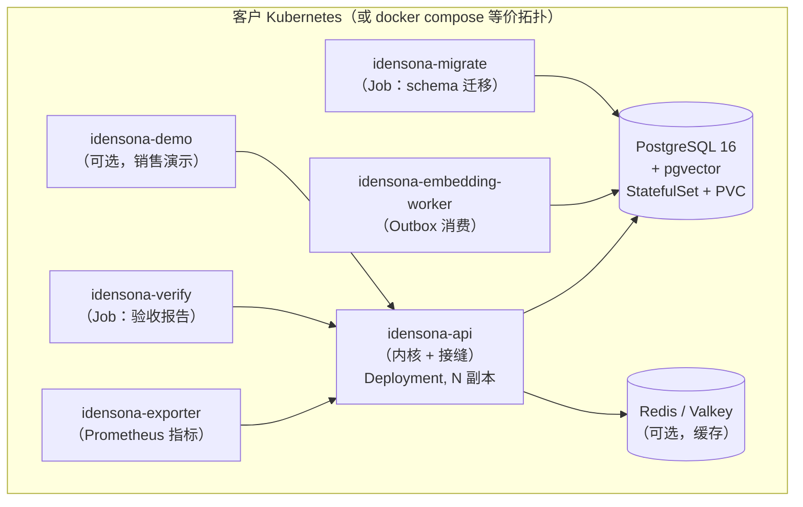

# Idensona 部署与分发设计 v0.9.2

**版本** v0.9.2 ｜ 2026-11-26 ｜ 配套：[`Idensona_产品规格说明书_v0.9.2.md`](Idensona_产品规格说明书_v0.9.2.md)、[`Idensona_架构设计_v0.9.2.md`](Idensona_架构设计_v0.9.2.md)、[`Idensona_生态交付与商业合作_v0.9.2.md`](Idensona_生态交付与商业合作_v0.9.2.md)、[`Idensona_阶段拆解与任务进度_v0.9.2.md`](Idensona_阶段拆解与任务进度_v0.9.2.md)

> **本文档的定位**：Idensona 是**要卖的软件产品**。用户明确要求——**部署与分发必须在设计阶段就打提前量**，不能等做完了再想怎么卖。
> **本版决策（2026-11-26 用户确认）**：**1A 多租户共享云 + 2C 完整编排 infra + 3C Demo 与 Verify 双件**。接受工期延长。
> **重要影响**：该决策**推翻了** v0.9.2 规格书 §14 与架构 §10 原有的"**不做多租户 SaaS / K8s / 微服务拆分（决策门前）**"排除项。这是一次**受控的架构变更**，须登记 ADR（本文件即为其设计载体）。

---

## 0. 三条分发通道（一句话总览）

| # | 通道 | 卖什么 | 客户怎么用 | 谁承担运维 |
|---|---|---|---|---|
| **CH-A** | **API（多租户云）** | 能力订阅（按实例/调用量计费） | 客户机器配置 `base_url` + `api_key` + `tenant`，指向 Idensona 云 | **我们** |
| **CH-B** | **SDK + Infra 编排包** | SDK 许可 + infra 交付（代码 + 容器编排 + 运维手册） | 客户在自己的云/边缘 `helm install` 或 `docker compose up` | **客户**（我们提供支持） |
| **CH-C** | **展示与验证（Demo + Verify）** | 不单独售卖——是**销售与验收的必备件** | Demo：客户/投资人点着看；Verify：客户验收签字用 | 我们交付、客户运行 |

> **纪律**：**三条通道共用同一个内核**（同一份 `src/lifeos/` + 同一份 `seam/`），差异只在**部署形态与编排层**。任何"云版一套代码、SDK 版另一套代码"的做法都是禁止的——那会导致行为不一致，"连续性"承诺立刻失效。

---

## 1. CH-A：API 形态（多租户共享云）

### 1.1 为什么要多租户（而不是每客户独立部署）

| 维度 | 多租户共享云（1A） | 每客户独立部署（1B，未选） |
|---|---|---|
| 边际成本 | **低**（一套跑 N 客户） | 高（N 套运维） |
| 自助开通 | **可**（注册即用） | 不可（需人工部署） |
| 计费粒度 | 可做（按 tenant/实例/调用量） | 难（只能整包卖） |
| 隔离风险 | **高**（必须工程保证） | 低（物理隔离） |
| 适合阶段 | 规模化后 | 早期样板客户 |

> **用户裁决 1A**：直接做多租户云。**代价**：必须一次性把"租户隔离"做对——它是"隐私事故"类风险（对标风险 R-14 跨实例污染），一旦出错后果不可逆。

### 1.2 租户模型（四层标识，缺一不可）

```
Tenant（客户组织）
  └─ Project（客户的应用/产品线，可选层）
      └─ Instance（Idensona Instance = 一个"它"）
          └─ Subject（人：老人 / 家属 …）
```

| 层 | 标识 | 作用 | 隔离要求 |
|---|---|---|---|
| **Tenant** | `tenant_id` | 计费、配额、SLA 边界 | **最强隔离**：跨 tenant 任何读写必须为空 |
| Project | `project_id`（可空） | 同一客户多产品的逻辑分组 | 跨 project 默认隔离，可配置共享 |
| **Instance** | `life_id` | 一个"它" | 已有 `life_id` 谓词强制（P0 已实现） |
| Subject | `subject_id` | 关系主体 | 已有 `subject_id` 谓词（P0 已实现） |

**关键裁决**：
1. **`tenant_id` 必须成为所有权威表的新增列**（不是外层封装能解决的——SQL 层必须能过滤）；
2. **`tenant_id` 不参与"身份"语义**——同一个 Instance 不能跨 tenant 迁移（迁移 = 导出+导入到新 tenant，走 F11）；
3. **API key 绑定 tenant**，key 泄露的影响范围被限制在单 tenant 内。

### 1.3 API 形态的接口面

| 端点 | 变更 |
|---|---|
| `POST /v1/chat/completions`（S1 接缝） | 新增必填头：`X-Idensona-Tenant`（或从 API key 解析） |
| `GET /seam/context`（S2） | 同上 |
| `POST /memories/{op}`（S3） | 同上 |
| **新增** `POST /tenants` | 开通租户（管理面，需运维权限） |
| **新增** `POST /tenants/{id}/keys` | 签发/轮换 API key |
| **新增** `GET /tenants/{id}/usage` | 用量与配额（计费依据） |

**鉴权双层**：
1. **API key → tenant**（认证）；
2. **`Device-Id`/`Client-Id` → `life_id`**（已有 SE-2 身份映射，但映射范围**限定在该 tenant 内**）。

> **禁止**：允许 API key 指定任意 `life_id`。必须经映射表，且映射表查询强制带 `tenant_id` 谓词。

### 1.4 多租户的四个必做工程件

| # | 工程件 | 为什么必做 | 验收 |
|---|---|---|---|
| **T-1** | **租户隔离测试集** | 跨 tenant 泄漏 = 隐私事故 | 自动化断言：tenant A 的 key 查不到 B 的任何 Instance/记忆/事件，**且覆盖全部端点** |
| **T-2** | **配额与限流** | 单租户打爆影响全云 | 每 tenant QPS/并发/存储配额；超限返回 429 且不污染状态 |
| **T-3** | **计费埋点** | 没有计量就没法收费 | 复用 `ModelInvocation` + 新增 `tenant_id`；月用量可对账 |
| **T-4** | **SLA 与可观测** | 客户要求可用性承诺 | 分租户指标（延迟/错误率）；SLO 看板（选型见 §4.2） |

### 1.5 多租户数据模型的最小改动（诚实评估）

> **这是一个"看起来小、实际穿透全库"的改动**，必须提前说清。

| 层 | 改动 | 影响面 |
|---|---|---|
| Schema | 15 实体（12 核心 + 3 支撑）**全部新增 `tenant_id`** | 迁移脚本 + 全部谓词 |
| 索引 | 全部查询索引前缀改为 `(tenant_id, life_id, …)` | 性能调优重做 |
| 迁移 | 现有单机数据 `tenant_id = 'default'` | 一次性迁移 |
| 备份/擦除 | 擦除范围必须能按 tenant 聚合（客户离网要能整体交付/删除） | 两级删除语义扩展 |
| 审计 | `PolicyDecision`/`ModelInvocation` 加 `tenant_id` | 审计导出按 tenant 切分 |

**风险提示（必须写进风险登记）**：这条改动**越晚做越贵**——P0 已完成的 183+ 测试与全部 SQL 谓词都要重跑重审。因此**建议在 P1 开工前把 `tenant_id` 列加入**（哪怕单租户阶段恒为 `'default'`），避免 P6 云化时大手术。

---

## 2. CH-B：SDK + Infra 完整编排（2C）

### 2.1 交付物清单（"卖 SDK"具体卖什么）

| 包 | 内容 | 客户得到 |
|---|---|---|
| **`idensona-sdk`（pip）** | 内核 + 接缝 + 量尺，纯 Python 库 | 可在自己进程内嵌 |
| **`idensona-infra`（容器编排）** | Dockerfile + docker-compose + **Helm Chart** | 一条命令拉起完整栈 |
| **`idensona-ops`（运维件）** | 备份/恢复脚本、升级脚本、健康检查、指标导出配置 | 可运维 |
| **`idensona-docs`（文档）** | 部署手册、升级手册、故障排查、SLO 建议 | 可自助 |
| **授权件** | License key + 版本校验机制 | 商业控制点 |

### 2.2 Infra 拓扑（Helm Chart 的最小完整栈）



**三种交付粒度（客户按能力选）**：

| 粒度 | 内容 | 适用 |
|---|---|---|
| **Lite** | API + PG（compose 两容器） | 家庭网关、单机、PoC |
| **Standard** | API + PG + Worker + Exporter + Migrate（compose/Helm） | 常规私有化 |
| **Full** | Standard + Redis + HA（多副本 + PDB + 反亲和）+ 备份 CronJob + Verify/Demo | 生产环境、大客户 |

### 2.3 编排件必须解决的四件事（否则"卖 infra"是空话）

| # | 问题 | 方案 |
|---|---|---|
| **K-1 版本可复现** | 客户升级后发现行为变了 | **镜像 digest 固定**（不用 `latest`）+ Chart 版本与内核 SemVer 绑定 |
| **K-2 Schema 迁移安全** | 升级失败导致数据损坏 | `idensona-migrate` 作为 **Job 前置**，失败即整体回滚；迁移脚本**只前向兼容**，禁止破坏性变更 |
| **K-3 备份/恢复可演练** | 客户不敢上线 | `backup`/`restore` 脚本 + **恢复演练验收项**（不是文档说明，是可执行脚本） |
| **K-4 授权与离网** | 客户断网后是否还能用 | **离线 License**（签名文件 + 有效期），不要求在线校验（隐私纪律：不能因授权检查而回传数据） |

> **K-4 是关键纪律**：**授权校验不得引入数据出境**——否则与"隐私封闭默认"直接冲突。采用**离线签名 License**（客户机器本地校验公钥签名）。

### 2.4 SDK 的两种嵌入模式

| 模式 | 说明 | 适用 |
|---|---|---|
| **Embedded（进程内）** | `import idensona`，直连客户自己的 PG/sqlite | 硬件厂主控（RK 系列）、低延迟要求 |
| **Sidecar（旁挂服务）** | SDK 以容器形式与客户服务同 Pod/同机 | 客户不想改代码，只想接 API |

> 两种模式共用同一份代码；差异只在**存储连接方式**与**进程边界**。

---

## 3. CH-C：展示与验证（Demo + Verify，3C）

### 3.1 为什么这是"分发通道"而不是"文档附件"

销售现场的两个致命问题：
1. **"换模型还是同一个它"看不见** → 客户无法相信，只能听我们说（不可接受）；
2. **"你说达标，凭什么"** → 没有可签字的东西，采购流程走不完。

因此 Demo 与 Verify 是**产品的一部分**，必须在设计阶段就纳入镜像与 Chart。

### 3.2 Demo（销售演示件）

| 项 | 设计 |
|---|---|
| 形态 | `idensona-demo` 容器（独立镜像层，可关） |
| 内容 | ①预置样例 Instance（含人格契约、若干记忆、关系状态）②页面：状态面板 / 记忆回放 / **一键"换模型"对照** ③对话入口（可接客户自己的模型） |
| 关键演示 | **A/B 对照**：同一 Instance，模型 A 与模型 B 的两段回答并列展示 + 状态/记忆不变的可视化 |
| 数据纪律 | 样例数据**全部合成**，标注 `synthetic_labeled`；不得用真实用户数据 |
| 开关 | **默认关闭**（生产环境不得暴露 Demo 路由）；由环境变量 `IDENSONA_DEMO=1` 开启 |

> **风险提示**：Demo 是**攻击面**（可注入事件的调试入口）。生产必须默认关闭 + 独立鉴权。

### 3.3 Verify（验收/签字件）

| 项 | 设计 |
|---|---|
| 形态 | `idensona-verify`（**Job 或 CLI**，非长驻服务） |
| 三份报告 | **E-A 换模型不变** / **E-B 可回放取证** / **E-C 红线可审计**（对齐规格书 §11.1） |
| 输出 | 带签名的 PDF/Markdown 报告（含协议版本号 + 适用范围声明 + 时间戳） |
| 可复现 | 客户可自己重跑同一命令得到同一结果（**这是"可验证"的定义**） |
| 不依赖外网 | 全部在客户环境内完成（隐私纪律） |

```bash
# 客户验收时执行（示例）
idensona-verify --instance life_xxx \
                --report-dir ./reports \
                --provider-a cloud:model-a \
                --provider-b local:model-b
# → reports/E-A_continuity_20261126.md / E-B_replay_... / E-C_policy_...
```

### 3.4 Demo/Verify 与"证据纪律"的对接

| 规格书纪律 | 在 Demo/Verify 中的落地 |
|---|---|
| EV-1 报告须带协议版本号与适用范围 | 报告页脚强制渲染 gold set 版本 + 判定流程版本 |
| EV-2 设计目标不得当实测值 | Verify 只输出**实测**；未实测项标 `NOT_MEASURED`，Demo 中的 150ms 等标"设计目标" |
| EV-3 失败结论如实写入 | Verify **必须**输出未通过项，不得只列通过项 |
| EV-4 合成数据须标注 | Demo 数据与 Verify 材料中的合成项标注 `synthetic_labeled` |

---

## 4. 三通道共用的工程基础（提前量的具体内容）

> 这一节是"设计阶段打提前量"的落地清单——**现在不做，后面每一条都会变成返工**。

### 4.1 必须现在就定的六件事

| # | 事项 | 为什么现在定 | 决策建议 |
|---|---|---|---|
| **F-1** | **`tenant_id` 列是否现在加** | 后加=全库迁移+全测试重跑 | **现在就加**，单租户阶段恒为 `'default'` |
| **F-2** | **配置来源统一** | 云版（DB/环境变量）与 SDK 版（文件）若两套，行为会分叉 | 统一 `ConfigurationProvider` 抽象：`EnvProvider` / `FileProvider` / `DBProvider` |
| **F-3** | **存储抽象层** | F1 sqlite 与 F2 PG 已存在差异（向量降级） | 明确 `MemoryBackend` 协议：`PgVectorBackend` / `SqliteFtsBackend`；**重放一致性必须两者都 100%** |
| **F-4** | **镜像分层** | Demo/Verify 若要可关，必须分层构建 | 三层：`core`（内核+接缝）/ `full`（+worker+exporter）/ `demo`（+页面） |
| **F-5** | **License 校验离线性** | 若设计成在线校验，隐私纪律崩塌 | 离线签名（Ed25519），公钥内置，无网络调用 |
| **F-6** | **租户上下文传递** | 中期改会造成大量签名变更 | 引入 `RequestContext{tenant_id, life_id, subject_id}` 显式穿透（替代到处传散参数） |

### 4.2 可观测与运维选型（与既有技术栈一致）

| 能力 | 选型 | 许可 | 备注 |
|---|---|---|---|
| 指标 | OpenTelemetry + Prometheus | Apache-2.0 | 已在 v0.9.1 §7 |
| 日志 | 结构化 JSON（loguru 已有） | MIT | 按 tenant 打标 |
| 追踪 | Jaeger | Apache-2.0 | 采样率可配 |
| 看板 | **Grafana 不引入**（AGPL） | — | 用客户自有看板或 Prometheus 原生 UI |
| 编排 | Helm / docker compose | Apache-2.0 | 不用 operator（工作量过大） |

> **注意**：v0.9.1 §7 已明确"不用 Grafana（AGPL）"——多租户云化**不得**因此引入 AGPL 组件，否则整机开源义务触发。

---

## 5. 对既有文档的连锁修订（本决策的正式影响）

| 文档 | 原内容 | 修订 |
|---|---|---|
| **规格书 v0.9.2 §10 X8** | "不做多租户 SaaS / K8s / 微服务拆分（决策门前）" | **推翻**：改为"多租户与编排**列入交付范围**（1A/2C 决策），但**仍不做微服务拆分**（单体 + 多副本）" |
| **规格书 v0.9.2 §7.3** | 三形态 F1/F2/F3 | 明确三形态与三通道的映射（见 §6 映射表） |
| **架构 v0.9.2 §6/§10** | 服务形态仅单机 Compose | 新增 §6.4 租户层与 §6.5 编排拓扑；X8 排除项修订 |
| **生态交付 v0.9.2 §3** | 四条路径 P-1…P-4 | 与三通道对齐（CH-A/B/C），P-3 云订阅**升级为当前主线之一** |
| **阶段 v0.9.2** | P0–P5 | **新增 P6「云化与分发」**（tenant 隔离/配额/计费/编排/Demo/Verify） |

---

## 6. 形态 × 通道 × 阶段 映射表（唯一对照）

| 交付形态 | 对应通道 | 阶段可用性 | 备注 |
|---|---|---|---|
| **F2 服务（单机 Compose）** | CH-B Lite/Standard | P1 起可用 | 当前开发主线 |
| **F1 SDK（pip + sqlite）** | CH-B Embedded | P4 起可用 | 硬件厂嵌入 |
| **F3 引擎（API）** | **CH-A 多租户云** | **P6 起可用** | 需 tenant 隔离/配额/计费 |
| **Demo 容器** | CH-C | P2 起（销售演示） | 默认关闭 |
| **Verify CLI/Job** | CH-C | P2 起（验收） | 依赖 E-A/B/C 证据 |

> **关键路径变化**：**`tenant_id` 必须在 P1 前加入**（F-1），否则 P6 云化要回头重做全库。这是"提前量"最具体的一条。

---

## 7. 工期影响（诚实声明）

> 用户已明确"接受工期延长"。以下是增量估算（**工程估算，±40%，非承诺**）。

| 阶段 | 原估算 | 增量内容 | 新估算 |
|---|---|---|---|
| P1 接缝 | 12–19 人日 | **+`tenant_id` 列与谓词改造 + `RequestContext` 抽象**（F-1/F-6） | **18–28 人日** |
| P2 跨模型 | 8–12 人日 | 无重大增量（复用接缝） | 8–12 人日 |
| P3 Emotion | 10–15 人日 | 无重大增量 | 10–15 人日 |
| P4 生态化 | 15–25 人日 | **+SDK 打包 + License 离线校验 + 镜像分层**（F-4/F-5） | **20–32 人日** |
| **P6 云化与分发** ★新增 | — | 租户隔离测试集/配额限流/计费埋点/SLA 可观测/Helm Chart/Demo/Verify | **30–50 人日** |
| P5 整机验证场 | 3–5 月 | 无重大增量 | 3–5 月 |

**合计（软件部分，不含 P5 招募）**：原 45–70 人日 → **约 86–137 人日（单人）**；2 人并行约 **11–17 周**。

> **诚实声明**：以上增量主要来自"多租户隔离"与"完整编排"，这两项是用户裁决 1A/2C 的直接代价。**如果不做多租户（选 1B）+ 不做编排（选 2A）**，可回到原估算——但那就不是"卖软件产品"的完整形态。

---

## 8. 三通道的验收门槛（分别定义，不混用）

| 通道 | 及格线 | 签字件 |
|---|---|---|
| **CH-A 多租户云** | T-1 隔离测试全过 + T-2 限流生效 + T-3 计费可对账 + SLO 达标 | 云服务 SOW + SLO 报告 |
| **CH-B SDK+Infra** | Lite/Standard 一键起 + K-1~K-4 全过（含恢复演练） | 部署验收单 + 恢复演练记录 |
| **CH-C Demo+Verify** | Demo 可演示 A/B 对照 + Verify 三份报告可复现 | Verify 报告（客户签字） |

---

## 9. 一句话总结

**Idensona 要卖软件，就必须把"多租户云（CH-A）+ SDK 与完整编排（CH-B）+ Demo 与 Verify（CH-C）"当作产品形态而非售后事项来设计；最具体、最紧急的提前量是 `tenant_id` 与 `RequestContext` 必须在 P1 之前加入（否则 P6 云化要重做全库），其次是配置/存储抽象、镜像分层与离线 License 四项——代价是软件部分人日从 45–70 升至 86–137，但换来的是"能卖"而不是"只能演示"。**

---

## 附：真相源

| 论断 | 来源 |
|---|---|
| 三形态 F1/F2/F3 | [`Idensona_架构设计_v0.9.2.md`](Idensona_架构设计_v0.9.2.md) §6.1 |
| 接缝端点契约 | 同上 §7.2；[`规格书 §3.5`](Idensona_产品规格说明书_v0.9.2.md) |
| 证据三件 E-A/E-B/E-C | [`规格书 §11.1`](Idensona_产品规格说明书_v0.9.2.md) |
| 证据纪律 EV-1~EV-4 | [`规格书 §11.2`](Idensona_产品规格说明书_v0.9.2.md) |
| `life_id`/`subject_id` 谓词隔离（已实现） | [`src/lifeos/store/memory_store.py`](../src/lifeos/store/memory_store.py) |
| `ModelInvocation` 逐笔留痕（可复用为计费埋点） | [`规格书 §3.4`](Idensona_产品规格说明书_v0.9.2.md) |
| 不用 Grafana（AGPL） | [`规格书 §7.1`](Idensona_产品规格说明书_v0.9.2.md) |
| 隐私封闭默认 / 不出境纪律 | [`规格书 §9.4`](Idensona_产品规格说明书_v0.9.2.md)、[`架构 §1.3`](Idensona_架构设计_v0.9.2.md) |
| 用户裁决 1A/2C/3C | 用户指令（2026-11-26） |
| 工期估算 | 工程估算，±40%，非承诺 |
