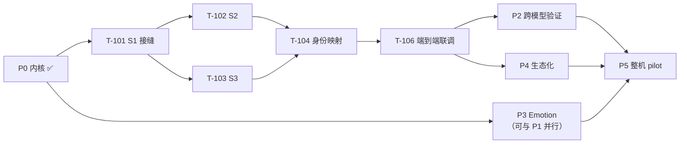

# Idensona 阶段拆解与任务进度 v0.9.2

**版本** v0.9.2 ｜ 2026-11-25（2026-11-26 定名 Idensona）｜ 配套 [`Idensona_架构设计_v0.9.2.md`](Idensona_架构设计_v0.9.2.md)

> **命名说明**：**Idensona = Identity + Persona**（域名 `idensona.com` 已注册）。原代号 **LifeOS** 已降级为项目历史代号——注意本文档中所有 `src/lifeos/` 路径与 `LifeInstance` 实体名**保持原样不改**（那是真实代码路径，改名会破坏 183 项测试）。

> **本文档回答**：Idensona 分几个阶段、每阶段的任务分解是什么、**现在到哪了**、还剩什么、风险在哪。
> **数据纪律**：进度状态依据**实际代码与测试核查**（非文档声称）；工期为**估算**并显式标注假设；不编造完成度。

---

## 0. 进度快照（一页看清，2026-11-25）

### 0.1 实测基线（代码级核查，非文档推断）

| 指标 | 实测值 | 核查方式 |
|---|---|---|
| `src/lifeos/` 模块数 | **21 个包/模块** | `dir src\lifeos` |
| 测试文件数 | **37 个** | `tests/test_*.py` |
| 测试函数数 | **183 个** | 正则统计 `^def test_` |
| 10 红线 | **全部实现**（RED-01~RED-10） | [`src/lifeos/policy/engine.py:37-171`](../src/lifeos/policy/engine.py:37) |
| 三级事件模型 | **已实现**（L0/L1/L2 + provenance） | `src/lifeos/events/` |
| 确定性提交 | **已实现** | [`events/commit.py:120`](../src/lifeos/events/commit.py:120) |
| 记忆双时态 + 冲突治理 | **已实现** | `src/lifeos/store/` |
| 两级删除 + 擦除验证 | **已实现** | `src/lifeos/store/erase.py` |
| 回放 | **已实现** | `src/lifeos/replay/` |
| 评估量尺 | **已实现**（四臂基线 + Gate） | `src/lifeos/evalharness/`、`baselines/` |
| **三条接缝（S1/S2/S3）** | **未实现** | 无对应端点 |
| **Emotion 模块** | **未实现** | 无对应模块 |
| **F1 SDK / 实例导出** | **未实现** | 无对应实现 |

> **口径说明（诚实）**：v0.9.1 文档曾记"254 tests"；本次实测为 **37 文件 / 183 个测试函数**。差异可能源于口径不同（参数化用例计数 vs 函数计数）或测试集变更。**以本次实测为准，不沿用旧数字**。

### 0.2 一句话进度

> **内核主干已完成（可交付度 ~70%）；生态化与接缝未开始（可交付度 0%）。** 整体"可对外验证"程度：**内核能力可内部验证，但无法与真实语音链路联通**——这正是下一步的全部重点。

---

## 1. 阶段划分（6 阶段，以"可验证里程碑"切分）

> **切分原则**（继承项目纪律）：先证最危险的假设；先做最容易验证的事；每个阶段必须有**可交付的证据物**，否则不算完成。

| 阶段 | 名称 | 目标（可验证） | 证据物 | 状态 |
|---|---|---|---|---|
| **P0** | 内核成型 | 身份/状态/记忆/人格/关系/政策全部落地且可回放 | 183 测试 + 四臂基线报告 | ✅ **已完成** |
| **P1** | **接缝打通** | Idensona 能接入已验证的小智语音链路，完成一轮真实对话 | 对话链路日志 + 上下文注入证据 | 🔴 **未开始（最高优先）** |
| **P2** | 跨模型连续性验证 | 换模型后人格/记忆/关系不变（可复现报告） | 换模型前后断言报告 | 🔴 未开始（依赖 P1） |
| **P3** | Emotion 模块 | 双通道情绪解释可用且可回放 | E1–E4 验收报告 | 🔴 未开始（可与 P1 并行） |
| **P4** | 生态化 | F1 SDK + 实例导出/导入 + 身份映射产品化 | SDK 可用性 + 迁移演练 | 🔴 未开始（依赖 P1/P2） |
| **P5** | 整机验证场 | elderly-companion 上 10–15 人 pilot | dogfood 报告 | 🔴 未开始（依赖 P1–P4） |

---

## 2. 任务分解（WBS，含 ID / 依赖 / 产出 / 验收）

### 2.1 P0 内核成型（已完成，仅列证据）

| ID | 任务 | 产出 | 状态 | 证据 |
|---|---|---|---|---|
| T-001 | 三级事件模型（L0/L1/L2） | `events/` 全套 | ✅ | `protocol.py` / `interpret.py` / `commit.py` / `pipeline.py` |
| T-002 | `deterministic_commit` 纯函数 | 单一提交实现 | ✅ | [`commit.py:120`](../src/lifeos/events/commit.py:120) |
| T-003 | Life Kernel 惰性衰减 | 五态 + valence/arousal | ✅ | `kernel/decay.py` |
| T-004 | Relationship Engine | 有界规则 + 版本化 | ✅ | [`relationship.py:30`](../src/lifeos/kernel/relationship.py:30) |
| T-005 | Behavior Planner | Utility Scoring | ✅ | `planner/engine.py` |
| T-006 | Policy Engine 10 红线 | RED-01~10 | ✅ | [`policy/engine.py:37`](../src/lifeos/policy/engine.py:37) |
| T-007 | Memory OS（双时态/冲突/删除） | 权威记忆 | ✅ | `store/` 全套 |
| T-008 | Context Assembly | 纯函数 + 模板版本化 | ✅ | [`assembly/assemble.py:55`](../src/lifeos/assembly/assemble.py:55) |
| T-009 | Model Gateway | 多 Provider 调用 | ✅（基础） | `gateway/provider.py` |
| T-010 | Eval Harness + 四臂基线 | A/B/C/Idensona 对照 | ✅ | [`baselines/assembly.py:78`](../src/lifeos/baselines/assembly.py:78) |
| T-011 | 回放一致性 | 逐事件比对 | ✅ | `replay/replay.py` |
| T-012 | 两级删除 + 擦除验证 | 不可恢复断言 | ✅ | `store/erase.py` |

### 2.2 P1 接缝打通（当前主战场）★

| ID | 任务 | 依赖 | 产出 | 验收标准 | 估算 |
|---|---|---|---|---|---|
| **T-101** | **S1 LLM 接缝**：Idensona 暴露 OpenAI 兼容 `/v1/chat/completions`（含 SSE 流式） | T-008/T-009 | 端点 + 内部"组装→路由→审批→渲染"链路 | xiaozhi-server 配 `base_url` 后能返回对话；`ModelInvocation` 逐笔落库 | 3–5 人日 |
| **T-102** | **S2 上下文接缝**：`GET /seam/context` | T-008 | 摘要端点 | xiaozhi `context_providers` 能注入；P95 < 150ms | 2–3 人日 |
| **T-103** | **S3 记忆接缝**：把 `POST /memories/{op}` 对接到 xiaozhi 编排 | T-007 | 记忆写入/召回通路 | 一轮对话产生记忆 → 下一轮召回出现 | 2–3 人日 |
| **T-104** | **身份映射**：`{device_id, client_id} → life_id` | T-101 | 映射表 + 鉴权 | 同一设备恒定映射；未映射设备拒绝 | 1–2 人日 |
| **T-105** | **接缝守卫 CI**：G1/G2/G3 断言 | T-101–104 | CI 测试集 | 接缝层无状态性 + 可独立压测 | 1–2 人日 |
| **T-106** | **端到端联调**（真机或 digital-human） | T-101–105 | 联调记录 | 一轮完整语音对话（听到→记得→回复） | 2–3 人日 |
| **T-107** | 接缝故障降级验证 | T-106 | 降级测试 | Idensona 停机时 xiaozhi 回落直连模型，不中断 | 1 人日 |

> **P1 合计估算：12–19 人日（约 3–4 周，单人）**。假设：环境已就绪（已验证）、无需大规模重构、无硬件阻塞。

### 2.3 P2 跨模型连续性验证

| ID | 任务 | 依赖 | 产出 | 验收 |
|---|---|---|---|---|
| T-201 | 双 Provider 配置（云大模型 + 边缘小模型） | T-106 | Provider 注册表 | 两者均可跑通对话 |
| T-202 | `POST /model/switch` 实例级切换 | T-201 | 热切换实现 | 切换后无重启 |
| T-203 | 切换前后断言（人格/记忆/关系零变化） | T-202 | 断言报告 | 报告可复现、可归档 |
| T-204 | 跨模型一致率测量（复用四臂量尺） | T-203 | 一致率报告 | 按规格书阈值判定 |

> **估算：8–12 人日**（含模型环境准备）。

### 2.4 P3 Emotion 模块（可与 P1 并行）

| ID | 任务 | 依赖 | 产出 | 验收 |
|---|---|---|---|---|
| T-301 | 声学通道（语速/能量/基频/停顿） | 前端或后端提供音频特征 | 特征提取器 | 同一音频重复提取结果一致 |
| T-302 | 文本通道（LLM 结构化抽取） | T-101（复用 Gateway） | 情绪解释器 | 结构化输出 + `evidence` |
| T-303 | 融合器（确定性规则/加权） | T-301/302 | 融合逻辑 | 6 类标签输出稳定 |
| T-304 | 经 commit 写入状态 | T-002 | 状态跃迁 | 零旁路写入（RED-09 断言） |
| T-305 | EU-1/EU-2/EU-3 用例实现 | T-303/304 | 三个用例 | E1–E4 验收全通 |
| T-306 | `ambiguous_emotion` 周报 | T-305 | 指标输出 | 比例超阈值即人审 |

> **估算：10–15 人日**（声学特征工程是主要不确定性）。

### 2.5 P4 生态化

| ID | 任务 | 依赖 | 产出 | 验收 |
|---|---|---|---|---|
| T-401 | F1 SDK（sqlite + 向量降级） | T-101 | 可嵌入包 | 在无 PostgreSQL 环境跑通全链路 |
| T-402 | 实例导出/导入 | T-002 | 迁移格式 | 导出→导入后回放一致 |
| T-403 | Provider 注册表重构（借鉴 xiaozhi 模式） | T-201 | 配置驱动 + 热切换 | 配置文件切换 provider 即生效 |
| T-404 | 量尺产品化（客户可自跑 CI） | T-010 | CLI + 报告模板 | 客户按文档可独立出报告 |

> **估算：15–25 人日**。

### 2.6 P5 整机验证场

| ID | 任务 | 依赖 | 产出 | 验收 |
|---|---|---|---|---|
| T-501 | elderly-companion 集成（架构 A 或 B） | T-401 | 整机可跑 | 连续 72 小时无崩溃 |
| T-502 | 10–15 人 pilot（伦理审查后） | T-501 | dogfood 数据 | 连续性/留存/关系三类数据 |
| T-503 | 周人审 + 伦理监督 | T-502 | 人审记录 | 每周产出 |
| T-504 | 商业化材料（样板间） | T-502 | 报告包 | 可用于 B 端洽谈 |

> **估算：pilot 3–5 个月（含招募，不含硬件供应链）**。

---

## 3. 进度汇报（已完成 / 未完成 / 阻塞）

### 3.1 已完成（P0，证据充分）

| 项 | 完成度 | 证据 |
|---|---|---|
| 身份/人格契约 | 100% | `entities.py` |
| 三级事件 + provenance | 100% | `events/` |
| 状态演化（惰性衰减） | 100% | `kernel/decay.py` |
| 关系动力学 | 100% | `kernel/relationship.py` |
| 行为规划 | 100% | `planner/engine.py` |
| 10 红线审批 | 100% | `policy/engine.py` |
| 双时态记忆 + 冲突治理 | 100% | `store/conflict.py` |
| 两级删除 + 擦除验证 | 100% | `store/erase.py` |
| 上下文组装 | 100% | `assembly/assemble.py` |
| 回放 + 四臂量尺 | 100% | `replay/`、`baselines/` |
| 测试 | 183 个测试函数 | `tests/`（37 文件） |

### 3.2 未完成（P1–P5，全部）

| 阶段 | 未完成项 | 为什么没做 |
|---|---|---|
| **P1** | 三条接缝 + 身份映射 | **这是本次架构变更（v0.9.2）才明确定义的新增层**——此前架构未区分"内核"与"接缝" |
| P2 | 跨模型切换验证 | 依赖 P1 |
| P3 | Emotion 模块 | 本次才升级为独立模块 |
| P4 | SDK / 导出 / 注册表 | 生态化前提未定（本次才定为 F1/F2/F3） |
| P5 | 整机 pilot | 依赖 P1–P4 |

### 3.3 阻塞与前置依赖

| # | 阻塞项 | 影响 | 解除条件 |
|---|---|---|---|
| BL-1 | 三条接缝未实现 | P1 全部工作无法开始 | 立即可开始（无外部依赖） |
| BL-2 | 硬件（ESP32-S3-CAM / RK3576）联调环境 | T-106/T-501 无法完成 | 硬件到手；当前可用 digital-human 顶替 T-106 部分 |
| BL-3 | 边缘模型选型（Qwen2.5 规模）未定 | T-201 影响 | 需实测 RK3576 上 token/s |
| BL-4 | 客户访谈未做 | 商业化材料缺说服力 | T-04 访谈（见 §5） |
| BL-5 | 伦理审查未申请 | P5 无法启动 | 提前 2–3 个月申请 |

---

## 4. 关键路径与并行机会

**关键路径**：`T-101 → T-102/T-103 → T-104 → T-106 → P2 → P5`
**可并行**：P3（Emotion）与 P1 并行；T-04（客户访谈）与全部技术工作并行。

---

## 5. 非技术任务（容易被忽略，但阻塞商业化）

| ID | 任务 | 产出 | 估算 | 状态 |
|---|---|---|---|---|
| **T-04** | **客户访谈**：5–8 家硬件厂产品负责人 + 3–5 户老人家庭 | 访谈记录 + 画像修正 | 3–4 周 | 🔴 未开始 |
| T-05 | 竞品季度复核 | 竞品文档更新 | 2–3 人日/季 | 🔴 未开始 |
| T-06 | 开源策略 ADR（许可证选择） | ADR 文档 | 2–3 人日 | 🔴 未开始 |
| T-07 | 伦理审查申请（P5 前置） | 审查批件 | 提前 2–3 月 | 🔴 未开始 |
| T-08 | 合规包整机化（Consent 流程 + 擦除 drill） | 合规演练记录 | 5–8 人日 | 🔴 未开始 |

---

## 6. 风险登记册（含技术/项目/商业）

| # | 风险 | 类别 | 等级 | 触发信号 | 缓解 |
|---|---|---|---|---|---|
| R-01 | 接缝层演化出业务逻辑 | 技术 | 高 | 接缝层函数变多、开始有状态 | G1/G2/G3 守卫 + 评审规则（架构 §5.5） |
| R-02 | S1 接缝单点故障 | 技术 | 高 | 对话在 Idensona 故障时全断 | T-107 降级验证；xiaozhi 回落直连 |
| R-03 | 双记忆体系并存 | 技术 | 高 | xiaozhi 记忆档位未关 | 架构裁决 + 启动检查断言 |
| R-04 | Emotion 融合效度不足 | 技术 | 中 | EU-1/3 误报高 | 先规则化；E4 周报人审 |
| R-05 | 身份映射错配 | 技术 | 高 | 跨实例召回出现内容 | CI 断言跨 life_id 必为空 |
| R-06 | 边缘模型性能不达标 | 技术 | 中 | RK3576 token/s 过低 | BL-3 提前实测；备选更小模型 |
| R-07 | 工期估算偏差 | 项目 | 中 | 单任务超估算 50% | 每两周重估；估算区间不取上限 |
| R-08 | 硬件到货延迟 | 项目 | 中 | BL-2 | digital-human 顶替；并行开发 |
| R-09 | 伦理审查周期长 | 项目 | 高 | BL-5 | 立即启动申请 |
| R-10 | 老人访谈伦理合规 | 项目 | 高 | T-04 老人走访 | 先走审查；或先只做 B 端访谈 |
| BR-01 | 无客户需求证据 | 商业 | 高 | 全部画像为推断 | T-04 访谈 |
| BR-02 | 大模型原生记忆竞争 | 商业 | 高 | 客户问"模型自己有记忆" | 强调"跨模型"定位（竞品文档 §3.1） |
| BR-03 | 单客户依赖 | 商业 | 中 | 只谈一家 OEM | 并行 2–3 家 PoC |

---

## 7. 工时口径（诚实声明）

| 项 | 口径 |
|---|---|
| 人日定义 | **1 名熟练工程师 1 个工作日**（含调试，不含会议/评审等待） |
| 团队假设 | **1–2 人**（沿用 review 文档 2–3 人口径的下限；本文件按单人估） |
| 不确定性 | **±40%**（P1/P3 主要来自接缝调试与声学特征工程） |
| 不含 | 硬件采购/结构/量产/供应链（不属软件团队） |
| 不含 | 伦理审查等待时间、客户谈判周期 |
| P1–P4 合计 | **约 45–70 人日 ≈ 9–14 周（单人）**；若 2 人并行可压到 6–8 周 |

> **不虚构**：以上为**工程估算**，非承诺排期。任何对外承诺需以本文件为基线重新核定。

---

## 8. 下一步（未来两周的动作清单）

| # | 动作 | 负责角色 | 完成标志 |
|---|---|---|---|
| A-1 | 立 T-101（S1 接缝）分支与设计稿 | 工程 | 设计稿评审通过 |
| A-2 | 写 S1 端点的最小骨架（返回固定文本） | 工程 | xiaozhi 能连上并收到响应 |
| A-3 | 启动 T-04 客户访谈（先 B 端 3 家） | 产品 | 3 份访谈记录 |
| A-4 | T-07 伦理审查材料准备 | 项目 | 材料提交 |
| A-5 | 竞品季度复核（T-05）首轮 | 产品 | 竞品文档 v0.9.2-r1 |

---

## 9. 一句话总结

**内核（P0）已实打实完成——21 个模块、37 个测试文件、183 个测试函数、10 红线全落地；真正的缺口在 P1 三条接缝（12–19 人日）：它既是"接上已验证小智链路"的唯一通路，也是 P2–P5 的全部前置；技术上最大的风险不是难度而是纪律（接缝层不许长业务逻辑），商业上最大的风险是当前所有客户画像都还没有一手访谈支撑——技术可以马上动，商业证据必须并行补。**

---

## 附：真相源

| 论断 | 核查方式 / 来源 |
|---|---|
| 21 个模块 | `dir src\lifeos`（实测） |
| 37 测试文件 / 183 测试函数 | `tests/test_*.py` 正则统计（实测） |
| 10 红线实现 | [`src/lifeos/policy/engine.py:37-171`](../src/lifeos/policy/engine.py:37) |
| 确定性提交 | [`src/lifeos/events/commit.py:120`](../src/lifeos/events/commit.py:120) |
| 关系规则 | [`src/lifeos/kernel/relationship.py:30-131`](../src/lifeos/kernel/relationship.py:30) |
| 四臂基线 | [`src/lifeos/baselines/assembly.py:78-111`](../src/lifeos/baselines/assembly.py:78) |
| 接缝可行性 | 架构 v0.9.2 §5（含 xiaozhi 源码出处） |
| 阶段/任务划分 | 本项目设计（可争论） |
| 工期估算 | 工程估算，±40%，非承诺 |
| 旧"254 tests" | v0.9.1 文档口径；**本次实测 183 函数，以实测为准** |
