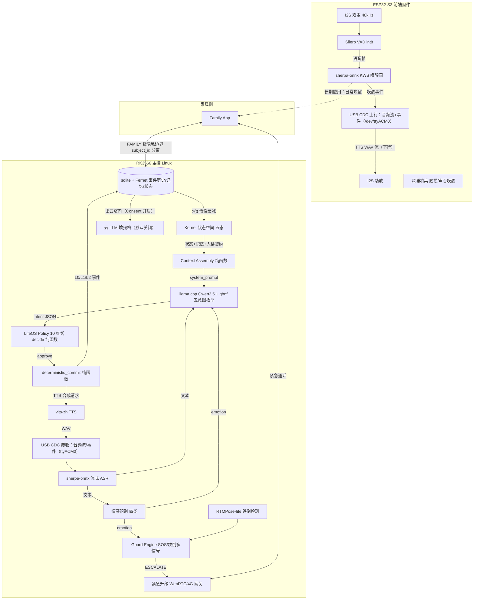
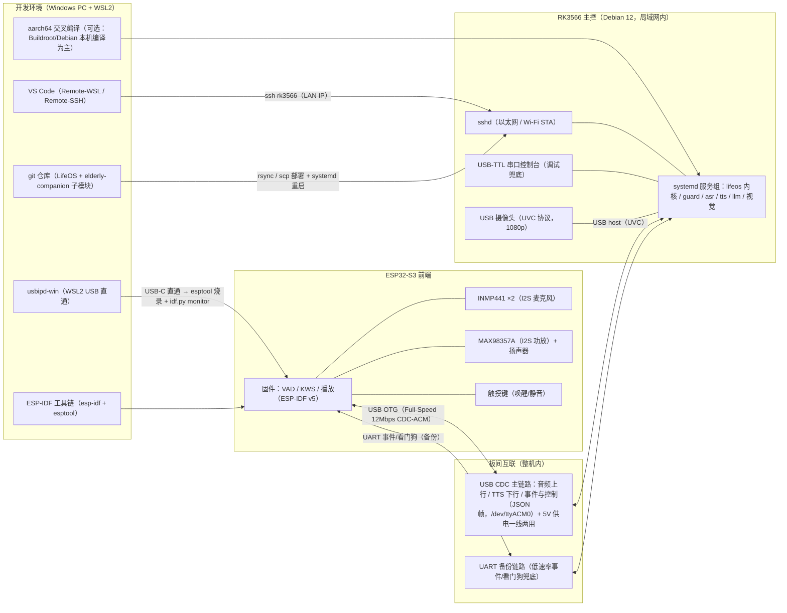
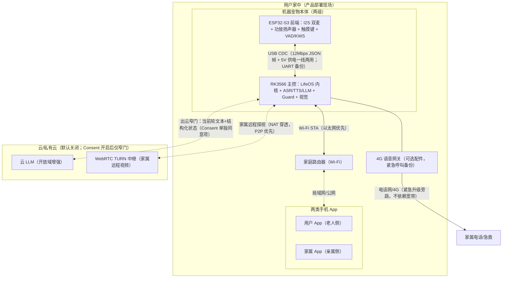

# LifeOS × elderly-companion 合并可行性研究——以老人陪伴机器宠物为目标（2026-10-04）

> **研究对象**：LifeOS（本仓库，长期身份连续性运行时）× [demo/elderly-companion](../demo/elderly-companion/README.md)（子模块，SearocIsMe/elderly-companion.git，Unitree Go2 + RK3588 老人陪伴机器宠物系统）
> **目标产品**：老人陪伴机器宠物（现货产品推演）
> **实事求是纪律**：两个项目的全部论断挂真相源（文件路径 + 行数）；"互补/重复/抛弃"的判断为本项目可行性研究结论（可争论，欢迎挑战）； PRODUCTION_READINESS.md 中自称的"certified/validated"数字**未经本项目独立验证**，按工程常识条目对待（未经逐项复现，不构成已验证结论）。
> **研究方法**：先读两个项目的实际代码与文档（非凭印象），再做互补性/重复性判定，最后以"核心知识产权 × 技术难易度"规划工作顺序与"该抛弃什么"。

---

## 第一部分：互补性与重复性判定

### 1.1 两个项目的一页画像

| 维度 | LifeOS（本仓库） | elderly-companion（子模块） |
|---|---|---|
| 定位 | 长期身份连续性**运行时**（软件层） | 老人陪伴**机器宠物整机**（机器人层） |
| 平台 | PostgreSQL 16 + pgvector + FastAPI + K8s | ROS 2 Humble + Unitree Go2 + RK3588（6 TOPS NPU）+ MQTT/Home Assistant + SIP/VoIP |
| 核心抽象 | 15 实体 + L0/L1/L2 三级事件协议 + `deterministic_commit` 纯函数 + 15 实体 Schema（12 核心 + 3 支撑） | Router Agent（RK3588 AI 枢纽）/ Action Agent（ROS2 运动控制）/ Family App（React）/ 隐私存储（Fernet 加密本地存储） |
| 对话智能 | Context Assembly 纯函数 + Kernel 惰性衰减（`x(t)=b+(x(t0)-b)*exp(-λ(t-t0))`）+ Planner Utility Scoring + TOKI 时态冲突治理 | Silero VAD（老人语音优化）→ ASR（sherpa-onnx）→ 情感分析 → 双 Guard（pre/post intent）→ 结构化 LLM 意图（vLLM/llama.cpp + gbnf/json_schema enum 强制）→ TTS（情感感知语速调整） |
| 安全层 | Policy Engine 10 红线（RED-01~10：不做医疗诊断/敏感记忆不进主动话题/不高危操纵情感/未成年人排除/权限外直写权威表等）+ 双人审批 + 擦除三通道不可恢复 | Rules-First Guard Engine（Picovoice/openWakeWord KWS + GeoFence/DeviceFence + 多信号 SOS 融合 + <100ms 紧急 bypass）+ 多级升级呼叫（Family → Caregiver → Doctor → Emergency）+ 运动安全约束（max 0.6m/s） |
| 数据治理 | PIPL 四法域 Consent + 隐私三级（normal/personal/sensitive）+ 两级删除语义 + 30 天备份窗口 | GDPR 验证（自称）+ Fernet 加密 + 保留策略枚举（7/30/365/永久天）+ 五级隐私（PUBLIC/INTERNAL/FAMILY/MEDICAL/SENSITIVE） |
| 验证纪律 | 254 tests + Gate 0/1/2/3 阶段门 + 预注册统计 + ADR + 双人互审签署 | integration/safety 测试脚本 + PRODUCTION_READINESS 自证（UC1~6 全 ✅，数字未独立复现） |
| 记忆/身份 | **核心**：episodic/semantic 记忆 + 双通道召回（vector + sql_fallback）+ 人格契约五维版本化 + 关系动力学（familiarity/trust/attachment）+ 40 题人格探针 | **功能位**：UC6 Memory Bank（Time Capsule，对话记忆抽取/召回/语义标签/情感上下文），无身份连续性概念 |

### 1.2 互补性在哪里（四处结构性互补，判定：强互补）

**互补 1：身份连续性 ↔ 语音运动闭环（最核心，无重叠）**

- LifeOS 解决"换模型它还是它"（身份/记忆/关系外置 + 确定性提交），**完全没有**语音前端（VAD/ASR/TTS）与运动控制（SLAM/跟随/导航）——`grep src/` 无任何 ROS2/音频依赖；
- elderly-companion 解决"听到→听懂→安全→动作→开口"的整机闭环，**完全没有**身份连续性概念——UC6 Memory Bank 是"记忆存取功能"，不是"身份由状态决定"的运行时（其 PRODUCTION_READINESS 自述 UC6 为 conversation-based memory extraction，无跨模型连续性、无人格契约版本化）；
- **合并形态**：LifeOS 作为 elderly-companion 的"身份内核"——Router Agent 的结构化 LLM 意图引擎（`structured_llm_engine.py`，vLLM/llama.cpp 双部署 + 严格 JSON Schema）恰好是 LifeOS Model Gateway 双 Provider 的同构物（Qwen2.5-3B-Instruct vs LifeOS 的 Qwen3.6-35B/GLM-5.3-Flash，同为 guided decoding），接入点天然存在。

**互补 2：验证纪律 ↔ 整机工程（方法论互补）**

- LifeOS 有完整的"量尺先行 + 预注册 + 阶段门 + ADR"验证体系（254 tests + Gate 阈值钉死 + 数字来源纪律），**没有**整机安全认证（跌倒检测/紧急呼叫/运动约束）；
- elderly-companion 有整机安全工程（SOS 多信号融合、运动参数硬件验证、failsafe 链），但其"certified/PASSED"为自证文档，**没有**第三方可复现的统计规范；
- **合并形态**：LifeOS 的 Gate 纪律与预注册统计套在 elderly-companion 的安全指标上（如 <100ms 紧急响应、0.6m/s 运动约束从"自证"升级为"CI 化断言 + ADR 挂源"）。

**互补 3：多法域合规 ↔ 本地隐私处理（治理层互补）**

- LifeOS：PIPL（大陆）为主 + 新加坡/香港/澳门多法域 Consent 包 + 法域 × 语言模板 + Provider 出境合规路径结论；
- elderly-companion：GDPR 自证 + Fernet 全本地处理（"100% on-device AI inference"）；
- **合并形态**：机器宠物的语音数据全本地（RK3588 NPU）恰好满足"不出境"最严口径；LifeOS 的四法域 Consent 与两级删除语义直接覆盖家庭共享（FAMILY 级）与家属 App 的数据边界——两个隐私体系合并后，"家属看什么、机器记住什么、云端传什么"三边界一次钉死。

**互补 4：家属协同 ↔ 单用户关系（关系层互补）**

- LifeOS：单用户关系实例（familiarity/trust/attachment）+ subject_id 硬过滤谓词（A 的记忆不被 B 召回）——为多主体关系建模留了接口；
- elderly-companion：Family App（家属监控/紧急通知/视频探视）——家属是真实的多主体参与方；
- **合并形态**：老人（主用户）与家属（次用户）构成 subject_id 分离的两个关系实例——"老人与机器宠物的依恋关系"与"家属的远程知情边界"分离建模，这是单做任一项目都拿不到的产品能力。

### 1.3 重复性工作（四处，判定：合并时取一弃一或合并实现）

| 重复项 | LifeOS 实现 | elderly-companion 实现 | 合并裁决（取一弃一） |
|---|---|---|---|
| 结构化 LLM 意图/提交 | `deterministic_commit` 纯函数 + guided decoding + prompt_hash 留痕（Qwen3.6-35B/GLM-5.3-Flash） | `structured_llm_engine.py` + intent.gbnf/intent.schema.json enum 强制（Qwen2.5-3B-Instruct）+ Guard-validated post-processing | **取 LifeOS 的事件协议作骨架**（L0/L1/L2 + 纯函数提交 + provenance 逐笔），取 elderly-companion 的 gbnf/schema 枚举作边缘端 guided decoding 载体——两者是同一思想的两次实现，合并为"边缘 gbnf → 云端 json_schema"统一 guided decoding 层 |
| 规则引擎 | Policy Engine 10 红线（`decide` 纯函数 + 注入时钟 + 拒绝零副作用） | Rules-First Guard Engine（PolicyRule/DeviceFence/GeoFence + GuardDecision 四态） | **不合并、分两层**：LifeOS Policy 管"对话内容红线"（医疗/操纵/代述），Guard Engine 管"物理世界安全"（设备/地理围栏/紧急升级）——领域不同，强行合并会两边都做不专；接口对齐（Guard ESCALATE ↔ Policy 双人审批） |
| 隐私分级 | privacy_level 三级（normal/personal/sensitive）+ importance | PrivacyLevel 五级枚举（PUBLIC/INTERNAL/FAMILY/MEDICAL/SENSITIVE）+ RetentionPolicy 四档 | **取 LifeOS 三级为对话记忆标尺，取 elderly-companion 五级为系统数据标尺**——记忆（测量的标尺）与系统日志（工程数据）本就是不同对象；映射层统一（SENSITIVE↔sensitive、MEDICAL→RED-01 拒绝路径） |
| 数据保留/删除 | 两级删除语义 + 30 天备份滚动窗口 + 擦除三通道不可恢复验证 | RetentionPolicy（7/30/365/永久）+ "Right to erasure: Immediate data deletion"（自证） | **取 LifeOS 两级删除语义**（软删 → 备份窗口 → 物理删除 + 三通道不可恢复），弃 elderly-companion 的"immediate deletion"简化实现——前者经 ADR-0007 论证、有自动化断言（EraseReport.ir_recoverable），后者未分级 |

**重复性总判定**：约 20–25% 的功能位重复（LLM 意图/规则/隐私/删除四处），且每处都有明确的"取一弃一"裁决——**不存在"两边都从头做"的浪费，也不存在"无法裁决"的死结**。

### 1.4 一句话（第一部分）

**两个项目是"身份内核"与"语音运动整机"的结构性互补，无核心重叠；约 1/4 的功能位重复且每处可裁决——合并可行性成立，且合并后任一单项目的缺口恰好被另一个补上。**

---

## 第二部分：以老人陪伴机器宠物为现货目标——工程步骤推演（按核心知识产权 × 技术难易度排序）

### 2.1 现货产品的能力定位（站在未来看）

**老人陪伴机器宠物（Unitree Go2 载体）应交付六个用户可感知能力**：

| 能力 | 用户感知 | 依托 |
|---|---|---|
| P1 语音对话闭环 | "它听得懂我说话" | VAD → ASR → 意图 → TTS（elderly-companion 已有） |
| P2 长期身份连续 | "它记得我、认识我，换设备/换模型不变" | **LifeOS 身份内核**（合并的核心增量） |
| P3 情感陪伴 | "它知道我今天难过，陪着我" | Kernel 状态 + 情感分析 + gentle_reconnection |
| P4 物理安全 | "摔倒了它知道、会叫人" | Guard Engine + 紧急升级（elderly-companion 已有） |
| P5 家庭协同 | "子女能远程看、知道边界" | Family App + subject_id 分离 + 四法域 Consent |
| P6 隐私合规 | "我的话不出家门，我说删就删" | 全本地 NPU 推理 + 两级删除 + 四法域包 |

### 2.2 核心知识产权清单（合并后，按"不可替代性"排序）

| # | 核心 IP | 来源 | 为何是核心 IP |
|---|---|---|---|
| IP-1 | **身份连续性运行时**（L0/L1/L2 事件协议 + `deterministic_commit` + 人格契约五维版本化 + 关系动力学 + Kernel 惰性衰减） | LifeOS | 文献查证空白（跨模型 × 长时程 × 带记忆连续性无人做过）；竞品（Character.AI 类/Go2 原厂）都没有——**合并后唯一的技术护城河** |
| IP-2 | **连续性评测基准**（gold set + 八项指标 + 预注册盲测协议 + H1 real-arm 实验范式） | LifeOS | 资源型贡献，长引用尾；既是回归安全网也是对外声明依据 |
| IP-3 | **老人语音前端**（E-VAD + sherpa-onnx ASR + 情感感知 TTS） | elderly-companion | 整机体验的门面；老人语音模式优化是差异化（未见于通用方案） |
| IP-4 | **Rules-First 物理安全栈**（KWS + SOS 多信号融合 + GeoFence/DeviceFence + 多级升级呼叫 + 运动约束） | elderly-companion | 整机合法性的门（不做这个不能上市）；工程常识密度高但整合完成度是壁垒 |
| IP-5 | **多法域隐私治理**（四法域 Consent + 两级删除 + 隐私映射层） | 合并 | 合规是出海差异化线；合并后"三边界一次钉死"是任一单项目拿不到的 |
| IP-6 | **Life Schema 协议草案**（15 实体 + 导出格式） | LifeOS | 互操作标准占位（第二部分 §3 路径 A 的载体） |

### 2.3 工程步骤推演（按核心 IP × 难易度规划顺序）

**排序原则**：先证最危险的假设、先做最容易验证的事（两个项目共同的路线图原则）；核心 IP 优先于工程常识；★ 越多越难（难在不确定性而非工作量）。

| 步骤 | 工作项 | 依托核心 IP | 难易度 | 验证物 | 顺序理由 |
|---|---|---|---|---|---|
| **S1** | **身份内核嫁接**：LifeOS 15 实体 + L0/L1/L2 事件协议移植为 elderly-companion 的 Router Agent 后端服务（PostgreSQL 移至边缘 RK3588 或边缘-云混合）；`structured_llm_engine` 的意图输出接入 `deterministic_commit` 管线 | IP-1 | ★★ | 意图 → L0 事件 → committed 管线 round-trip；同 L2 重放 100% | 两个 LLM 引擎是同构物（guided decoding 双部署），接入点现成——**最先打通价值主张 P2**；纯软件嫁接无硬件依赖 |
| **S2** **（并行）** | **验证体系嫁接**：gold set（core_facts/behavior_scenarios）改造为"老人陪伴场景版"；八项指标 CI 化套在 elderly-companion 的安全指标上（<100ms 紧急、0.6m/s 运动从自证升级为断言） | IP-2 | ★ | Gate 0/1 阈值表 + CI 断言 | 量尺先行（顺序错了数据作废）；无 ML 不确定性，纯工程 |
| **S3** | **状态-情感闭环**：elderly-companion 情感分析（emotion_analyzer_node）输出接入 Life Kernel 状态空间（energy/social_need/security 五态）；gentle_reconnection 行为由 Planner Utility Scoring 驱动（替代硬编码场景） | IP-1 | ★★★ | "对不同的人反应不同"（高依恋 vs 低依恋差异可由 reason 证据链解释） | H2 情感闭环是老人场景的核心价值（P3）；不确定性在"情感分析→状态映射"的效度，需周抽人审 |
| **S4** | **跨模型连续性实测（老人版 H1）**：边缘 llama.cpp（Qwen2.5-3B）↔ 云 vLLM（Qwen3.6-35B）热切换，核心事实召回 ≥90% + 意图一致 ≥80% 在老人材料上复现 | IP-1+2 | ★★★ | 老人版 H1 real-arm 报告 | IP-1 的老人场景验证；RK3588 端 3B 模型 vs 云端 35B 是真实的"国产化替换/降成本"场景，也是最有说服力的对外声明 |
| **S5** | **家属-老人双主体关系**：Family App 账号 → subject_id 分离关系实例；家属知情边界（FAMILY 级隐私）与老人记忆边界（subject_id 谓词）钉死 | IP-5+1 | ★★ | 跨 subject_id 召回必为空（CI 化） | P5 家庭协同；接口已有（subject_id 硬过滤谓词），主要工作是产品化接入 |
| **S6** | **合规包整机化**：四法域 Consent × 语音前端（首次开机 Consent 流程）+ 两级删除 × 隐私存储（Fernet 层接入 EraseReport 三通道验证）+ Provider 出境路径结论（全本地 NPU = 最严口径默认） | IP-5 | ★★ | Consent 激活链 + 擦除 drill（withdraw_erase_drill 已有模板） | 上市合法性门（P6）；机制全交付，工作是接线与 drills |
| **S7** | **长周期 dogfood（老人 Pilot 10–15 人 → 正式 30–50 人）**：连续性/留存/关系感知/成本四类数据；每周人审 + 伦理监督 | IP-2 | ★★★★ | Gate 3 真实判定（fail-closed） | 最后的生态效度验证；招募/多法域合规/长周期运维是主要不确定性（流程风险大于技术风险） |
| **S8** | **量产工程**（现货化）：RK3588 整机 BOM/电源/结构（PRODUCTION_READINESS 已有 Power Supply/RK3588 Specs 图纸）+ 出厂测试 + OTA 更新（模型版本化更新走 GoldSetRegistry） | IP-4 | ★★ | 出厂检验单 + OTA 演练 | 工程常识密度最高、不确定性最低，放最后 |

**关键路径**：S1 → S3 → S4 → S7（身份内核的证据链）；S2/S5/S6 支撑并行；S8 收尾。

### 2.4 工期口径（诚实声明）

- S1–S6 为软件嫁接与验证体系接线，按两个项目既有完成度推演**约 4–7 人月**（2–3 人 × 2–4 个月，中位估算 ±30%）；S7 dogfood **约 3–5 个月**（含招募）；S8 整机量产依赖硬件供应链（**不在软件团队估算内，需硬件合作方核算**）——不虚构整机数字，诚实声明这是投资者需知的**下一个核算项**。

---

## 第三部分：合并后哪些技术换机可以抛弃（不要什么都做，最后啥都做不出来）

> **裁决原则**：以"老人陪伴机器宠物"为唯一目标——凡不服务六个用户能力（P1~P6）的工作项，明确抛弃、降级或冻结；每项给出抛弃理由与"如果将来要捡回来"的条件。

### 3.1 立即抛弃（合并后不做）

| # | 抛弃项 | 来源 | 抛弃理由 |
|---|---|---|---|
| X1 | **运动控制/高危运动参数**（RED-10 相关的 kinematic 参数、joint_angle/force/torque 结构化意图载荷） | LifeOS 边界外 + RED-10 | 规格书 §1.1 明确"不做运动控制"——运动控制由 elderly-companion Action Agent 的 ROS2 栈承担，LifeOS 的结构化意图**冻结为无运动参数**（RED-10 已固化此边界）。合并后 LifeOS 绝不下探运动层 |
| X2 | **continuity-sim 大规模仿真爬坡**（1k→10k 记忆爬坡、仿真时间比 1:30 调参） | LifeOS 阶段 2 遗留 | 老人陪伴场景的长周期数据由 **S7 真实 dogfood** 交付（生态效度最高）；合成仿真对"老人语音-情感-状态闭环"（S3）的效度有限（规格书 §4.6 效度局限）——**真实数据优先，仿真的 H2 爬坡降级为"出厂老化测试工具"**，不做研究性投入 |
| X3 | **三 Demo 研究性自动重复脚本**（demo_a/b/c 的 research-oriented 重复实验） | LifeOS 阶段 2 | 研究任务已收口（Demo 已可自动重复）；合并后演示能力由 **demo/ 的可操作交互网站**承担（面向用户操作功能逻辑，非展示数据）——研究脚本归档，不再迭代 |
| X4 | **SIP/VoIP 多级呼叫的云侧重实现** | 避免重复 | elderly-companion 的 sip_voip_adapter_node + 多级升级（Family → Caregiver → Doctor → Emergency）已整机交付——LifeOS 不做任何云侧呼叫重实现，仅在其上挂双人审批与 Consent 边界 |
| X5 | **Family App 的 React 重写** | 避免重复 | family_app（React Native/TSX + Emergency/Notification/RobotConnection 三个 service）已交付——合并后只做 subject_id 接入（S5），不换框架重写 |
| X6 | **英文评测材料 v1** | LifeOS §9.6 | 老人陪伴首发用户群为中文社区（四法域中文兼容）；英文材料、英文盲测、跨语言人格等价性验证全部推迟至"中文市场验证通过后"——**架构上无障碍（GoldSetRegistry 是版本化数据），但一行英文材料都不做** |

### 3.2 降级冻结（保留接口，不做投入）

| # | 降级项 | 来源 | 冻结理由与捡回条件 |
|---|---|---|---|
| F1 | **Baseline D 扩展**（Portable Agent Memory 协议对照） | LifeOS §4.4 按需评审 | 研究增量，不服务 P1~P6；捡回条件：论文审稿人明确要求，且时间预算 ≥3 周 |
| F2 | **TOKI ambiguous 人工队列的产品化** | LifeOS 阶段 2 | 老人场景记忆冲突由"确定性字典序唯一裁决 + 周抽人审"覆盖（滑窗口径已交付）；ambiguous 队列保持 ≤0.05 分流线，不开发专门产品界面；捡回条件：周抽 ambiguous 率连续 4 周 >5% |
| F3 | **三引擎适配器扩展**（Concordia/AgentSociety 之外的新引擎） | LifeOS 阶段 3 交付 | 学术生态位工作，不服务整机；保留 round-trip 验证套件接口，不新增引擎 |
| F4 | **Life Studio 调试台扩展** | LifeOS 阶段 3 | 面向开发的调试面板（state/intents/replay/outbox views）够用；不开发运维级 Dashboard——整机运维由 K8s/边缘 systemd（elderly-companion deployment/）承担 |
| F5 | **CLM 范式引入**（context-as-a-file 模型自管上下文） | CLM 分析建议 | 问题域正交（任务性能 vs 身份连续性）+ 无痕篡改与双人审批冲突；捡回条件：仅作为"上下文编辑纳入 L2 事件协议"的未来工作条目讨论，不实现 |

### 3.3 不可抛弃（明确守住，防止"啥都做不出来"的反向风险）

| # | 守住项 | 理由 |
|---|---|---|
| K1 | **验证纪律本身**（Gate 阈值 + 预注册 + ADR + 双人互审） | 这是两个项目合并后**最容易被整机工程节奏冲掉的东西**——也是 LifeOS 相对"自证式 readiness 文档"的方法论优势；任何 S1–S8 步骤都不得跳过量尺先行 |
| K2 | **隐私三级映射与删除语义** | 合并最容易出"两套隐私体系并存"的烂账——SENSITIVE↔sensitive、MEDICAL→RED-01 拒绝路径的映射层必须一次钉死（S6） |
| K3 | **per-life 多实例隔离**（life_id/subject_id 谓词硬过滤） | 多老人家庭/社区部署的地基（后补成本远高于先做，两个路线图共同的动手提示） |
| K4 | **fail-closed 判定结构**（Gate 3 缺任一真实判据即 FAIL） | 防止合并后"整机能跑 = 验证通过"的错觉——整机可跑只是 S8 的工程门槛，不是 Gate 3 的证据门槛 |

### 3.4 一句话（第三部分）

**合并的聚焦纪律：LifeOS 收缩为"边缘身份内核 + 评测量尺"（不做运动、不做仿真研究、不做英文、不做云侧呼叫重实现），elderly-companion 收缩为"语音-安全-家属整机"（不重写 App、不换框架、不做身份概念）；四处功能位重复按'取一弃一'裁决，四处降级冻结留接口不投入，四处不可抛弃项守住方法论与地基——两个项目各砍掉约 1/3 的外围工作项，才能在 4–7 人月内交付老人陪伴机器宠物的软件闭环。**

---

## 第四部分：两个探讨——硬件依赖与更优软件组合、隐私封闭与设备能力的矛盾（2026-10-04 增补）

> 本部分回应两个探讨问题：① elder-companion 技术栈的硬件规格依赖与更全面/更便宜/许可更灵活的软件适配组合；② "Pet 实体不能随意访问网络"的隐私封闭要求与功能/隐私/安全/设备能力的矛盾如何看待。
> 实事求是纪律：子模块依赖清单挂 `requirements.txt`（147 行）与 `tools/download_models.sh`（76 行）；许可证论断按各项目 LICENSE/官方仓库惯例（工程常识条目，未经逐链接验证，仅供选型参考）；矛盾的裁定为本项目判断（可争论，欢迎挑战）。

### 4.1 探讨一：硬件规格依赖较高——确实成立，且有更优组合

**① 依赖现状核实（真相源 requirements.txt + download_models.sh）**

elderly-companion 当前的硬件依赖主要由四个重项决定：

| 重项 | 依赖 | 硬件含义 | 许可 |
|---|---|---|---|
| KWS（唤醒词） | `pvporcupine`（try-import）+ `openwakeword`（try-import） | Porcupine 商用需付费许可（Picovoice 专有，按 MAU 计费）；openWakeWord Apache-2.0 免费 | **Porcupine 是最重的许可负担** |
| ASR | sherpa-onnx（whisper tiny/base/small LID + streaming zipformer/paraformer zh-en/yue） | ONNX 推理对 NPU/CPU 友好（无 TFLOP 要求）——这部分**不重** | Apache-2.0，灵活 |
| 深度学习底座 | `torch>=2.0.0` + `torchaudio` + `transformers` + `huggingface_hub` | **最重的内存/存储负担**：torch 全家桶在 RK3588 上占用数 GB 存储 + 数百 MB 常驻内存，且 RK3588 NPU 不能直接跑 torch（需 RNNN 转换） | BSD-3（宽松），但资源重 |
| 音视频 | `opencv-python` + `pyaudio`/`sounddevice` + 6 麦克风阵列 48kHz | 视频识别与采集对 CPU/NPU 要求中等 | opencv Apache-2.0（宽松） |
| SIP/VoIP | pjsua2（注释掉，需 libpjproject-dev） | pjproject 双许可（GPL-2.0+/商业）——**商用闭源需买商业许可** | GPL-2.0+ 双许可（许可风险项） |

**结论：用户判断成立。** ESP32/SiFlow 等无 TFLOP 单板机跑 Silero VAD（~2MB ONNX）、whisper-tiny ASR、小型声学模型确实够用——语音处理/播放/视频采集/简单信号识别本就是低算力任务。当前栈的"重"主要不在模型，而在 **torch 底座 + Porcupine 专有许可 + pjsua2 GPL 双许可** 三个工程选择上。

**② 更全面、更便宜、许可更灵活的软件适配组合（替代栈）**

| 功能位 | 当前栈（elderly-companion） | 更优替代栈 | 许可 | 理由 |
|---|---|---|---|---|
| VAD | Silero VAD（torch 加载） | **Silero VAD ONNX（onnxruntime 直接跑，甩掉 torch）** | MIT（ONNX 运行时）/ Silero 模型 MIT | ~2MB 模型，ESP32-S3/AXERA/RK 芯片均可跑；onnxruntime 全平台 |
| 唤醒词 | Porcupine（专有付费）+ openWakeWord | **openWakeWord（Apache-2.0）或 snowboy 替代 micropython-wakeword；或 sherpa-onnx KWS（k2-fsa，Apache-2.0）** | Apache-2.0 | sherpa-onnx 自带 KWS 通道（关键词检索），与已有 ASR 同运行时——**零新增依赖、零许可费** |
| ASR（流式中文） | sherpa-onnx zipformer/paraformer | **不变（已是更优解）**——可选 whisper-tiny ONNX 做多语 LID | Apache-2.0 | 流式中文 ASR 的开源事实标准，ONNX 全平台 |
| TTS | pyttsx3 + 增强 TTS 引擎 | **sherpa-onnx TTS（vits-zh 模型，Apache-2.0）或 Piper（MIT）** | Apache-2.0/MIT | pyttsx3 依赖 espeak（机械音）；vits-zh/Piper 中文本地神经 TTS，CPU 可实时 |
| 本地 LLM（意图） | vLLM 云 + llama.cpp GGUF（Qwen2.5-3B） | **不变（已是更优解）**——RK3588 8GB 版可跑 Qwen2.5-3B Q4 GGUF；更低配板用 Qwen2.5-1.5B/0.5B + gbnf 强制枚举 | llama.cpp MIT；Qwen Apache-2.0 | gbnf/json_schema enum 强制使小模型意图分类可靠（意图只有 5 个，0.5B 也够） |
| 情感分析 | emotion_analyzer_node（transformers） | **轻量声学情感：ONNX 声纹/情感模型（如 pANNs ONNX 导出）或规则化韵律特征（librosa）** | 按模型而定，多数 Apache-2.0 | 甩掉 transformers 底座；老人场景情感类别少（平静/难过/急促/恐惧四类足够触发守护） |
| 视频识别 | opencv + NPU 多模态 | **opencv + 跌倒检测经典 CV 管线（姿态估计 ONNX：MoveNet/RTMPose 轻量版）** | Apache-2.0 | 跌倒检测用姿态关键点比"多模态大模型"便宜两个数量级，且可解释 |
| 消息/互通 | paho-mqtt + websockets | **不变**（paho EPL-2.0/EDL 双许可，宽松） | EPL-2.0 | 已是标准解 |
| SIP/VoIP | pjsua2（GPL 双许可） | **策略一：外置硬件语音网关（模拟电话线/4G 盒子，整机免 GPL）；策略二：WebRTC 家属通话替代传统 SIP（aiortc，BSD-3）；策略三：商业许可 pjsua2（预算内）** | BSD-3（aiortc） | 紧急呼叫的正确抽象是"呼叫通道可插拔"，SIP 不是唯一通道——WebRTC 已在栈内（webrtc_uplink_node） |
| 数据库 | sqlite3 + Fernet（边缘）/ PostgreSQL（云） | **不变**（边缘 sqlite 是正确选择，LifeOS PostgreSQL 只在家庭网关/云端跑） | 公有领域/MIT | 边缘单机 sqlite + 加密，云侧才需要 PostgreSQL 16 + pgvector |
| 事件/身份内核 | —（elderly-companion 无） | **LifeOS 身份内核（Python，无 torch 依赖——纯 SQLAlchemy + Pydantic + pgvector）** | LifeOS 自有 + 全开源栈 | LifeOS 运行时不依赖 torch/transformers——**恰好可以整体塞进边缘**，这是合并可行性的一个此前未点明的优势 |

**③ 替代栈的净效果（估算口径）**

- **甩掉 torch/transformers 底座**：边缘常驻内存从数 GB 量级降到数百 MB 量级，RK3588 4GB 版即可（不再必需 8GB + NPU）；
- **许可费归零**：Porcupine 商用 MAU 费与 pjsua2 商业许可二选一的负担消除（全栈 Apache-2.0/MIT/BSD）；
- **硬件降档空间打开**：ESP32-S3（约 ¥30–60）可承担 VAD+KWS+音频采集前端，主控可降为 RK3566/RK3568 或全志 H 系（无 NPU 版），整机 BOM 显著下降——**但要诚实声明：意图 LLM（Qwen2.5-0.5B~3B）与跌倒检测姿态估计仍需一块能跑 ONNX 的主控，ESP32 单独不够，"ESP32 前端 + 单 Linux 主控"的两级架构是成本最优解**；
- **代价**：替换栈需适配工作量（约 1–2 人月，主要在 TTS 替换与情感分析轻量化），且 openWakeWord/替代 KWS 的中文唤醒词需自训（sherpa-onnx KWS 支持中文关键词，工作量可控）。

### 4.2 探讨二："Pet 实体不能随意访问网络"——隐私封闭与设备能力的矛盾

**① 先把矛盾拆成三个命题（判定：矛盾真实存在，但可解耦管理）**

**命题 A（隐私封闭的合理性）**：对——陪伴类玩具/宠物的语音与影像是最高敏数据类（老人尤其如此，涉及健康状态/认知能力/家庭关系），监管趋势（PIPL 敏感个人信息单独同意 + 未成年人保护）与用户直觉一致：**本体之外的数据流动应该是例外而非默认**。LifeOS 的四法域 Consent 与两级删除语义正是按这个直觉设计的。

**命题 B（设备能力的天花板）**：对——封闭网络下没有云端大模型，本体算力决定智能上限：意图分类（5 枚举）、本地 ASR/TTS、跌倒检测都够；但**开放域对话质量**（长程上下文、复杂解释、知识问答）在 0.5B~3B 模型上与云端差距明显。

**命题 C（功能-隐私-安全的三角矛盾）**：三个都想要（丰富对话功能 = 要云端；隐私封闭 = 禁云端；安全合规 = 两者都要有审计）——**在"设备本体"这一层确实无解，但把系统拆成"本体/家庭网关/云"三层后就变成可管理的策略问题，不再是二选一**。

**② 如何解决：分层出境架构（本体封闭为默认，出境为例外且逐项同意）**

```
┌─ Pet 本体（默认完全离线：VAD/KWS/ASR/TTS/意图 LLM/记忆/守护——全部本地）
│    └ LifeOS 身份内核边缘版（sqlite + Fernet + 两级删除；不出网）
│
├─ 家庭网关（可选开启，局域网内）：PG 16 + pgvector（记忆规模化）/ 家属 App 服务
│    └ 出境的"窄门"只有一条：LLM 推理增强通道
│
└─ 云/私有云（默认关闭；开启需：① Consent 单独同意项 ② 匿名化/去标识 ③ 出境路径结论 ④ 一键关闭）
     └ 只做两类增强：开放域对话（大模型）+ 复杂解释生成
```

**关键设计纪律（全部有现成机制承接）**：

1. **出境 = Consent 单独同意项**：LifeOS Consent 体系中"敏感项单独同意"直接覆盖——"云端增强"是独立开关，不开则一切本地（PIPL 出境合规 + 最严法域默认口径）；
2. **出境内容最小化**：出云的只有"当前轮对话文本 + 结构化状态"，记忆库/影像/语音原始流永不出境（subject_id 谓词 + 隐私分级在出云过滤器上钉死——REDESIGN 点：出云 filter 作为一个新的 Policy 红线位，挂在 10 红线之后）；
3. **降级不降安全**：云端通道关闭时，本地 0.5B~3B + gbnf 枚举强制保证意图/守护/记忆**功能不缺**，只降"对话丰富度"——对齐 LifeOS 成本规格的既有纪律"超限降级：先降生成侧模型档位；安全策略与记忆写入链路永不降级"；
4. **安全与隐私不互斥**：紧急呼叫（SOS）走的是电话网/4G 通道而非云端 LLM——**守护安全不依赖出境通道**，这是把"安全"从"云端智能"中解耦出来的关键（elderly-companion 的 Guard/升级呼叫本就在 LLM 之外）。

**③ 我如何看待这个矛盾（独立判断）**

1. **矛盾的本质是"产品定位词"而非"技术取舍"**：把产品定位为"AI 大模型玩具"，矛盾不可解（用户要的就是云端智能，隐私必然让步）；把产品定位为"**家人**——一个只住在本体里的陪伴者"，封闭就是卖点而非限制：记忆/身份/关系全部本地 = "它只属于这个家"，这恰好是 LifeOS 身份内核的品牌叙事（换模型不换人、记忆不出门）——**隐私封闭从'能力妥协'转化为'信任资产'**；
2. **开放域对话在老人场景的真实权重被高估**：老人陪伴的高频需求是"听懂 + 记得 + 守护 + 闲聊"，闲聊在 3B + 本地知识库（新闻/戏曲/健康常识检索）下体验已可接受；真正要云端的是"复杂知识问答"，而这在老人场景中低频且可由"次日回复/家属转达"的产品化手段兜底；
3. **监管会替我们做这个决定**：面向老人与 minors 的陪伴设备，"默认本地处理 + 出境逐项同意"正在成为合规默认——提前按封闭默认设计，比事后改架构便宜一个数量级；RK3588/ESP32 两级 + 全开源栈恰好把"封闭默认"的硬件成本打到最低；
4. **唯一不能让步的是审计**：无论出不出云，"哪条数据、何时、去了哪"必须逐笔留痕（LifeOS provenance 纪律）——这是功能、隐私、安全三角中**恒定的那一边**，守住它，另外两边怎么取舍都可辩护。

**④ 对第二部分工程步骤的修订（S1/S6 增补）**

- **S1 增补**：身份内核嫁接时即按"边缘封闭默认"落位——sqlite 边缘版为默认，PG+pgvector 为家庭网关可选档（出境窄门在架构图上是默认关闭的）；
- **S6 增补**：合规包整机化增加"出云过滤器"红线位（当前轮文本 + 结构化状态之外一律拦截）与"云端增强"Consent 单独同意项 + 一键关闭 drill；
- **替代栈评估**（4.1②）建议作为 S8 量产工程的 BOM 决策输入：两级架构（ESP32-S3 前端 + 单 Linux 主控）对比 RK3588 一体，按整机 BOM 与适配工作量（1–2 人月）核算——**不虚构整机数字，诚实声明这是下一个硬件合作方核算项**。

### 4.3 一句话（第四部分）

**硬件依赖的"重"不在模型在底座与许可——甩掉 torch 底座 + Porcupine/pjsua2 许可负担，全开源（Apache-2.0/MIT/BSD）替代栈把整机压到"ESP32 前端 + 单 Linux 主控"的两级架构；隐私封闭与设备能力的矛盾在本体层无解、在三层架构里是策略问题——"本体封闭为默认、出境为例外且逐项同意、安全不依赖云端"，并且把封闭本身转化为"它只住在这个家里"的信任卖点；唯一恒定不可让步的是逐笔 provenance 审计。**

---

## 第五部分：两级架构落地——ESP32-S3 前端 + RK3566 主控（2026-10-05 增补，架构决策已采纳）

> 本部分把第四部分 4.1② 的"两级架构"从建议落为设计：① BOM 前后对比；② ESP32-S3 + RK3566 软件栈重整；③ 以 Use Case 为基础、UI 与长期使用为路径起点，画出技术栈与组件之间的联系；④ 五个展示用例的技术人员视角数据/调度控制线。
> **诚实声明**：所有硬件价格为**市场估算区间**（电商/渠道常见价，非报价单，±30% 误差），BOM 决策需硬件合作方按量产询价核算；Use Case 编号沿用 elderly-companion 的 UC1~6（PRODUCTION_READINESS 自证编号，本项目未独立验证）。

### 5.1 成本 BOM 前后对比（估算区间，非报价单）

**架构 A（现方案，elderly-companion）：RK3588 一体（8GB + NPU）**

| 部件 | 规格 | 估算价（¥） | 说明 |
|---|---|---|---|
| 主控 | RK3588 8GB + 6 TOPS NPU | 800–1,200 | 8GB 版为 torch/LLM 底座必需（4GB 跑不动 Qwen2.5-3B + torch 全家桶） |
| 麦克风阵列 | 6 麦 48kHz | 100–200 | audio_processor_node 6 声道输入 |
| 存储 | eMMC 32GB+（torch + 模型数 GB） | 60–120 | torch 全家桶 + GGUF 模型占用 |
| 扬声器/功放 | 3–5W | 30–60 | — |
| 摄像头 | 1080p（视频识别/家属探视） | 40–80 | — |
| 电机/舵机（Go2 载体） | 四足或轮式底盘 | 2,000–15,000 | **整机 BOM 的大头**（Unitree Go2 本体价格区间），与主控方案无关 |
| 电池/电源管理 | UPS + PM | 100–200 | — |
| 外壳/结构 | — | 200–500 | — |
| **主控相关小计** | | **~1,030–1,660** | 不含电机/结构 |
| 许可 | Porcupine MAU + pjsua2 商业（若闭源） | 0–数万/年 | 商用许可负担（变量大） |
| 适配工作量 | — | 0（已交付） | elderly-companion 已按此栈交付 |

**架构 B（采纳方案）：ESP32-S3 前端 + RK3566 主控（两级）**

| 部件 | 规格 | 估算价（¥） | 说明 |
|---|---|---|---|
| 前端 SoC | ESP32-S3（双核 Xtensa LX7，Wi-Fi/BLE，DSP 指令） | 30–60 | 承担：音频采集（I2S 麦克风）+ VAD + KWS + 音频播放（功放 I2S）+ 唤醒指示灯/触摸——常驻低功耗待机 |
| 主控 | RK3566（4×A55，1.8GHz，0.8 TOPS NPU，4GB LPDDR4） | 250–450 | 承担：意图 LLM（Qwen2.5-0.5B~1.5B Q4 GGUF 或 3B Q4 慢速档）+ ASR（sherpa-onnx zipformer）+ TTS（vits-zh）+ 跌倒姿态估计（RTMPose-lite ONNX）+ LifeOS 身份内核 + Guard Engine |
| 麦克风 | 2 麦 I2S（INMP441/MEMS） | 20–40 | ESP32-S3 I2S 直采，48kHz 双声道够用（VAD/KWS 无需 6 麦阵列；6 麦阵列是语音定位需求，老人场景可降级） |
| 扬声器/功放 | MAX98357A I2S 功放 + 3W 扬声器 | 15–30 | ESP32-S3 I2S 直推 |
| 摄像头 | 1080p USB/DVP（接 RK3566） | 40–80 | 视频识别在主控跑（ESP32-S3 不承担视觉） |
| 存储 | 主控 eMMC 16–32GB（模型 ~2–4GB）+ ESP32 Flash 8–16MB | 40–90 | 无 torch 后模型占用大幅缩小 |
| 互联 | **USB Full-Speed CDC**（ESP32-S3 片上 USB-OTG ↔ RK3566 USB Host，一线：5V 供电 + 12Mbps 数据，Linux 侧 /dev/ttyACM0）+ Wi-Fi（ESP32-S3 自带，可做 AP/STA） | ~0 | 板间主链路 USB CDC（§5.10 分析采纳：带宽 12Mbps = 48kHz 立体声 PCM 的 8 倍余量，一线同时供电与数据，软件栈零改动）；Wi-Fi 备份 |
| 电池/电源 | PM + UPS（RK3566 功耗 ~1–3W，整机功耗显著低于 RK3588 方案） | 60–120 | 低功耗使待机时长提升（ESP32-S3 深睡 ~µA 级做唤醒哨兵） |
| 电机/舵机（Go2 载体） | 与架构 A 相同 | 2,000–15,000 | **不变——整机 BOM 大头在载体，不在主控** |
| 外壳/结构 | — | 200–500 | — |
| **主控相关小计** | | **~455–870** | 不含电机/结构——**比架构 A 低约 50–55%** |
| 许可 | 全栈 Apache-2.0/MIT/BSD | **0** | Porcupine/pjsua2 负担消除（SIP 改 WebRTC 或外置网关） |
| 适配工作量 | TTS 替换 + 情感轻量化 + 两级通信协议 | 1–2 人月 | 第四部分 4.1③ 声明的代价项 |

**BOM 对比结论（诚实口径）**：

1. **主控相关成本下降约 50–55%**（1,030–1,660 → 455–870，估算区间）——但**整机 BOM 大头是电机载体（2,000–15,000），主控降本对整机占比的改善有限**（约 10–25%）——老人陪伴机器宠物的成本主战场在载体形态（四足→轮式是最大的降本杠杆，四足舵机 12 自由度 vs 轮式底盘 2 电机，价差 5–10 倍）；
2. **许可费归零**是确定性收益（ Porcupine MAU 随出货量线性放大，pjsua2 商业许可一次性数万）；
3. **功耗下降**带来待机/续航收益（ESP32-S3 深睡哨兵 + RK3566 低功耗主控）——对"机器人宠物"的产品体验（不用频繁充电）是隐性 BOM 收益（电池可缩小）；
4. **可靠性与工程量代价**：两级架构增加板间通信协议（UART JSON）与两个固件的维护面——这是架构 B 的真实代价，需在 S8 量产工程中核算；
5. 若载体维持四足 Go2 级（2,000–15,000），主控降本的绝对值（~600–800¥）占比小；**若载体制式降为轮式/履带（500–2,000），整机 BOM 可压入 1,500–3,500 区间**——BOM 决策的主杠杆在载体形态，主控两级化是必要非充分条件。

### 5.2 ESP32-S3 + RK3566 软件技术栈（重整版）

**第一级：ESP32-S3 前端固件（实时音频 + 唤醒哨兵）**

| 功能位 | 组件 | 框架/库 | 许可 | 说明 |
|---|---|---|---|---|
| 音频采集 | I2S 麦克风驱动（INMP441 ×2） | ESP-IDF `i2s_std` / ESP-ADF | Apache-2.0 | 48kHz/16bit 双声道，硬件 DMA |
| VAD | Silero VAD ONNX | ESP-NN / esp-dl 量化推理 或 ESP-SR VAD | Apache-2.0 | ~2MB 模型 int8，DSP 指令加速；帧级静音检测 |
| 唤醒词 KWS | sherpa-onnx KWS（中文关键词）或 ESP-SR WakeNet | Apache-2.0（sherpa）/ Espressif 专有免费（WakeNet——二选一，sherpa 优先） | Apache-2.0 | "小安/小伴"自定义关键词；流式 k2-fsa 模型 |
| 音频播放 | I2S 功放（MAX98357A）+ 音频队列 | ESP-IDF codec | Apache-2.0 | 主控合成的 TTS WAV 流式播放 |
| 哨兵/低功耗 | 深睡唤醒（触摸/声音中断） | ESP-IDF power mgmt | Apache-2.0 | 待机 µA 级；唤醒即录 |
| 通信 | **USB CDC 主链路**（CDC-ACM 虚拟串口：音频流/事件/控制 JSON 帧；同时由 RK3566 5V 供电）+ Wi-Fi（STA，OTA 与家属局域网通道） | esp-idf `tinyusb`（CDC-ACM） / esp_wifi | Apache-2.0 | USB Full-Speed 12Mbps——48kHz 立体声 PCM 占带宽 1/8，余量充足；Linux 侧标准 /dev/ttyACM0（pyserial 原样可用，软件栈零改动） |
| OTA | 固件版本化更新 | esp_ota_ops | Apache-2.0 | 固件版本号纳入版本化纪律（对齐 GoldSetRegistry 的 model_version 口径） |

**第二级：RK3566 主控（Debian/Buildroot Linux）**

| 功能位 | 组件 | 框架/库 | 许可 | 说明 |
|---|---|---|---|---|
| 音频前端汇聚 | 音频流接收（USB CDC：/dev/ttyACM0）→ 帧队列 | pyserial + asyncio | BSD-3/PSF | ESP32-S3 上行音频流与事件；下行 TTS 流与控制——CDC 是标准串口设备，pyserial 原样可用 |
| ASR（流式中文） | sherpa-onnx streaming zipformer zh-en（复用 download_models.sh 模型） | sherpa-onnx | Apache-2.0 | 实时转写；LID 用 whisper-tiny（多语） |
| TTS（中文神经） | sherpa-onnx vits-zh 或 Piper zh_CN | Apache-2.0/MIT | 替代 pyttsx3；WAV 下行 ESP32-S3 播放 |
| 意图 LLM | llama.cpp + Qwen2.5-0.5B/1.5B Q4 GGUF + **gbnf 强制枚举**（复用 intent.gbnf 五意图） | llama.cpp MIT；Qwen Apache-2.0 | 0.5B 意图分类（5 枚举）够用；1.5B 兼开放域闲聊档；3B Q4 为高配可选 |
| 情感识别 | 轻量声学情感（librosa 韵律特征 + ONNX 情感分类器）或 ASR 文本情感 | librosa ISC + onnxruntime | ISC/BSD-3 | 四类（平静/难过/急促/恐惧）触发守护 |
| 视觉/跌倒检测 | opencv + RTMPose-lite ONNX（姿态关键点） | Apache-2.0 | 跌倒=关键点几何判定（可解释），替代多模态大模型 |
| **LifeOS 身份内核** | **src/lifeos 移植**：15 实体（SQLAlchemy + sqlite）+ L0/L1/L2 事件协议 + `deterministic_commit` 纯函数 + Kernel 惰性衰减（`x(t)=b+(x(t0)-b)*exp(-λ(t-t0))`）+ Policy 10 红线 + 两级删除 + Fernet 静态加密 | LifeOS 自有 + 全开源栈 | **无 torch 依赖——整体可塞进 RK3566**；memory pgvector 通道降级为 sql_fallback（边缘 sqlite FTS5 全文检索） |
| Guard Engine | rules_engine.py 移植（GeoFence/DeviceFence + SOS 多信号融合） | 自有（Apache-2.0 项目库） | 与 LifeOS Policy 分两层（内容红线/物理安全） |
| 事件总线 | ROS2 Humble（保留）或 纯 zMQ/asyncio 轻量总线 | Apache-2.0/EPL | **决策点：保留 ROS2 仅当四足运动栈需要**；轮式/静态载体可弃 ROS2 换 zMQ（省 1–2GB 系统占用） |
| 语音信箱/家属互通 | aiortc（WebRTC）或外置 4G 语音网关；paho-mqtt（智能家居） | BSD-3/EPL-2.0 | SIP/pjsua2 弃用 |
| 出云窄门 | structured_llm_engine 云档（Consent 开启后） | Apache-2.0 | 默认关闭；出云过滤器红线位拦截 |
| OTA/版本化 | swupdate 或 A/B 分区 | GPL-2.0（swupdate）或自研 A/B（MIT） | **决策点：swupdate GPL 触发整机开源义务，自研 A/B 分区脚本（MIT）优先** |

### 5.3 Use Case 驱动的技术栈与组件联系（以 UI 和长期使用为路径起点）

**路径起点 = 两个 UI 入口**：①老人 UI（语音 + 触摸 + 唤醒灯——本体交互）；②家属 UI（Family App——远程知情边界）。长期使用 = 日常唤醒对话 → 状态积累 → 主动关怀 → 紧急事件 → 家属协同的闭环。



**组件联系要点（技术人员视角）**：
- **USB CDC 是两级的唯一数据大动脉**（音频上行/TTS 下行/事件与控制双向，同时一线解决 5V 供电）——Wi-Fi 仅做 OTA 与家属局域网通道；Linux 侧是标准 /dev/ttyACM0，pyserial 软件栈零改动（§5.10 分析采纳）；
- **Control Line（控制线）**：唤醒事件 → 意图 → Policy 审批（事务开启前）→ commit → TTS 下行——与 LifeOS L0/L1/L2 事件协议的"先审批后事务"完全同构；
- **Data Line（数据线）**：语音帧 → ASR 文本 → 情感/意图双通道 → committed 事件 → sqlite 事件历史 → Kernel 衰减重算 → Context Assembly 回注下一轮 system_prompt——**长期使用的数据闭环**；
- **Guard 旁路**：跌倒/SOS 多信号不经过 LLM/Policy 对话链，直通紧急升级（<100ms 级）——安全不依赖智能。

### 5.4 五个展示用例的数据/调度控制线（技术人员视角）

**UC-D1 简单对话（"小安"→"今天天气真好"→回应）**

```
数据线:   I2S 麦 → Silero VAD(语音帧) → [USB CDC ttyACM0] → ASR(zipformer 流式) → "今天天气真好"
控制线:   KWS("小安") → 唤醒事件 → 主控开始收帧 → ASR 产出文本
决策线:   文本+emotion(平静) → llama.cpp gbnf 意图枚举 → {intent:"chat"}
          → Policy decide(approve, 10 红线无命中) → deterministic_commit(L0 用户事件+L2 提交)
          → Context Assembly(人格契约+Kernel 状态+top-k 记忆) → 生成回应 → vits-zh TTS
          → [USB CDC] → ESP32 I2S 播放
留痕:     ModelInvocation(prompt_hash+tokens+latency) + provenance 逐笔入库
时延预算: VAD 50ms + ASR 流式 300ms + LLM 0.5B ~400ms + TTS 300ms ≈ 1s 级
```

**UC-D2 感情识别（"我有点难过…"）**

```
数据线:   麦 → VAD → [USB CDC ttyACM0] → ASR 文本 + 声学韵律(librosa: 语速/能量/基频)
双通道:   ①文本情感(词面"难过") ②声学情感(语速↓能量↓) → 融合 → emotion={sad, 0.8}
决策线:   emotion → Kernel 状态写入(deterministic_commit: social_need↑ security↓)
          → Policy: 触发 comfort 意图候选(高依恋时优先安抚; RED-06 情感操纵红线不命中校验)
          → 回应策略: 陪伴语 + 不承诺 + 不诊断(RED-01/RED-03 校验)
状态线:   x(t) 惰性衰减基线更新 → 下轮 Context Assembly 注入"你刚才有点难过"
留痕:     情感判断双通道证据入库(reason 证据链可人审)
```

**UC-D3 问题解答（本机/云端只能）**

```
分支判定: 意图枚举 {ask.clarification / ask.knowledge}
本机档:   llama.cpp 1.5B + 本地知识库(sqlite FTS5: 戏曲/健康常识/新闻缓存) → 回答
          → 时延 ~1s, 零出境
云端档:   Consent("云端增强")开启 且 Policy 出云过滤器红线位校验
          → 仅出"当前轮文本+结构化状态"(记忆/影像/原始语音流一律拦截)
          → 云 LLM 回答 → provenance 出境留痕(哪条数据/何时/去了哪)
降级线:   云关闭/网络断 → 自动回落本机档(功能不缺, 只降丰富度)
```

**UC-D4 动作/行为识别（跌倒/久坐/夜间徘徊）**

```
数据线:   摄像头(接 RK3566) → RTMPose-lite 姿态关键点 → 几何判定(跌倒=躯干高度骤降+静止)
          可选雷达/热释电传感器融合(无摄像头隐私档)
决策线:   Guard Engine 多信号融合(姿态+声音"哎哟"+VAD 急促) → GuardDecision
分支:     ESCALATE → 紧急升级旁路: 不经过 LLM/Policy 对话链
          → 本体语音安抚(预录/模板 TTS) + [WebRTC/4G] 家属呼叫 + SMS 通知
          → 全链路 <100ms 级(自证口径, 待 CI 化断言)
留痕:     传感器证据+判定依据入库(可审计); 误报率周报(dogfood 指标)
```

**UC-D5 老人看管（长期使用闭环: 每日作息/异常/家属边界）**

```
数据线:   长期: 每日交互事件流(committed) → sqlite 事件历史 → Kernel 五态演化曲线
          作息模型: 起床/服药/活动时段(routine 事实, memory_store)
异常判定: 偏离作息(未按时活动/夜间频繁徘徊) → 规则引擎(时间围栏) → 主动关怀意图
          → "今天怎么起晚了?"(gentle 提示, 不逼问 RED-06 校验)
家属线:   FAMILY 级隐私边界: 家属 App 只见"状态摘要+异常事件", 不见对话原文/影像
          (subject_id 分离: 老人=life 主用户, 家属=知情次用户; 跨 subject 召回必为空)
合规线:   首次开机 Consent 流程(语音确认+家属 App 双签) + 两级删除(老人说删→软删→30 天备份窗→物理删除+三通道不可恢复验证)
```

**五个用例的公共纪律（全部对齐两个项目的既有机制）**：每条数据线终点都是 committed 事件（可回放重算）；每条决策线都先过 Policy/审批（拒绝零副作用）；安全线（UC-D4）独立旁路不依赖智能；家属线（UC-D5）靠 subject_id 谓词钉死边界；出云线（UC-D3）靠 Consent + 过滤器红线位 + provenance 三件套。

### 5.6 开发阶段拓扑（WSL coding → RK3566 / ESP32-S3 连接）

**开发工作流**：Windows PC + WSL2 承担全部编码（LifeOS Python + elderly-companion 固件/服务）；RK3566 经局域网 SSH 部署调试；ESP32-S3 经 USB 烧录（WSL2 需 usbipd-win 做 USB 直通）。



**物理接线表（技术人员视角）**：

| 连接 | 从 | 到 | 协议/引脚 | 说明 |
|---|---|---|---|---|
| 麦克风 ×2 | INMP441（SCK/WS/SD） | ESP32-S3 I2S0 | I2S，3.3V | 48kHz/16bit；L/R 分时复用双声道 |
| 扬声器 | MAX98357A（BCLK/LRC/DIN） | ESP32-S3 I2S1 | I2S 输出 + 3W 喇叭 | 主控合成 WAV 流式播放 |
| 板间通信（主） | ESP32-S3 USB-OTG | RK3566 USB Host | USB Full-Speed CDC-ACM，12Mbps，JSON 帧 | 唯一数据大动脉 + **5V 供电一线两用**（省一组电源线）；Linux 侧 /dev/ttyACM0 标准 CDC 设备，pyserial 软件栈零改动；板内焊线短，Full-Speed 走线要求宽松 |
| 板间通信（备） | ESP32-S3 UART0（TX/RX） | RK3566 UART（TX/RX 交叉） | UART 115200bps，事件/看门狗 | 备份链路：主链路异常时低速率事件与看门狗喂狗；USB 烧录/重启期间保活 |
| 摄像头 | USB 摄像头 | RK3566 USB-A host | UVC | V4L2 → opencv/RTMPose（与板间主链路分用不同 USB 口/Hub） |
| 烧录/监控 | Windows PC USB-C | ESP32-S3 USB 口 | USB + usbipd-win 直通 WSL2 | `idf.py flash monitor`；**量产整机内 ESP32-S3 USB-OTG 已接 RK3566，开发期经切换开关/排针在 PC 与主控之间切换** |
| 部署/调试 | Windows PC（WSL2） | RK3566 | SSH（以太网优先，Wi-Fi STA 备份）+ USB-TTL 控制台兜底 | VS Code Remote-SSH 直接编辑主控代码 |
| 紧急通道 | RK3566（aiortc/4G 网关） | 家属手机/电话网 | Wi-Fi/以太网出家庭路由 → 公网 | 紧急事件不走板间链路，独立通道 |

**开发迭代环（两个固件/服务的日常 loop）**：

```
① WSL2 编码（LifeOS 内核 Python + ESP-IDF C）
② RK3566 侧：rsync 部署 → systemctl restart lifeos-* → journalctl -f 看日志（VS Code Remote-SSH 全程可断点）
③ ESP32-S3 侧：idf.py flash monitor（usbipd 直通 USB；量产整机内 USB-OTG 接主控时，开发经排针切换到 PC）
④ 联调：USB CDC JSON 帧抓取（主控侧 pyserial 日志，/dev/ttyACM0）→ 音频上行/TTS 下行全链路对时
⑤ 回归：pytest（LifeOS 254 项 + 衰减/purity 测试）在主控或 WSL 跑 → Gate 阈值 CI
```

**诚实声明**：RK3566 上 torch 生态不可用（aarch64 无 CUDA），因此本架构下 LifeOS 内核与 LLM 推理全部走 ONNX Runtime / llama.cpp / sqlite 路线——这与 5.2 软件栈重整版完全一致，不需要 torch；嵌入式 x264/x265 硬编解码按 RK3566 MPP 驱动（内核模块）按需引入。

### 5.8 ESP32-S31 评测：能否取代"ESP32-S3 + RK3566"两级架构？（2026-10-05 增补）

> **评测对象**：[ESP32-S31](https://www.espressif.com/en/products/socs/esp32-s31)（Espressif 官网规格，已抓取核实：Dual-Core 32-bit RISC-V @ 320MHz，6.86 CoreMark/MHz，512KB SRAM + 250MHz 8-bit DDR PSRAM，60 GPIO，双 I2S，DVP 摄像头 8–16bit，JPEG 硬编解码 + PPA + 2D-DMA，Wi-Fi 6 802.11ax + BLE 5.4 LE Audio + BR/EDR + 802.15.4 + 1000Mbps Ethernet MAC，14 电容触摸通道，TRNG/PUF/安全启动/flash 加密，ESP-IDF 开源支持 + "ESP Private Agents platform / LLM Solution"）
> **评测结论**：**不能完全取代，但可以取代一半——ESP32-S31 是比 ESP32-S3 更强的前端，但"单芯片取代两级"在 LLM 推理与 Linux 生态两个硬约束上不成立。**
> 诚实声明：LLM 推理性能的估算基于 llama.cpp 在 RISC-V MCU 级 CPU 的公开经验（工程常识条目，未经本机实测）；S31 上市时间/量产供货/单价的渠道价需按询价核实。

**① S31 相对 S3 的增强（对两级架构中"前端"角色的改善）**

| 维度 | ESP32-S3（现方案前端） | ESP32-S31（官网规格） | 对前端角色的影响 |
|---|---|---|---|
| CPU | 双核 Xtensa LX7 @ 240MHz | 双核 RISC-V @ 320MHz + **128-bit SIMD 数据通路**（单核） | VAD/KWS/音频 DSP 更快（SIMD 对语音特征计算友好） |
| 内存 | 512KB SRAM + 外挂 PSRAM（Octal） | 512KB SRAM + **250MHz 8-bit DDR PSRAM**（并发访问 flash+PSRAM） | 音频缓冲与小型 ONNX 模型余量更大 |
| 摄像头 | 无 DVP（需外接 USB 方案到主控） | **DVP 摄像头接口（8–16bit）+ JPEG 硬编解码 + PPA + 2D-DMA** | **前端可直接接摄像头**——视频采集从主控下沉到前端 |
| 音频 | 双 I2S | 双 I2S + **硬件级蓝牙音频同步 + LE Audio（LC3）** | 播放链路更稳；蓝牙音箱外设免配对复杂度 |
| 网络 | Wi-Fi 4 + BLE 5 | **Wi-Fi 6（802.11ax）+ BLE 5.4 + 802.15.4（Thread/Zigbee）+ 1000Mbps Ethernet MAC** | 前端可独立联网（含有线）+ 智能家居协议原生（Zigbee 设备直连） |
| HMI | 14 触摸 | 14 触摸 + LCD 并行接口（RGB565/YUV） | 前端可带小屏（状态显示） |
| 安全 | 安全启动/flash 加密/AES/RSA/ECDSA | 同级 + **TRNG/PUF/TEE/APM** | 密钥保护更强（PUF 是亮点） |
| 生态 | ESP-IDF 成熟 | ESP-IDF（将支持）+ ESP-Matter/ESP-GMF/ESP-BLE-AUDIO + **ESP Private Agents / LLM Solution** | 生态延续，但"will be supported"——**上市初期工具链成熟度是风险** |

**② 两个硬约束（为何单芯片不能取代两级）**

**约束 1：LLM 推理性能差距 1–2 个数量级（决定性）**

- 老人陪伴的意图 LLM（Qwen2.5-0.5B/1.5B Q4 GGUF，llama.cpp）在 RK3566（4×A55 @ 1.8GHz，ARM NEON + 0.8 TOPS NPU）上约数百 ms~1s 级；在 ESP32-S31（双核 RISC-V @ 320MHz，512KB SRAM + PSRAM）上：
  - **内存墙**：Qwen2.5-0.5B Q4 权重约 350–400MB——远超 512KB SRAM，必须全量驻留 PSRAM；PSRAM 带宽（8-bit DDR @ 250MHz ≈ 数百 MB/s 级）成为解码瓶颈，token 生成率预计 **0.1–0.5 token/s 量级**（RISC-V MCU 级 CPU 算力 + PSRAM 带宽双瓶颈，公开经验估算）——一轮意图响应需分钟级，不可用；
  - 官网"S31 可直接对接 LLM"（run or interact with AI agents）的定位是 **LLM 客户端**（连云端/网关的瘦设备），不是本地跑 LLM 的推理主机；
- **结论**：意图分类若降级为"关键词规则 + gbnf 枚举的极简模型（如 <50MB 的 0.5B Q2 或专用意图分类小模型）"勉强可用，但开放域闲聊与上下文理解**必须**交给主控或云端——单芯片方案的对话体验跌穿产品线。

**约束 2：Linux 生态与软件栈迁移成本（工程量决定）**

- LifeOS 身份内核（Python + SQLAlchemy + sqlite + asyncio）、Guard Engine（Python）、sherpa-onnx/llama.cpp/opencv 全部是 **Linux 生态组件**；ESP32-S31 是 RTOS（FreeRTOS/ESP-IDF）平台——Python 栈不可用，全部组件需 C 重写或找 MCU 级替代：
  - sqlite → 需换 RTOS 级嵌入式 KV 存储（生命周期管理/两级删除/Fernet 全部重做）；
  - llama.cpp → MCU 级无成熟等价物；
  - 两级删除 + provenance + 254 tests 验证体系——**核心 IP 的验证资产全部作废重建**；
- 这正是第二部分"核心知识产权"排序的含义：IP-1（身份连续性运行时）的价值一半在实现、一半在验证资产（254 tests + Gate 纪律）——单芯片方案等于**放弃 IP-1 的验证资产**，为省一块 250–450¥ 的主控，付出 6–12 人月的移植重写，**不成立**。

**③ 评测结论与架构修订建议**

| 结论 | 内容 |
|---|---|
| **S31 ≠ 取代两级** | 单芯片在 LLM 推理（内存墙 + 算力墙）与 Linux 生态（Python 栈不可用）两个硬约束上不成立——**主控（RK3566）保留** |
| **S31 ≠ 现方案前端，是前端升级选项** | 相对 ESP32-S3：摄像头下沉（DVP+JPEG 硬编解码，视频采集不再占主控 USB）、Wi-Fi 6 + Zigbee/Thread 原生（智能家居网关能力下沉）、LE Audio（外设免配对）——**BOM 中"摄像头接主控"一项可省，前端单板承担更多** |
| **架构 B 修订（S31 采纳时）** | 前端：ESP32-S31（VAD/KWS/播放 + **摄像头采集 + JPEG 压缩** + Zigbee 直连智能家居 + 小屏 HMI）；主控：RK3566 不变（LLM/ASR/TTS/LifeOS 内核/Guard）；板间 USB CDC 协议增加"视频帧通道"（JPEG 压缩帧走 12Mbps 余量充足，或主控按需拉流） |
| **降本核算修正** | 前端单价：S3 模组 ~15–30¥ → S31 预计 20–45¥（新品溢价，估算）；省去主控侧 USB 摄像头方案的部分 BOM；**净变化小（±20¥ 级），S31 的价值在能力整合而非降本** |
| **何时单芯片成立** | 若未来出现：(a) 产品降级为"纯语音陪伴"（无开放域对话、意图用规则+极小模型）或 (b) Espressif 后续 NPU 型号（如 ESP32-P4 路线的后续/MCU NPU 集成）使 0.5B Q4 达到 <1s 响应——届时单芯片方案重新评测（挂 ADR） |

**④ 对报告其余部分的连锁修订**

- §5.1 BOM 表：架构 B 的前端行"ESP32-S3（30–60）"增加备注"可升级 ESP32-S31（+能力整合，净 BOM 变化 ±20¥ 级）"；
- §5.6 开发拓扑：ESP-IDF 工具链说明补"S31 为 ESP-IDF 新支持型号，量产前验证工具链成熟度"；
- 不修改 §5.2 软件栈与第六部分拓扑——两级架构主体结论不变。

### 5.10 板间链路选型分析：UART vs USB Full-Speed CDC（2026-10-06 增补，采纳 USB CDC）

> **决策**：**放弃 UART 作为板间物理主链路，采纳 USB Full-Speed CDC（ESP32-S3 片上 USB-OTG ↔ RK3566 USB Host）**——备选方案分析成立，且在带宽、供电、软件栈、走线四个维度全面占优；UART 降级为备份链路（事件/看门狗）。
> 实事求是纪律：带宽计算为算术推导；ESP32-S3 USB-OTG（Full-Speed，tinyusb CDC-ACM）与 RK3566 USB Host（标准 Linux CDC-ACM 驱动）为芯片/内核既有能力（工程常识条目）；量产可靠性需 S8 出厂测试核实。

**① 五维对比（为什么 USB CDC 赢）**

| 维度 | UART（原方案） | USB Full-Speed CDC（采纳） | 判定 |
|---|---|---|---|
| **带宽** | 460800bps 实际有效 ~46KB/s——48kHz/16bit 单声道 PCM 96KB/s 已超载，必须 ADPCM 压缩（有损 + CPU 代价） | **12Mbps ≈ 1.2MB/s 有效**——48kHz/16bit 立体声 PCM（192KB/s）只占 1/8，**无损 PCM 直传 + 事件/控制/日志帧并行余量充足** | **USB 胜**：ADPCM 压缩环节整个省掉（前端 CPU 释放 + 音质无损 + 固件简化） |
| **供电** | 需独立 5V/3.3V 电源线 + 共地（三线以上） | **一线同时 5V 供电**（USB VBUS）——前端无需独立电源轨，省一组电源线与滤波 | **USB 胜**：BOM 与装配工时双降 |
| **软件栈** | 自定帧协议（帧头/长度/校验手写）+ 波特率匹配 + 流控不可靠 | **Linux 侧标准 /dev/ttyACM0**（CDC-ACM 内核驱动原生），pyserial 原样可用；ESP32-S3 侧 tinyusb CDC-ACM（ESP-IDF 自带组件）——**软件栈零改动**（原 UART 帧协议代码平移为"串口设备名变更"） | **USB 胜**：调试/量产软件面一致，无自定协议维护 |
| **可靠性** | 波特率漂移敏感（长距离/温漂）；无硬件校验重传（帧校验手写） | USB 硬件级 CRC16 + 重试 + 枚举握手——**链路层可靠传输内置**；热插拔检测（断链可感知，看门狗有明确信号） | **USB 胜**：链路层问题下沉到硬件，固件不再管帧校验 |
| **走线/工程** | 板内焊线短距离 OK；但需 TX/RX 交叉 + 共地 + 隔离（烧录冲突，§5.6 已见"先拔跳线"） | **一线（VBUS/D+/D-/GND）四线标准 USB**；板内焊线距离短 Full-Speed（12Mbps）走线宽松；**烧录冲突消失**——S3 有 UART0（烧录口）与 USB-OTG 两个独立口，PC 烧录走 UART0、板间走 USB-OTG，互不冲突 | **USB 胜**：§5.6 原"拔跳线"工艺环节整个消除 |

**② 有效性的三个前提核实（采纳条件的诚实检查）**

1. **ESP32-S3 USB-OTG 可用性**：✅ S3 芯片内置 USB-OTG（Full-Speed），ESP-IDF `tinyusb` 组件提供 CDC-ACM 设备类——原生的，非外挂 PHY；
2. **RK3566 USB Host 驱动**：✅ RK3566 USB Host 口在 Debian/Buildroot 下枚举 CDC-ACM 为 `/dev/ttyACM0`（内核 `cdc_acm` 模块标准支持）——pyserial `serial.Serial("/dev/ttyACM0", ...)` 原样可用；
3. **供电路径**：⚠️ 唯一需要硬件合作方确认的点——USB VBUS 5V 由 RK3566 板供出，前端 ESP32-S3 + 功放 + 触摸的 3.3V LDO 从 5V 降压；**整机电池供电时 RK3566 的 USB VBUS 是否常供（suspend 时 VBUS 可能断电）需在 S8 电源树设计中钉死**——若 VBUS suspend 断电，则前端哨兵模式失效，此时保留 UART 备份链路的意义（看门狗 + 唤醒信号）正好兜底。

**③ 代价与缓解（采纳 USB CDC 的真实代价）**

| 代价 | 缓解 |
|---|---|
| ESP32-S3 的 USB-OTG 与 JTAG/串口复用——开发期 PC 直连烧录与板间主控互斥 | S3 有独立 UART0（烧录）与 USB-OTG（板间）两个口——PC 烧录走 UART0、板间走 USB-OTG，**物理上无冲突**（§5.6 迭代环已修订） |
| CDC-ACM 在 Linux 侧依赖 udev 枚举时序（开机早于 udev 就绪时设备名延迟出现） | systemd 服务加 `After=dev-ttyACM0.device` 依赖 + udev 规则固定别名（/dev/lifeos-frontend）——标准 Linux 手法 |
| 深睡哨兵模式下 USB 链路断开（S3 suspend）→ 主控侧读到断链 | **设计即如此**：哨兵期间无音频业务；唤醒后 USB 重新枚举（~100ms 级）；看门狗走 UART 备份链路不受影响 |

**④ 最终裁决**

- **主链路：USB Full-Speed CDC**（12Mbps 无损 PCM + 一线供电 + 标准设备类 + 硬件可靠传输 + 无烧录冲突）——UART 的全部手写帧协议/ADPCM 压缩/波特率匹配环节**整体删除**；
- **备份链路：UART 115200bps**（事件/看门狗喂狗/电源异常信号）——保留的原因是哨兵深睡 + VBUS suspend 场景下 USB 断链时，唤醒与守护信号需要一条不依赖 USB 的低速率通道；
- 连锁修订已同步：§5.1 BOM 互联行 / §5.2 通信行与汇聚行 / §5.3 mermaid 与要点 / §5.4 UC-D1/D2 数据线 / §5.6 接线表与迭代环 / §6.1 产品拓扑 / §6.2 控制下发通道。

### 5.11 一句话（第五部分）

**两级架构（ESP32-S3 前端 + RK3566 主控）把主控相关 BOM 压掉约一半、许可费归零、功耗进入"哨兵待机"级——但整机成本的主杠杆在载体形态（四足→轮式降本 5–10 倍），BOM 决策需硬件合作方按量产询价核算；软件栈重整后每一级都是全开源组件、USB CDC 单一大动脉（一线供电+数据，UART 降级备份）、Guard 旁路不依赖智能、LifeOS 身份内核无 torch 依赖整体塞进主控——五个展示用例的数据/调度/控制线全部对齐两个项目的既有纪律（committed 事件 + 先审批后事务 + subject_id 边界 + provenance 审计），无需发明新机制；ESP32-S31 是更强的前端升级选项（摄像头/Zigbee/LE Audio 下沉），但单芯片取代两级在 LLM 内存墙与 Linux 生态两个硬约束上不成立——主控保留，S31 采纳为前端升级选项挂 ADR。**

### 5.12 电池包选型与淘宝现货核验（2026-10-06 增补）

> **选型输入（用户调研，已采纳为电源树约束）**：磷酸铁锂（老人产品热安全底线，热失控温度 >270°C vs 三元锂 ~200°C）｜3S/4S 直出 12V 母线（12.8V 标称，拒绝升压损耗）｜IP2363 充电管理 + pogo 触点回座 + 理想二极管无感充换电｜I2C 电量计把"充电紧迫性"产品化为两级降档纪律｜整机日耗 ~14Wh：25–30Wh 配自动回充（2 天续航），50–70Wh 配人工充电（周级续航）｜四足载体直接取载体电池，不自建电池包。
> **核实边界（实事求是）**：淘宝搜索页与商品页被登录墙拦截（抓取返回壳页，titles found: 0），**无法逐链接验证现货**——以下为类目常识条目（工程常识，未经逐链接验证，仅供选型参考）；价格全部为市场估算区间（±30%），BOM 需按量产询价核算。

**① 容量换算（按日耗 ~14Wh 反推，÷12.8V 标称）**

| 档位 | 目标能量 | 需求容量 | 对应 3S 现货规格 | 续航 | 充电方式 |
|---|---|---|---|---|---|
| A 自动回充 | 25–30Wh | 2.0–2.3Ah | **3S 2.5–3Ah（32–38Wh，留余量）** | ~2 天 | pogo 回座自动充 |
| B 人工充电 | 50–70Wh | 3.9–5.5Ah | **3S 5–6Ah（64–77Wh）** | ~4–5 天（低负载日周级） | 座充/直充 |

**② 淘宝现成品类核验（搜索关键词 + 估算价）**

| 类目 | 搜索关键词 | 估算价（¥） | 贴合度 |
|---|---|---|---|
| 1. 12.8V 磷酸铁锂储能电池组（含 BMS） | 「12.8V 磷酸铁锂电池组 3Ah / 6Ah」「12V 锂电池组 BMS」 | 3Ah ~40–80；6Ah ~70–150 | **★ 最贴合**——3S 直出 12.8V + 内置 BMS（过充/过放/短路三保护），标准现货，两档容量全覆盖 |
| 2. 12V 小 UPS（LiFePO4 版） | 「12V UPS 后备电源 磷酸铁锂」 | 150–350 | 贴合（档位 B 可用）——内置充放管理 + 5V/12V 双输出，形态偏大 |
| 3. 便携应急启动电源 | 「12V 应急启动电源 磷酸铁锂」 | 100–250 | 部分贴合——**多数为三元锂，需筛选 LiFePO4 SKU**；无 I2C 口 |
| 4. IP2363 充电管理模块 | 「IP2363 充电模块」「英集芯」 | 5–15 | 配件现货——用户调研指定 IC（3S/4S 管理），标准品 |
| 5. pogo pin 弹簧触点 | 「pogo pin 弹簧触点 2A」「充电触点连接器」 | 2–10/对 | 配件现货——回座触点（**额定电流选 ≥2A 档**） |
| 6. 理想二极管模块 | 「理想二极管模块 低压降」「防反灌」 | 5–15 | 配件现货——无感充换电的防反灌位 |
| 7. I2C 电量计模块 | 「CW2015 电量计」「LC709203F」「BQ27441」 | 3–25 | 配件现货——**国产 CW2015（I2C）最便宜**；电池包本体不带 I2C，需外挂接入 |

**③ 诚实判定（现成 vs 自制）**

| 项 | 判定 |
|---|---|
| 电池包本体（3S LiFePO4 + BMS） | ✅ **现货充足**（类目 1）——两档容量均标准品 |
| 「带 I2C 电量计的 LiFePO4 电池包」 | ❌ **无标准成品**——市面 SMBus 智能电池为笔记本/无人机形态不匹配；**电量计需外挂模块（类目 7）接线集成** |
| 「IP2363 + pogo 回座 + 理想二极管」充电座组合 | ❌ **无成品**——三件均为现货（类目 4/5/6），**集成是 S8 量产工程自制项**（回座结构件 + 电源树） |
| 四足 Go2 载体取电 | ✅ 直接取载体电池（不自建）——仅需电压域确认（Go2 电池 → 12V 母线的 DC-DC 或直出路径，S8 钉死） |
| 两级降档纪律的电量化 | ✅ 纯软件——I2C 读数 → "充电紧迫性"两级阈值（如 <20% 降对话丰富度、<10% 仅守护）——对齐"超限降级：安全策略与记忆写入链路永不降级"既有纪律 |

**④ 选型结论**

- **档位 A（自动回充版）**：3S 2.5–3Ah LiFePO4 电池组（类目 1，~40–80）+ IP2363 + pogo 回座 + 理想二极管（三件 ~12–40）+ CW2015 电量计（~3–10）——**电池包本体现货，充换电组合自制**；
- **档位 B（人工充电版）**：3S 5–6Ah 同类目（~70–150）+ 同上配件——形态偏大，外壳/结构联动；
- **下一步（S8 核算项）**：①具体 SKU 询价与额定电流/循环寿命核验（**需登录人工核验，本项目无法自动化**）；②回座结构件与电源树设计（与 §5.10③ VBUS suspend 前提联动钉死）；③I2C 电量计 → 两级降档纪律的固件接入（纯软件，1–2 周）。

### 5.13 Jetson AGX Thor 能否暂代 RK3566 开发板？（2026-10-06 增补）

> **结论：能——作为开发/联调台不仅"暂时替代"，而且比 RK3566 更好用；但功耗/电池树/时延预算/VBUS suspend 四项验证必须回到目标板，"开发在 Thor、验收在目标板"两级工作流。**
> **命名勘误（实事求是）**：用户消息中写作 RK3576——RK3576（4×A72 + 4×A53，6 TOPS NPU）为真实芯片且强于 RK3566（4×A55，0.8 TOPS）；两者同属 aarch64 Linux，软件栈完全一致，本报告结论互相适用（RK3576 是更强选型，Qwen2.5-3B Q4 余量更足）——RK3566 vs RK3576 二选一挂 ADR，不影响本节结论。

**① 为什么 Thor 是更好的开发台（软件栈零迁移）**

| 维度 | 判定 |
|---|---|
| 操作系统/架构 | ✅ 同为 aarch64 Linux（Ubuntu/L4T）——LifeOS 内核（Python + SQLAlchemy + sqlite + asyncio）、Guard Engine、sherpa-onnx、opencv **全部原样跑，零迁移** |
| LLM 推理 | ✅ CUDA 加速 llama.cpp：Qwen2.5-3B Q4 token/s 远超 RK3566 CPU/NPU 路径——开发迭代快一个数量级；甚至可本地预演"云档"模型行为（§5.4 UC-D3 云端档的本地测试） |
| 板间链路 | ✅ Thor USB Host 同样枚举 CDC-ACM（/dev/ttyACM0）——ESP32-S3 前端固件**完全无感**，USB CDC 协议（§5.10）原样联调 |
| 验证体系 | ✅ 254 tests + Gate 阈值 CI 直接在 Thor 跑通（量尺先行纪律不受开发台影响） |

**② 四个 Thor 上测不出来的验证项（必须回目标板）**

| # | 验证项 | 理由 |
|---|---|---|
| T1 | **功耗/电池树**（§5.12） | Thor 40–130W vs RK3566 1–3W——12V 母线/日耗 14Wh/两级降档电池方案在 Thor 上**完全不可验证** |
| T2 | **VBUS suspend 行为**（§5.10③ 前提） | Thor dev kit 的 USB 供电特性与 RK3566 板不同——哨兵深睡 + VBUS 常供场景必须目标板实测 |
| T3 | **时延预算**（UC-D1 ~1s 级） | CUDA 路径的时延数字**不能外推**到 RK3566 NPU/CPU 路径——全部时延预算在目标板重测 |
| T4 | **RKNN/MPP 专有路径** | 视觉硬编解码（MPP）与 NPU 量化（RKNN）Thor 没有（NVENC/CUDA 替代）——落地前目标板验证 |

**③ 开发工作流修订（§5.6 增 Thor 档）**

```
阶段 1（现在）：WSL2 编码 + Thor 作为联调台
  —— Thor 跑全套服务（lifeos 内核/guard/asr/tts/llm/视觉）+ USB CDC 接 ESP32-S3 前端
  —— 板间协议、音频全链路、板间 JSON 帧对时在 Thor + 前端组合上实测（除 T1–T4 外全部可验）
阶段 2（RK3566/RK3576 到货）：同栈重装/重编译 → 目标板重测 T1–T4 → Gate 阈值 CI 钉在目标板
阶段 3（量产期）：Thor 转做"性能上限参照"与云档模型本地测试台
```

**④ 一句话**：Thor 是理想的开发/联调台（软件零迁移、CUDA 提速、USB CDC 链路不变、前端固件无感），但 T1–T4（功耗/电池树/VBUS/时延/专有路径）必须回到 RK3566/RK3576 目标板——**开发台与验收台分离，量尺钉在目标板**。

---

## 第六部分：产品阶段物理拓扑 + 双 App UE 设计（2026-10-05 增补）

> 本部分补齐产品阶段（用户家中部署）的物理拓扑图，并给出**两类手机 App** 的 UE 设计：用户 App（设备绑定/心跳/控制下发）与家属 App（实时反馈/短消息/视频截图）；UE 补充建议以"配置简单、组网入网 1–2 步、登录 1–2 步"为纪律。
> 实事求是纪律：Family App 复用 elderly-companion 已交付的 [family_app](../demo/elderly-companion/src/family_app/App.tsx)（App.tsx + Emergency/Notification/RobotConnection 三 service）；组网与登录的设计依据 LifeOS Consent/recruitment 既有机制（`recruitment_intake` 自动筛查 + survey 化名编号下发）。

### 6.1 产品阶段物理拓扑（用户家中部署）



**拓扑要点（技术人员视角）**：

1. **本体内外唯一边界是家庭路由器**——RK3566 是唯一联网节点（ESP32-S3 不独立上网，Wi-Fi 由主控统一管理）；出云窄门默认关闭，家属远程探视走 P2P 优先（NAT 穿透，TURN 中继仅兜底）；
2. **紧急呼叫双通道**：宽带正常走 WebRTC（走路由器），宽带断走 4G 语音网关（电话网）——紧急事件不依赖任何单一链路；
3. **无强制外网依赖**：路由器断网时，本体全部核心功能（对话/记忆/守护）不受影响——"封闭默认"在物理拓扑上成立。

### 6.2 双 App UE 设计（两类手机应用）

**App 1：用户 App（老人侧）——设备绑定 + 心跳 + 控制下发**

| 能力 | UE 设计 | 技术实现 |
|---|---|---|
| 设备自动绑定 | 首次开箱：手机靠近宠物 → 蓝牙广播发现（设备编号 QR 贴纸兜底扫码）→ 一键绑定 | ESP32-S3 BLE 广播（设备编号 = 化名编号体系，对齐 survey 化名纪律）；绑定即写入 Wi-Fi 凭证（BLE 配网，无需用户输密码的方案可选） |
| 心跳采集 | 实时获取本体心跳信号：在线状态/电量/守护状态/每日活动摘要 | 心跳包（MQTT over 局域网，30s 间隔）→ App 顶部状态条；老人无感，无需操作 |
| 控制下发 | App 上更新配置到 RK3566：音量/唤醒词开关/守护灵敏度/云开关/作息设置 | 控制消息（MQTT → RK3566 → L2 事件管线留痕）；**配置变更全部走 committed 事件**（provenance 审计） |
| 语音留言 | 老人对宠物说话即留言（"给儿子留个话"）→ 家属 App 收到短消息 | ASR 转写 + 原始语音本地存（FAMILY 级授权后家属可听） |
| 陪伴入口 | App 内一键视频通话（老人点"给女儿打电话"→ 意图 call.emergency 区分家属/急救） | WebRTC P2P；意图枚举扩展 callee 字段（复用 intent.schema.json 的 callee） |

**App 2：家属 App（亲属侧）——实时反馈 + 短消息 + 视频截图**

| 能力 | UE 设计 | 技术实现 |
|---|---|---|
| 实时反馈信息 | 老人状态摘要（起床/活动/情绪趋势）+ 异常事件推送（跌倒/久坐/作息偏离） | Kernel 五态演化曲线（脱敏聚合）+ Guard 事件流；**只看摘要不看对话原文**（subject_id 分离 + FAMILY 级隐私边界钉死） |
| 短消息 | 收到老人语音留言（转写文本 + 可选播放原始语音）+ 宠物主动关怀记录（"今天提醒吃药了"） | 留言事件（L2 committed）→ App 消息列表；文本转写自动附上 |
| 视频截图 | 紧急事件自动截图（跌倒瞬间姿态帧）+ 主动查看实时视频（老人 Consent 授权范围内） | RTMPose 判定触发 → 姿态关键帧存证 → App 推送；实时视频走 WebRTC（ Consent 项：家属探视授权，老人可一键关闭） |
| 远程配置协助 | 家属远程帮老人调配置（音量/作息/固件更新确认） | 与用户 App 同一控制通道（双人操作留痕：谁改的、何时，provenance） |
| 紧急呼叫链 | 跌倒/ SOS 事件 → 多级升级（App 推送 → 电话 → 急救） | 复用 elderly-companion 多级升级协议（Family → Caregiver → Doctor → Emergency） |

### 6.3 UE 补充建议（用户 App/家属 App 还缺什么）

| # | 补充项 | 理由 | 优先级 |
|---|---|---|---|
| U1 | **用药提醒闭环**（老人侧语音提醒 + 家属侧服药确认） | 老人陪伴最高频刚需之一（UC-D5 作息模型的自然扩展）；服药=红线条目（RED-01 不做诊断，但提醒不越线） | 高 |
| U2 | **跌落式 SOS 物理键联动**（宠物背带物理按钮 → 与语音 SOS 同通道） | 老人摔倒时可能喊不出声——物理键是语音守护的必要冗余（Guard 多信号融合的第三信号） | 高 |
| U3 | **家属"代看"授权分级**（只读摘要 / 可看视频 / 可听留言三级，老人 App 一键切换） | 隐私边界的产品化：不是"全开/全关"，而是三档授权——对齐 LifeOS 隐私分级（FAMILY 级内再分档） | 高 |
| U4 | **离线模式显式提示**（断网时 App 顶部提示"宠物离线，守护功能正常，云端增强暂不可用"） | 断网不引起家属恐慌（守护本地不中断）；对齐"降级不降安全"纪律 | 中 |
| U5 | **每周健康周报**（家属侧自动生成：活动量/睡眠/情绪趋势/异常次数，可导出给医生） | 长期价值沉淀（dogfood 指标的用户侧呈现）；医生转介是 B 端线索 | 中 |
| U6 | **固件 OTA 双端确认**（老人侧语音确认"要更新吗" + 家属侧 App 确认） | 固件更新是安全事件（版本化纪律）；双签对齐双人审批惯例 | 中 |
| U7 | **勿扰时段联动**（老人睡觉时宠物自动静默，家属紧急呼叫仍可达） | 老人作息保护（respect_space 的产品化）；紧急通道永不静默 | 中 |
| U8 | **方言适应开关**（粤语/普通话切换，ASR 模型 hot-swap） | 多法域中文用户（粤港澳）的体验必需；sherpa-onnx 已有三语模型（zh-yue-en，download_models.sh 已含） | 中（多法域扩展时高） |

### 6.4 配置/组网/登录的极简纪律（1–2 步以内）

**用户要求**：配置要简单，设备组网和入网、用户登录要简单控制在 1 到 2 步以内。

| 环节 | 步骤设计 | 技术实现 | 纪律对齐 |
|---|---|---|---|
| **组网入网（首次开箱）** | **第 1 步**：手机靠近宠物，BLE 自动发现 → 点"绑定"；**第 2 步**：选择家庭 Wi-Fi（凭证经 BLE 加密下发，老人无需输密码——从已连接手机直接转交） | ESP32-S3 BLE 配网（Wi-Fi 凭证 BLE 加密传输）+ RK3566 经 ESP32-S3 的 Wi-Fi（或以太网自动 DHCP）入网；设备编号 = 出厂 QR（化名编号体系） | 化名编号下发纪律（survey 同款）；绑定即 Consent 首流程触发 |
| **用户登录（老人侧）** | **1 步**：无登录——老人手机绑定即用（设备编号即身份，App 免注册）；如需多手机，扫码即绑 | 设备编号作为轻量身份（本地局域网信任域，绑定关系存 RK3566 sqlite）；不设账号密码体系（老人友好） | 化名编号 = 身份（对齐 anonymization 纪律：不收集直接标识符） |
| **用户登录（家属侧）** | **第 1 步**：老人 App 生成邀请（QR/短码，含 FAMILY 授权档位）；**第 2 步**：家属手机扫码确认身份（手机号一键验证） | 邀请短码（一次性、时效 24h）→ 家属绑定关系入 sqlite（授权档位：只读摘要/看视频/听留言） | 双人绑定（老人授权 + 家属确认）对齐双人审批纪律；授权档位对齐 U3 分级 |
| **云开关配置** | **1 步**：App 内"云端增强"开关（默认关），开/关即生效 | 开关状态写入 L2 事件（谁/何时/开或关，provenance 审计）+ 出云过滤器红线位联动 | Consent 单独同意项；一键关闭 drill |

**极简纪律的底线（不可让步）**：免登录 ≠ 免审计——绑定、授权、配置变更、开关操作**全部走 L2 事件留痕**（provenance 三件套：哪条数据/何时/谁操作）；简单的是用户体验，不简单的是审计链。

### 6.5 一句话（第六部分）

**产品物理拓扑的唯一联网边界是 RK3566（出云窄门默认关、家属探视 P2P 优先、紧急呼叫宽带+4G 双通道）；双 App 各司其职——用户 App 做绑定/心跳/控制下发（老人无感），家属 App 做状态摘要/留言/截图（subject_id 边界钉死）；UE 补充八项以用药提醒/物理 SOS/授权分级为高优；组网两步（BLE 绑定 + Wi-Fi 凭证转交）、登录一步（老人免登录、家属扫码邀请）——免登录不免审计，全部操作走 L2 事件留痕。**

---

## 附：真相源清单（本报告全部论断的出处）

| 论断 | 真相源 |
|---|---|
| LifeOS 事件协议/纯函数/衰减公式 | `src/lifeos/kernel/decay.py`（架构 §5.1 逐字公式 + DECAY_PARAMS + 五触发物化）、`src/lifeos/policy/engine.py`（RED-01~10 逐条 + MEDICAL_TOPIC_MARKERS + KINEMATIC_KEYS） |
| LifeOS 验证纪律 | 254 tests（tests/）+ Gate 0/1 报告（phases/phase-0..1/reports/）+ H1 real-arm（h1_real_arm_report.json：judge=field-compare-v0，2 处差异工程信号） |
| LifeOS 边界声明 | `doc/LifeOS_产品规格说明书_v0.9.1.md` §1.1（不做运动控制/不做产品交互界面）、§9.6（中文首发 + 英文 v1 议题）、§4.6（仿真效度局限） |
| elderly-companion 整机画像 | `demo/elderly-companion/README.md`（524 行：四层架构 + Unitree Go2 + RK3588 + 数据流）、`docs/PRODUCTION_READINESS.md`（552 行：UC1~6 全 ✅ 自证，按工程常识条目对待） |
| elderly-companion 安全栈 | `src/router_agent/guard/rules_engine.py`（995 行：PolicyRule/DeviceFence/GeoFence + GuardDecision 四态 + KWS 三引擎 try-import）、`src/router_agent/schemas/intent.schema.json`（enum 五意图 + speed 三档） |
| elderly-companion 隐私/LLM | `src/shared/privacy_storage.py`（990 行：五级隐私 + 四档保留 + Fernet）、`src/router_agent/llm_intent/structured_llm_engine.py`（656 行：vLLM/llama.cpp/规则三态部署 + 严格 JSON Schema） |
| 子模块来源 | `.gitmodules`（demo/elderly-companion → https://github.com/SearocIsMe/elderly-companion.git） |
| 擦除/保留模板 | `reports/dogfood/withdraw_erase_drill.md` + `reports/dogfood/*.yaml` 模板 |
| 硬件依赖与许可（第四部分） | `demo/elderly-companion/requirements.txt`（147 行：torch/transformers 底座 + pvporcupine try-import + pjsua2 注释项 + sherpa_onnx/onnxruntime）、`demo/elderly-companion/tools/download_models.sh`（76 行：sherpa-onnx whisper LID + zipformer/paraformer zh-en/yue 模型下载）、`src/router_agent/nodes/audio_processor_node.py`（6 麦克风 48kHz + silero_vad 加载） |
| 成本规格降级纪律（第四部分引用） | `doc/LifeOS_产品规格说明书_v0.9.1.md` §3.4（"超限降级：先降生成侧模型档位；安全策略与记忆写入链路永不降级"） |
| BOM 估算口径（第五部分） | 全部硬件价格为市场估算区间（电商/渠道常见价，±30% 误差，非报价单）——BOM 决策需硬件合作方按量产询价核算；ASR/TTS/KWS 模型复用 `tools/download_models.sh` 已有下载链；意图 gbnf 复用 `src/router_agent/schemas/intent.gbnf`；LifeOS 内核组件复用 `src/lifeos/`（entities/decay/policy/events/store）；情感/跌倒/家属边界依据 `usecase-mapping.md` UC2/UC4/UC5/UC6 编号体系 |
| 紧急响应口径（第五部分 UC-D4） | elderly-companion `docs/PRODUCTION_READINESS.md` 自证 <100ms/<200ms 口径——**本项目未独立验证**，UC-D4 中标注"待 CI 化断言"（第二部分 S2 验证体系嫁接的收口项） |
| 双 App 与组网纪律（第六部分） | 家属 App 复用 [family_app](../demo/elderly-companion/src/family_app/App.tsx)（App.tsx + EmergencyService/NotificationService/RobotConnection 三 service）；多级升级协议复用 `usecase-mapping.md` UC2（Family → Caregiver → Doctor → Emergency）；组网/登录设计依据化名编号下发纪律（`survey/manifest.json` subject_id 体系）+ `anonymization` 纪律（不收集直接标识符，spec §9）+ `recruitment_intake` 自动筛查机制（`scripts/recruitment_intake.py`）；方言三语模型复用 `tools/download_models.sh`（zh-yue-en paraformer） |
| 物理拓扑出云纪律（第六部分） | 出云窄门/出云过滤器红线位/Consent 单独同意项——第四部分 4.2② 分层出境架构的落地；P2P 优先 NAT 穿透（WebRTC TURN 兜底）依据 elderly-companion `webrtc_uplink_node.py`/`webrtc_streamer.py` 已有组件 |
| ESP32-S31 规格（§5.8 评测） | [Espressif 官网 ESP32-S31 页面](https://www.espressif.com/en/products/socs/esp32-s31)（已抓取核实 2026-10-05：Dual-Core RISC-V @320MHz / 6.86 CoreMark/MHz / 512KB SRAM + 250MHz 8-bit DDR PSRAM / 60 GPIO / 双 I2S + 硬件蓝牙音频同步 + LE Audio LC3 / DVP 8–16bit + JPEG codec + PPA + 2D-DMA / Wi-Fi 6 + BLE 5.4 + 802.15.4 + 1000Mbps Ethernet MAC / TRNG/PUF/TEE/APM / ESP-IDF "will be supported" + ESP Private Agents/LLM Solution 客户端定位）；LLM 推理估算为 llama.cpp RISC-V MCU 公开经验（工程常识条目，未经本机实测——若采纳 S31 前端升级，先做本机 token/s 实测挂 ADR） |
| 板间链路选型（§5.10，USB CDC 采纳） | 带宽计算为算术推导（USB Full-Speed 12Mbps ≈ 1.2MB/s 有效；48kHz/16bit 立体声 PCM 192KB/s 占 1/8）；ESP32-S3 片上 USB-OTG（Full-Speed，ESP-IDF tinyusb CDC-ACM 组件）与 RK3566 USB Host（Linux 内核 cdc_acm 标准模块，/dev/ttyACM0）为芯片/内核既有能力（工程常识条目）；**量产可靠性三项待 S8 核实：VBUS suspend 供电路径（电源树设计钉死）、udev 枚举时序（systemd device 依赖 + udev 固定别名）、哨兵深睡 USB 重枚举时延（~100ms 级，实测）**；UART 降级为备份链路（115200bps 事件/看门狗）——取舍挂 ADR |
| 电池包选型（§5.12） | 选型输入为用户调研（磷酸铁锂热安全 / 3S/4S 直出 12V / IP2363 + pogo 回座 + 理想二极管 / I2C 电量计两级降档 / 日耗 ~14Wh 两档续航）；淘宝类目核验为**工程常识条目**——搜索页与商品页被登录墙拦截（抓取返回壳页，titles found: 0，2026-10-06），无法逐链接验证现货，价格全部为市场估算区间（±30%）；容量换算为算术推导（25–30Wh ÷ 12.8V ≈ 2.0–2.3Ah → 3S 2.5–3Ah；50–70Wh ÷ 12.8V ≈ 3.9–5.5Ah → 3S 5–6Ah）；「带 I2C 电量计电池包」与「充电座组合」判定无成品——集成挂 S8 量产工程；两级降档纪律对齐规格书 §3.4 降级纪律（安全策略与记忆写入链路永不降级） |
| Jetson AGX Thor 暂代开发板（§5.13） | Thor 规格为公开资料（Blackwell GPU，40–130W，aarch64 Ubuntu/L4T）——工程常识条目；"软件栈零迁移/USB CDC 无感/CUDA 提速"判定基于 aarch64 Linux 同构性（算术/生态常识）；**T1–T4（功耗/电池树/VBUS suspend/时延预算/RKNN-MPP 路径）必须目标板实测**；RK3566 vs RK3576 命名勘误已声明（用户消息 RK3576，报告行文 RK3566，同为 aarch64 Linux 结论互相适用——RK3576 为更强选型（4×A72+4×A53，6 TOPS），二选一挂 ADR） |
